# Yüksek Başarımlı Hesaplama (HPC) — Ders Notları

Bu notlar, yüksek başarımlı hesaplamanın (High-Performance Computing, HPC) donanım temellerini, başarım ölçütlerini ve paylaşımlı bellek programlamayı (OpenMP) ele alır. Kuramsal temeller büyük ölçüde Grama ve ark. (2003) ile Hennessy ve Patterson (2019) kaynaklarına dayanır. Uygulama kodları `Uygulamalar/OpenMP/` dizinindedir; derleme ve çalıştırma adımları `Uygulamalar/uygulamalar.md` dosyasında anlatılmıştır.

## İçindekiler

1. Giriş: Bilgisayarlar ve Sayıların Temsili
2. Paralel Hesaplamaya Neden İhtiyaç Duyarız?
3. Paralel Mimariler ve Flynn Taksonomisi
4. Paralel Başarımın Ölçütleri ve Yasaları
5. İşlemci Mimarisinde Örtük Paralellik
6. Bellek Hiyerarşisi ve Bellek Sistemi Başarımı
7. Veri Odaklı Tasarım ve Veri Erişim Desenleri
8. Başarım Sınırları: Roofline Modeli ve STREAM
9. Paralel Algoritma Tasarımı ve Görev Bağımlılıkları
10. Paylaşımlı Bellek Programlama ve OpenMP

---

## Bölüm 1 — Giriş: Bilgisayarlar ve Sayıların Temsili

### 1.1 Konrad Zuse ve Bilgisayarların Etkisi

1941 yılında Konrad Zuse, ikili kayan noktalı aritmetik kullanan, programlanabilir ve tam otomatik ilk çalışan bilgisayar olarak kabul edilen Z3'ü inşa etti. Zuse, bu cihazın yalnızca bilim ve mühendislikte değil, yaşamın her alanında kullanılacağını öngörmüştü. Bugün bu öngörü gerçekleşmiştir: Bilgisayarlar hesaplama, görselleştirme ve veri işleme işlerini sürekli artan bir hızla yürüterek araştırmanın ve gündelik yaşamın vazgeçilmez aracı hâline gelmiştir. Bankacılıktan tıbba, eğitimden eğlenceye kadar her sektörde kritik bir rol oynarlar.

- **Hız:** Karmaşık problemler daha önce mümkün olmayan sürelerde çözülebilmektedir.
- **Verimlilik:** Rutin ve tekrarlayan görevlerin otomasyonu zaman ve emek tasarrufu sağlar.
- **İletişim:** Bilginin anında paylaşılması mümkün hâle gelmiştir.
- **Bilimsel araştırma:** Karmaşık modeller ve benzetimler (simulation) bilimsel araştırmaya yeni bir boyut kazandırmıştır.

### 1.2 Kayan Noktalı Aritmetik

Kayan noktalı aritmetik (floating-point arithmetic, FP), gerçek sayıların bir alt kümesini sabit hassasiyetli bir anlamlı kısım (significand) ile sabit bir tabanın tam sayı üssünün çarpımı olarak gösterir. Bu biçimde temsil edilen sayılara kayan noktalı sayılar denir. Sayıların bilgisayarda nasıl saklandığını anlamak, başarım odaklı kod yazmanın temel taşlarından biridir. Önce sorunu, ardından çözümü ele alalım.

#### Sorun: Sabit Noktalı (Fixed-Point) Temsil

32 bitlik bir yazmacı ikiye böldüğümüzü düşünelim: 16 bit tam sayı, 16 bit kesir kısmı için. Bu tasarımda noktanın yeri kalıcı olarak sabittir.

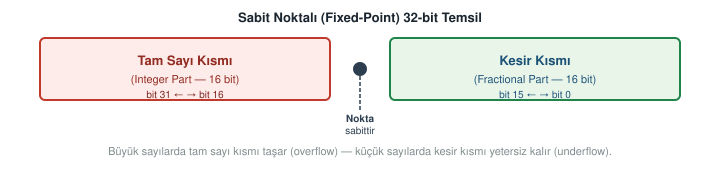

Sorun açıktır: Büyük bir sayı temsil edilmek istendiğinde tam sayı kısmı taşar (overflow); çok küçük bir sayıda ise kesir kısmı yeterli çözünürlüğü sağlayamaz. Kilometrelik kumaş toplarını ve milimetrelik dikiş paylarını aynı mezurayla ölçmeye çalışan bir terzi, iki uçta da yetersiz kalır.

#### Çözüm: Kayan Noktalı Temsil — IEEE 754

IEEE 754 standardı, sayıyı bilimsel gösterime benzer biçimde üç alana böler. Her 32 bitlik (tek duyarlıklı) kayan noktalı sayı şu yapıda saklanır:

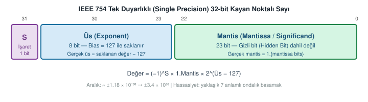

- **S — İşaret (sign), 1 bit:** $0$ pozitif, $1$ negatif sayıyı gösterir.
- **Üs (exponent), 8 bit:** Noktanın kaç basamak kaydığını kodlar. Negatif üsleri de temsil edebilmek için gerçek üsse **sapma** (bias) adı verilen 127 sabiti eklenerek saklanır; bellekteki değer *gerçek üs + 127* olur.
- **Mantis (mantissa / significand, anlamlı kısım), 23 bit:** Sayının anlamlı basamaklarını taşır. Normalleştirilmiş sayılarda baştaki `1.` her zaman var kabul edildiğinden belleğe yazılmaz. Bu **gizli bit** (hidden bit) kuralı sayesinde 23 bit ile 24 bitlik hassasiyet elde edilir.

Genel formül:

$$\text{Değer} = (-1)^{S} \times 1.\text{Mantis} \times 2^{(\text{Üs} - 127)}$$

```math
\underbrace{\text{Değer}}_{\substack{\text{saklanan}\\\text{sayı}}} = \overbrace{(-1)^{S}}^{\substack{\text{işaret}\\(+1 \text{ ya da } -1)}} \times \underbrace{1.\text{Mantis}}_{\substack{\text{gizli bit ve}\\\text{anlamlı basamaklar}}} \times \overbrace{2^{(\text{Üs} - 127)}}^{\substack{\text{gerçek üs kadar}\\\text{kaydırma}}}
```

**Ne anlatıyor?** Saklanan bit alanlarından sayının değeri geri elde edilir: İşaret biti sayının pozitif mi negatif mi olduğunu belirler, gizli bitle tamamlanan mantis anlamlı basamakları verir, bellekteki üsten sapma (127) çıkarılarak noktanın kaç basamak kaydırılacağı bulunur. Sapma sayesinde bellekte yalnızca negatif olmayan üs değerleri tutularak hem çok büyük hem çok küçük sayılar gösterilebilir.

#### Örnek: $5.75$ Sayısının IEEE 754 Gösterimi

**Adım 1 — İkili sisteme dönüştürme.** Tam sayı ve kesir kısımları ayrı ayrı dönüştürülür:

- $5_{10} = 101_{2}$
- $0.75_{10} = 0.5 + 0.25 = 0.11_{2}$
- Birleşim: $101.11_{2}$

**Adım 2 — Normalleştirme.** Nokta, en soldaki 1'in hemen sağına taşınır:

$$101.11_{2} \;\longrightarrow\; 1.0111 \times 2^{2}$$

Nokta iki basamak sola kaydığından gerçek üs 2'dir.

**Adım 3 — Alanları doldurma.**

- İşaret: Sayı pozitif olduğundan **0**.
- Üs: $2 + 127 = 129 = 10000001_{2}$.
- Mantis: Normalleştirme sonrasında noktadan sonraki kısım `0111`'dir. Gizli bit kuralı gereği baştaki `1.` saklanmaz; kalan 23 bit sona sıfır eklenerek doldurulur: `01110000000000000000000`.

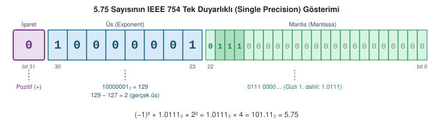

Doğrulama: $(-1)^{0} \times 1.0111_{2} \times 2^{2} = 101.11_{2} = 5.75$.

---

## Bölüm 2 — Paralel Hesaplamaya Neden İhtiyaç Duyarız?

### 2.1 Moore Yasası ve Tek Çekirdek Başarımının Tarihi

**Moore Yasası** (Moore's Law), Intel'in kurucularından Gordon Moore'un 1965'te yaptığı ampirik bir gözlemdir: Bir tümleşik devreye sığdırılabilen transistör sayısı düzenli aralıklarla ikiye katlanır. Moore bu süreyi önce bir yıl olarak vermiş, 1975'te yaklaşık iki yıla düzeltmiştir. Sıkça anılan "18 ay" değeri ise başarım artışı için yapılan bir yorumdur ve Grama ve ark. (2003) de bu değeri kullanır. Transistör sayısındaki artış, uzun yıllar boyunca hem daha yüksek saat frekansı hem de daha karmaşık işlemci tasarımları olarak kullanıcıya yansımıştır.

Hennessy ve Patterson'ın (2019, Şekil 1.1) derlediği verilere göre tek işlemcili sistemlerin başarımı yıllık ortalama şu oranlarda artmıştır:

| Dönem | Yıllık başarım artışı |
| :--- | :---: |
| 1978–1986 | yaklaşık %25 |
| 1986–2003 | yaklaşık %52 |
| 2003–2011 | yaklaşık %23 |
| 2011–2015 | yaklaşık %12 |
| 2015–2018 | yaklaşık %3,5 |

Saat frekansı da 1986–2003 arasında yılda yaklaşık %40 artmış, 2003 sonrasında ise neredeyse durmuştur. Bugün masaüstü işlemcilerin frekansı birkaç GHz düzeyinde kalmaktadır.

### 2.2 Güç Duvarı ve Dennard Ölçeklemesinin Sona Ermesi

Bir CMOS devrenin dinamik güç tüketimi yaklaşık olarak şu bağıntıyla verilir:

$$P_{\text{dinamik}} \approx \alpha \cdot C \cdot V^{2} \cdot f$$

```math
\underbrace{P_{\text{dinamik}}}_{\substack{\text{dinamik}\\\text{güç}}} \approx \overbrace{\alpha}^{\substack{\text{anahtarlama}\\\text{etkinliği}}} \cdot \underbrace{C}_{\substack{\text{anahtarlanan}\\\text{sığa}}} \cdot \overbrace{V^{2}}^{\substack{\text{besleme gerilimi}\\\text{(karesi)}}} \cdot \underbrace{f}_{\substack{\text{saat}\\\text{frekansı}}}
```

**Ne anlatıyor?** Devrenin her saat çevriminde anahtarlanan sığayı doldurup boşaltmak için harcadığı güç verilir. Güç frekansla doğrusal, gerilimle ise karesel olarak arttığından, gerilimin düşürülemediği durumda frekans artışı güç tüketimini hızla büyütür.

Burada $\alpha$ anahtarlama etkinliği, $C$ anahtarlanan sığa, $V$ besleme gerilimi ve $f$ saat frekansıdır. **Dennard ölçeklemesi** (Dennard scaling; Robert Dennard, 1974), transistörler küçüldükçe gerilim ve sığanın da aynı oranda küçüleceğini, böylece birim alandaki güç yoğunluğunun sabit kalacağını öngörüyordu. Yaklaşık 2005'ten itibaren sızıntı akımları ve eşik gerilimi nedeniyle gerilim artık düşürülemez hâle geldi. Bu durumda frekansı artırmak için gerilimin de artırılması gerektiğinden güç, frekansın yaklaşık küpüyle ($V \propto f$ varsayımıyla $P \propto f^3$) büyür. Ortaya çıkan ısı soğutma sınırlarına takılır; bu sınıra **güç duvarı** (power wall) denir.

Bu nedenle üreticiler tek ve çok hızlı bir çekirdek yerine aynı yonga üzerinde birden fazla çekirdeğe (multicore) yöneldi. Bir mutfakta tek bir aşçıyı ısıdan bayılacak kadar hızlı çalıştırmak yerine işi normal hızda çalışan dört aşçıya dağıtmak buna benzer.

Sonuç: Yeni donanım almak eski seri yazılımları artık kendiliğinden hızlandırmaz; programcının hesabı paralel alt parçalara bölmesi gerekir.

---

## Bölüm 3 — Paralel Mimariler ve Flynn Taksonomisi

Michael Flynn (1966), bilgisayar mimarilerini iki eksene göre sınıflandırdı: eşzamanlı işlenen **komut** (instruction) akışlarının sayısı ve **veri** (data) akışlarının sayısı. Her eksen tekli ya da çoklu olabilir; bu iki eksenin birleşimi dört kategori verir.

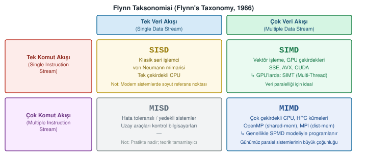

### 3.1 SISD — Tek Komut, Tek Veri (Single Instruction, Single Data)

Klasik von Neumann mimarisi bu tanıma uyar: Tek bir işlemci, tek bir komut dizisini tek bir veri akışı üzerinde sırayla yürütür. Çok çekirdekli bir sistemin her çekirdeği seri kodda SISD gibi davranır; bu nedenle SISD, paralel başarım değerlendirilirken başvurulan referans noktasıdır.

Kasabadaki tek eczacıyı düşünelim: Müşteriler reçetelerini sırayla getirir, eczacı her birini ayrı ayrı hazırlar. Hız tamamen eczacının kapasitesiyle sınırlıdır.

### 3.2 SIMD — Tek Komut, Çok Veri (Single Instruction, Multiple Data)

Tek bir denetim birimi, aynı komutu eşzamanlı olarak birçok veri öğesine uygular; buna **veri paralelliği** (data parallelism) denir. Döngü gövdelerindeki bağımsız aritmetik işlemler bu modele en uygun adaylardır.

İşlemcilerin vektör uzantıları olan **SSE** (Streaming SIMD Extensions) ve **AVX** (Advanced Vector Extensions), tek komutla 4 ya da 8 tek duyarlıklı kayan noktalı değeri aynı anda işler. Vektör işlemciler ve **GPU** (Graphics Processing Unit, grafik işlem birimi) çekirdekleri de bu yaklaşımı çok geniş veri genişliklerinde uygular.

Bir konserve fabrikasındaki doldurma hattında tek bir piston hareketi, bant üzerinde yan yana duran sekiz kutuyu aynı anda doldurur: Komut aynıdır, kutuların içindeki veri farklıdır.

GPU mimarilerinde SIMD'nin iş parçacığı düzeyine taşınmış biçimi olan **SIMT** (Single Instruction, Multiple Threads; tek komut, çok iş parçacığı) kullanılır. SIMT, iş parçacıklarının kendi koşullu dallanmalarını yazmasına izin vererek programlamayı kolaylaştırır.

**Maskeleme (masking).** SIMD ve SIMT birimlerinde her işlem birimi aynı komutu uygulamak zorundadır. Kodda bir `if-else` koşulu varsa önce `if` dalını sağlayan birimler çalışır, diğerleri maskelenerek bekler; ardından `else` dalı için tersi olur (Grama ve ark., 2003, Örnek 2.11). Dallar ayrıştığı ölçüde birimlerin bir kısmı atıl kalır ve gerçek verim düşer.

### 3.3 MIMD — Çok Komut, Çok Veri (Multiple Instruction, Multiple Data)

Birbirinden bağımsız işlem birimleri, her biri kendi komut akışıyla, farklı veri kümeleri üzerinde eşzamanlı çalışır. Çok çekirdekli masaüstü işlemcilerden yüz binlerce çekirdekli HPC sistemlerine kadar günümüz sistemlerinin büyük çoğunluğu bu kategoriye girer.

Büyük bir inşaat şantiyesinde elektrikçi tesisat çekerken sıvacı iç duvarları işler, çatı ustası kiremit döşer. Her ekip farklı araç kullanır, farklı malzeme işler ve bağımsız biçimde aynı anda çalışır.

MIMD sistemler çoğunlukla **SPMD** (Single Program, Multiple Data; tek program, çok veri) modeliyle programlanır: Her işlem birimi aynı programı çalıştırır, ancak kendi kimliğine (rank) göre farklı bir veri dilimini işler. **MPI** (Message Passing Interface, ileti geçirme arayüzü) tabanlı uygulamalar bu modelin en yaygın örneğidir. MIMD'nin esnekliği büyüktür; bunun karşılığı ise doğruluğu güvence altına alan eşzamanlama (synchronization) düzenekleri ve artan yazılım karmaşıklığıdır.

### 3.4 MISD — Çok Komut, Tek Veri (Multiple Instruction, Single Data)

Aynı veri akışı, farklı işlemler uygulayan birden fazla bağımsız birimden geçirilir. Uygulamada nadir görülen bu yapının başlıca kullanım alanı **hata toleransı** (fault tolerance) gerektiren kritik sistemlerdir: Uzay araçlarında ve uçuş denetim sistemlerinde aynı algılayıcı verisi birden fazla hesaplama birimince bağımsız olarak işlenir ve sonuçlar çoğunluk oylamasıyla (voting) doğrulanır.

Bir laboratuvarda aynı kan örneğinin birbirinden bağımsız üç analizörde farklı protokollerle test edilmesi buna benzer: Sonuçların tümü tutarlıysa tanıya güvenilir.

### 3.5 Paylaşılan Adres Uzayı: UMA ve NUMA

İşlemciler belleği ortak kullanıyorsa, belleğe fiziksel olarak nasıl eriştikleri başarımı doğrudan etkiler.

- **UMA (Uniform Memory Access, eşbiçimli bellek erişimi):** Tüm işlemcilerin belleğin herhangi bir noktasına erişim süresi aynıdır. *Uniform* sözcüğü Latince *unus* (bir) ve *forma* (biçim) sözcüklerinden türeyen *uniformis* kökünden gelir.
- **NUMA (Non-Uniform Memory Access, eşbiçimsiz bellek erişimi):** İşlemci sayısı arttığında belleği tek bir merkezde tutmak darboğaz yaratır. Bu nedenle bellek, işlemci düğümlerine dağıtılır. NUMA'da da tüm bellek **tek bir paylaşılan adres uzayı** oluşturur; her işlemci her adrese erişebilir. Fark yalnızca erişim süresindedir: Bir işlemcinin kendi düğümündeki (yerel) belleğe erişimi, ara bağlantı (interconnect) üzerinden başka düğümün (uzak) belleğine erişiminden hızlıdır. Kendi masanızdaki dosyaya uzanmak ile aynı binadaki başka bir odadan dosya istemek arasındaki fark gibidir.

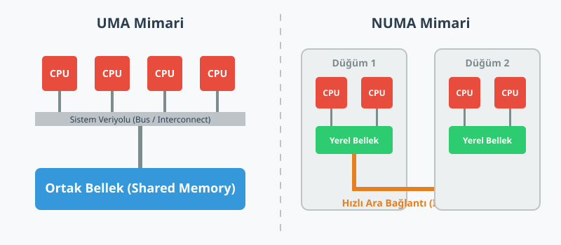

NUMA, belleği ayrı adres uzaylarına bölen ve verinin ancak ileti geçirerek paylaşıldığı **dağıtık bellek** (distributed memory) sistemlerinden farklıdır; MPI ile programlanan kümeler bu ikinci gruba girer.

---

## Bölüm 4 — Paralel Başarımın Ölçütleri ve Yasaları

Paralel bir programın ne kadar başarılı çalıştığını anlamak için ölçülebilir büyüklüklere ihtiyaç vardır. Bu bölümde başarımı sayısallaştıran iki ölçüt ve bu ölçütlerin sınırlarını ortaya koyan iki yasa ele alınmaktadır.

### 4.1 Hızlanma (Speedup) ve Verimlilik (Efficiency)

Seri çalışma süresi $T_{\text{seri}}$, $p$ işlemcili paralel çalışma süresi $T_{\text{paralel}}$ ile gösterilirse **hızlanma** şöyle tanımlanır:

$$S(p) = \frac{T_{\text{seri}}}{T_{\text{paralel}}}$$

```math
\underbrace{S(p)}_{\substack{\text{p işlemcideki}\\\text{hızlanma}}} = \frac{\overbrace{T_{\text{seri}}}^{\substack{\text{seri çalışma}\\\text{süresi}}}}{\underbrace{T_{\text{paralel}}}_{\substack{\text{p işlemcili}\\\text{çalışma süresi}}}}
```

**Ne anlatıyor?** Seri çalışma süresinin paralel çalışma süresine oranı, paralel programın aynı işi kaç kat daha kısa sürede bitirdiğini gösterir. Oran ne kadar büyükse eklenen işlemcilerden o kadar çok yararlanılmış demektir.

İdeal durumda $p$ işlemciyle $S = p$ beklenir. Bu hedefe neredeyse hiç ulaşılamaz; temel engel **ek yüktür** (overhead). İngilizce *overhead* sözcüğü, işin kendisine değil yönetimine harcanan "üstteki" maliyeti anlatır: hesaplama yerine eşgüdüm için harcanan her türlü zaman. Başlıca ek yük kaynakları şunlardır:

- **Eşzamanlama (synchronization):** İş parçacıklarının ortak bir noktada birbirini beklemesi.
- **İletişim (communication):** İşlemciler arası veri aktarımı.
- **Yük dengesizliği (load imbalance):** Bazı iş parçacıklarının erken bitirip diğerlerini boşta beklemesi.
- **Başlatma maliyeti:** İş parçacıklarının oluşturulup zamanlayıcıya teslim edilmesi.

Büyük bir şantiyede yirmi işçiyi eşgüdümlü çalıştırmak için sabah toplantısı, öğle koordinasyonu ve akşam denetimi gerekir. Bu toplantılarda hiç tuğla örülmez; işçi sayısı arttıkça bu eşgüdüm zamanı azalmaz, çoğu durumda artar.

**Verimlilik**, hızlanmanın ideal değere oranıdır:

$$E(p) = \frac{S(p)}{p} = \frac{T_{\text{seri}}}{p \cdot T_{\text{paralel}}}$$

```math
\underbrace{E(p)}_{\text{verimlilik}} = \frac{\overbrace{S(p)}^{\substack{\text{elde edilen}\\\text{hızlanma}}}}{\underbrace{p}_{\substack{\text{ideal hızlanma}\\\text{(işlemci sayısı)}}}} = \frac{T_{\text{seri}}}{\underbrace{p \cdot T_{\text{paralel}}}_{\substack{\text{tüm işlemcilerin}\\\text{harcadığı toplam süre}}}}
```

**Ne anlatıyor?** Elde edilen hızlanmanın işlemci sayısına oranı, işlemcilerin zamanının ne kadarının yararlı hesaplamaya harcandığını gösterir. İkinci biçimde payda, $p$ işlemcinin birlikte harcadığı toplam süredir; bu süre seri süreye ne kadar yakınsa ek yük o kadar azdır.

$E = 1$ mükemmel verimlilik demektir; $E < 1$ ek yük ya da yük dengesizliği olduğunu gösterir. Kabul edilebilir verimlilik eşiği uygulamaya ve sistemin maliyetine göre değişir; verimlilik düştükçe eklenen her işlemcinin kazandırdığı süre azalır.

### 4.2 Amdahl Yasası (Amdahl's Law)

Gene Amdahl (1967), bir programın **seri kalmak zorunda olan** kısmının en büyük hızlanmayı doğrudan sınırladığını gösterdi. $r$, programın **tek işlemcili çalışma süresi içindeki** seri payı olmak üzere $p$ işlemciyle:

$$S(p) = \frac{1}{r + \dfrac{1-r}{p}}$$

```math
\underbrace{S(p)}_{\text{hızlanma}} = \frac{1}{\underbrace{r}_{\substack{\text{seri pay}\\\text{(kısalmaz)}}} + \underbrace{\dfrac{1-r}{p}}_{\substack{\text{paralel pay,}\\\text{p işlemciye bölünür}}}}
```

**Ne anlatıyor?** Tek işlemcili süre 1 kabul edildiğinde paralel süre, kısaltılamayan seri pay ile işlemcilere bölünen paralel payın toplamıdır; hızlanma bu sürenin tersidir. İşlemci sayısı ne kadar artırılırsa artırılsın payda $r$'nin altına inemez.

$p \to \infty$ sınırında kuramsal üst sınır elde edilir:

$$S_{\max} = \frac{1}{r}$$

```math
\underbrace{S_{\max}}_{\substack{\text{ulaşılabilecek}\\\text{en büyük hızlanma}}} = \frac{1}{\underbrace{r}_{\text{seri pay}}}
```

**Ne anlatıyor?** İşlemci sayısı sonsuza giderken paralel payın süresi sıfıra iner ve geriye yalnızca seri pay kalır; bu nedenle hızlanma, seri payın tersini aşamaz.

Bir fabrikanın üretim hattını düşünelim: Bantların taşıma hızı istenildiği kadar artırılabilir, ancak her partinin başındaki kalıp kurma süresi (seri bölüm) sabit kalır. Bant ne kadar hızlanırsa hızlansın, kalıp kurma süresi toplam sürenin alt sınırını belirler.

| Seri pay $r$ | $S_{\max}$ (kuramsal üst sınır) |
| :---: | :---: |
| %50 | 2 |
| %25 | 4 |
| %10 | 10 |
| %5 | 20 |
| %1 | 100 |

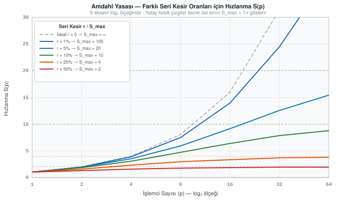

Grafikten çıkan sonuç şudur: Seri payı %10'dan %1'e indirmek, işlemci sayısını iki katına çıkarmaktan çok daha büyük kazanç sağlar. Bu nedenle HPC programcıları donanıma yatırım yapmadan önce profil çıkarıcı (profiler) araçlarla darboğazları bulup seri kısımları küçültmeye odaklanır.

### 4.3 Gustafson–Barsis Yasası (Gustafson's Law)

Amdahl, **sabit** bir problem boyutunun daha fazla işlemciyle çözülmesine bakıyordu; buna **güçlü ölçekleme** (strong scaling) denir. Oysa HPC sistemlerine geçişin asıl gerekçesi çoğunlukla aynı sürede çok daha büyük bir problemi çözmektir.

John Gustafson (1988), Ed Barsis'in gözlemlerine dayanarak bu bakış açısında tablonun değiştiğini gösterdi. Problem boyutu işlemci sayısıyla birlikte büyütüldüğünde (**zayıf ölçekleme**, weak scaling) seri bölümün göreli ağırlığı küçülür ve **ölçeklenmiş hızlanma** (scaled speedup) şöyle olur:

$$S(p) = p - s\,(p - 1)$$

Buradaki $s$, Amdahl'daki $r$'den farklı bir büyüklüktür: **$p$ işlemcili paralel çalışmanın süresi içindeki** seri paydır. Problem büyüdükçe seri kısım aynı kalıp paralel kısım büyüdüğünden, paralel çalışma süresine göre ölçülen bu pay, tek işlemcili süreye göre ölçülen Amdahl payından çok küçük olur.

```math
\underbrace{S(p)}_{\substack{\text{ölçeklenmiş}\\\text{hızlanma}}} = \overbrace{p}^{\substack{\text{ideal}\\\text{hızlanma}}} - \underbrace{s\,(p - 1)}_{\substack{\text{seri payın}\\\text{yol açtığı kayıp}}}
```

**Ne anlatıyor?** Problem işlemci sayısıyla birlikte büyütüldüğünde ideal hızlanmadan yalnızca seri bölüm yürütülürken boşta kalan $p - 1$ işlemcinin kaybı düşülür. Seri pay küçük kaldıkça hızlanma işlemci sayısıyla neredeyse doğrusal biçimde artar.

$s = 0.1$, $p = 32$ için:

$$S(32) = 32 - 0.1 \times 31 = 28.9$$

Karşılaştırma için Amdahl Yasası, $r = 0.1$ ve $p = 32$ için $S(32) = 1 / (0.1 + 0.9/32) \approx 7.8$ verir; $p \to \infty$ sınırındaki üst değer ise 10'dur. İki sonuç çelişmez: Seri pay farklı biçimde tanımlanmıştır ve iki yasa farklı sorulara yanıt verir.

> **Amdahl:** "Aynı işi $p$ kat daha hızlı yapabilir miyim?"
> **Gustafson:** "Aynı sürede $p$ kat daha büyük bir işi yapabilir miyim?"

### 4.4 Güçlü ve Zayıf Ölçekleme: Ölçüm ve Yorum

**Güçlü ölçekleme testi:** Problem boyutu sabit tutulur, işlemci sayısı artırılır. İdeal davranış $T(p) = T(1)/p$'dir. Gerçek eğri idealin altına düştüğünde seri bölüm ve ek yük devreye girmiştir.

**Zayıf ölçekleme testi:** İşlemci başına düşen iş miktarı sabit tutularak işlemci sayısı artırılır. İdeal davranışta duvar saati süresi (wall-clock time) değişmez: $T(p) = T(1)$. Sürenin artması iletişim ve eşzamanlama maliyetini gösterir.

| | Güçlü ölçekleme | Zayıf ölçekleme |
| :--- | :---: | :---: |
| **Problem boyutu** | Sabit | $p$ ile orantılı büyür |
| **Sorulan soru** | Kaç kat daha hızlı? | Aynı sürede ne kadar büyük? |
| **İdeal ölçüt** | $S(p) = p$ | $T(p) = T(1)$ |
| **Sınırlayan etken** | Seri pay $r$ | İletişim ve eşzamanlama ek yükü |
| **Yasa** | Amdahl | Gustafson–Barsis |

### 4.5 Ölçülmüş Bir Örnek: Pi Hesabında Hızlanma

`Uygulamalar/OpenMP/hizlanma.c` programı, $\pi = \int_0^1 \frac{4}{1+x^2}\,dx$ integralini orta nokta kuralıyla $4 \times 10^8$ adımda 1, 2, 4 ve 8 iş parçacığıyla hesaplar; her ölçümü üç kez tekrarlayıp en kısa süreyi alır. Ayrıca **Karp–Flatt metriği** (Karp ve Flatt, 1990) ile ölçülen hızlanmadan deneysel seri payı kestirir:

$$e(p) = \frac{1/S(p) - 1/p}{1 - 1/p}$$

```math
\underbrace{e(p)}_{\substack{\text{deneysel}\\\text{seri pay}}} = \frac{\overbrace{1/S(p)}^{\substack{\text{ölçülen hızlanmanın}\\\text{tersi}}} - \overbrace{1/p}^{\substack{\text{ideal hızlanmanın}\\\text{tersi}}}}{\underbrace{1 - 1/p}_{\substack{\text{normalleştirme}\\\text{terimi}}}}
```

**Ne anlatıyor?** Amdahl Yasası, ölçülen hızlanma değeri kullanılarak seri pay için çözülür; böylece ölçülen davranışı açıklayan deneysel seri pay elde edilir. $p$ arttıkça $e(p)$'nin de büyümesi, hızlanmayı seri bölümden çok ek yükün sınırladığını gösterir.

Aşağıdaki değerler Intel Core i7-4790K (4 fiziksel çekirdek, Hyper-Threading ile 8 mantıksal çekirdek, 4.0 GHz), Windows 11 ve MSYS2 GCC 14.2 (`gcc -O2 -fopenmp`) ile ölçülmüştür:

| $p$ | $T(p)$ (s) | $S(p)$ | $E(p)$ | $e(p)$ |
| :---: | :---: | :---: | :---: | :---: |
| 1 | 1.779 | 1.00 | 1.00 | — |
| 2 | 1.036 | 1.72 | 0.86 | 0.165 |
| 4 | 0.623 | 2.86 | 0.71 | 0.134 |
| 8 | 0.396 | 4.49 | 0.56 | 0.112 |

Yorum: Bu döngüde seri kod yok denecek kadar azdır; buna rağmen $e(p)$ yaklaşık 0.11–0.17 çıkmaktadır. Bu değer gerçek bir seri bölümü değil, iş parçacığı başlatma ek yükünü, turbo frekansının çekirdek sayısı arttıkça düşmesini ve $p = 8$'de Hyper-Threading'in iki mantıksal çekirdeği aynı fiziksel çekirdeğin birimlerini paylaşmaya zorlamasını yansıtır. $e(p)$'nin $p$ ile birlikte artması ek yükün baskın olduğunu, azalması ise sınırın gerçek bir seri bölümden kaynaklandığını düşündürür. Ölçümler makinenin o anki yüküne göre birkaç on yüzde değişebilir; kendi makinenizde tekrarlayarak karşılaştırınız.

---

## Bölüm 5 — İşlemci Mimarisinde Örtük Paralellik

Kod özel olarak paralelleştirilmese bile modern donanım ve derleyiciler (compiler) işleri hızlandırmak için çeşitli teknikler kullanır. Programcının doğrudan müdahalesi olmadan donanım ve derleyici düzeyinde sağlanan bu eşzamanlı çalışmaya **örtük paralellik** (implicit parallelism) denir.

### 5.1 Boru Hattı (Pipelining)

Bir mikroişlemcinin komutları nasıl işlediğini anlamak için profesyonel bir restoran mutfağını düşünelim. Bir siparişin hazırlanması dört aşamadan oluşsun: malzemenin kilerden getirilmesi, tarifin okunup malzemenin doğranması, ocakta pişirme ve tabağa alıp servis bandına koyma.

Mutfakta tek bir aşçı varsa bir siparişi bitirmeden diğerine geçemez. İş istasyonlara bölündüğünde ise (malzemeci, doğrayıcı, pişirici, sunumcu) birinci sipariş pişme aşamasına geçtiği anda doğrayıcı ikinci siparişi kesmeye, malzemeci üçüncü siparişin malzemesini getirmeye başlayabilir. Bilgisayar mimarisinde buna **boru hattı** (pipelining) denir; terim İngilizce *pipe* (boru) sözcüğünden türemiştir ve işlerin bir borudan kesintisiz akmasını anlatır.

İşlemcide bir komutun işlenmesi temelde dört aşamadan geçer:

1. **Getirme (fetch):** Komutun bellekten işlemciye alınması (malzemenin getirilmesi).
2. **Çözme (decode):** Komutun ne anlama geldiğinin çözümlenmesi. *Decode* sözcüğü, Latince *codex* (kitap, kayıt) kökünden gelen *code* sözcüğüne ayırma bildiren *de-* önekinin eklenmesiyle oluşmuştur.
3. **Yürütme (execute):** Aritmetik veya mantıksal işlemin aritmetik mantık biriminde (ALU) yapılması (yemeğin pişirilmesi).
4. **Geri yazma (write-back):** Sonucun yazmaçlara (registers) kaydedilmesi (yemeğin servise sunulması).

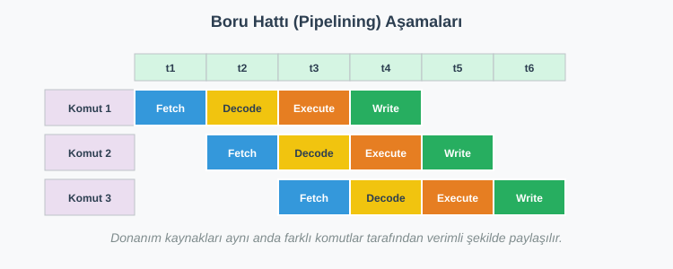
*Şekil 7. Boru hattında ardışık komutların zaman içindeki yürütülme aşamaları. Her saat vuruşunda (t) donanımın farklı birimleri farklı komutların aşamalarını işler.*

Boru hattı tek bir komutun süresini kısaltmaz; ancak aşamalar üst üste bindiği için birim zamanda tamamlanan komut sayısını (throughput, iş çıkarma hızı) önemli ölçüde artırır.

### 5.2 Süperskaler (Superscalar) Yürütme ve Bağımlılıklar

**Süperskaler işlemciler**, mutfağa fazladan ocak ve kesme tahtası eklenmesine benzer biçimde birden fazla boru hattına sahiptir ve her saat vuruşunda birden fazla komut başlatabilir. Bu mimaride başarımı üç tür bağımlılık sınırlar:

1. **Gerçek veri bağımlılığı (true data dependency):** Domatesler doğranmadan menemen pişirilemez. Bir komutun ürettiği sonuç hemen ardından gelen komutun girdisiyse bekleme (stall) yaşanır.
2. **Kaynak bağımlılığı (resource dependency):** Mutfakta tek fırın varsa ve iki yemek aynı anda fırına ihtiyaç duyuyorsa biri bekler. Donanımda tek bir kayan nokta biriminin iki komut tarafından istenmesi aynı durumu yaratır.
3. **Yordamsal bağımlılık (procedural dependency):** Müşterinin yemeğe acı sos isteyip istemeyeceği belli değildir (dallanma, branch). Aşçı zaman kazanmak için sosu hazırlamaya başlar; garson müşterinin sos istemediğini söylerse yapılan hazırlık çöpe gider. İşlemcide yanlış dallanma tahmini, **boru hattının boşaltılmasına** (pipeline flush) ve ciddi başarım kaybına yol açar.

### 5.3 VLIW (Very Long Instruction Word, Çok Uzun Komut Sözcüğü) Mimarisi

Süperskaler mimaride donanım, telaşlı bir aşçıbaşı gibi her an "Hangi ocak boş? Hangi yemek bekliyor? Veri hazır mı?" sorularına yanıt vermek zorundadır. Bu durum donanımı karmaşıklaştırır ve ısıyı artırır.

VLIW mimarisi bu karar yükünü donanımdan alır ve derleyiciye aktarır. Derleyiciyi, mutfağın saniye saniye planını bir gün önceden yapan bir şef gibi düşünebiliriz: Şef, hangi personelin hangi anda hangi işi yapacağını büyük bir "uzun sözcük" (paket) hâlinde yazar; donanım bağımlılık analizi yapmadan paketteki komutları uygular.

| Özellik | Süperskaler mimari | VLIW mimarisi (IA-64 vb.) |
| :--- | :--- | :--- |
| **Zamanlama kararı** | Çalışma zamanında (donanım) | Derleme zamanında (derleyici) |
| **Bağımlılık analizi** | Karmaşık donanım mantığı | Derleyici eniyilemesi |
| **Donanım karmaşıklığı** | Yüksek | Düşük |
| **Verim kaybının görünümü** | Çalışma zamanında beklemeler | Paketlerde boş kalan yuvalar |

Bir saat çevriminde yürütme birimlerinden yalnızca bir kısmının kullanılmasına **yatay atık** (horizontal waste), hiçbir komutun başlatılamadığı çevrimlere ise **dikey atık** (vertical waste) denir. Grama ve ark. (2003) bu kavramları süperskaler yürütme üzerinden tanımlar; aynı kayıplar, derleyicinin dolduramadığı yuvalar biçiminde VLIW paketlerinde de görülür.

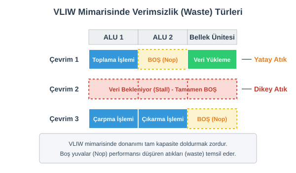
*Şekil 8. Çok uzun komut sözcüğü içindeki boş yuvalar (yatay atık) ve donanımın tamamen durakladığı çevrimler (dikey atık).*

İşlemciler iç yapılarını bu tekniklerle büyük ölçüde hızlandırmış olsa da ana bellek veriyi aynı hızda ulaştıramaz. İşlemci ile bellek arasındaki bu tek veri yolunun yarattığı darboğaza **von Neumann darboğazı** (von Neumann bottleneck), işlemci hızı ile bellek erişim hızı arasında yıllar içinde açılan makasa ise **bellek duvarı** (memory wall) denir. Bir sonraki bölüm bu sorunu ele alır.

---

## Bölüm 6 — Bellek Hiyerarşisi ve Bellek Sistemi Başarımı

Grama ve ark. (2003), işlemci saat hızlarının yılda yaklaşık %40 iyileşmesine karşın DRAM (Dynamic Random-Access Memory) erişim sürelerinin yılda yalnızca yaklaşık %10 iyileştiğini belirtir. Modern bir işlemci bir komutu, aynı komutun ihtiyaç duyduğu veriyi DRAM'den getirmekten çok daha kısa sürede tamamlar. Bu nedenle başarım yalnızca verinin ne kadar hızlı işlendiğiyle değil, bellek hiyerarşisi içindeki veri taşıma maliyetiyle de sınırlıdır.

### 6.1 Gecikme (Latency) ve Bant Genişliği (Bandwidth)

Grama ve ark. (2003) bu ayrımı bir itfaiye hortumu benzetmesiyle açıklar:

- **Gecikme:** Vananın açıldığı an ile suyun hortumun ucundan çıktığı an arasında geçen süredir. Bilgisayarda işlemcinin bellekten veri istediği an ile verinin işlemciye ulaştığı an arasındaki süreye karşılık gelir (genellikle nanosaniye mertebesindedir).
- **Bant genişliği:** Su akmaya başladıktan sonra saniyede kaç litre aktığıdır. Bilgisayarda birim zamanda aktarılan veri miktarıdır (örneğin GB/s).

### 6.2 Önbellek (Cache)

Mimarlar bu açığı kapatmak için işlemcinin içine ana bellekten çok daha hızlı fakat kapasitesi sınırlı SRAM (Static RAM) birimleri yerleştirdi. Bu bellek katmanlarına **önbellek** denir. İngilizce *cache* sözcüğü, Fransızca "saklamak, gizlemek" anlamındaki *cacher* fiilinden gelir. Bir işlemcide genellikle üç düzey bulunur: L1 en hızlı ve en küçük, L3 en yavaş ve en büyük olanıdır. L1 erişimi yaklaşık bir nanosaniye (birkaç saat çevrimi) sürerken DRAM erişimi 60–100 ns'yi bulabilir.

İşlemci bir veriye ihtiyaç duyduğunda önce önbelleğe bakar. Veri oradaysa buna **önbellek isabeti** (cache hit) denir ve veri hemen yürütme birimine iletilir. Veri önbellekte yoksa **önbellek ıskalaması** (cache miss) yaşanır; işlemci veri DRAM'den gelene kadar bekler (stall).

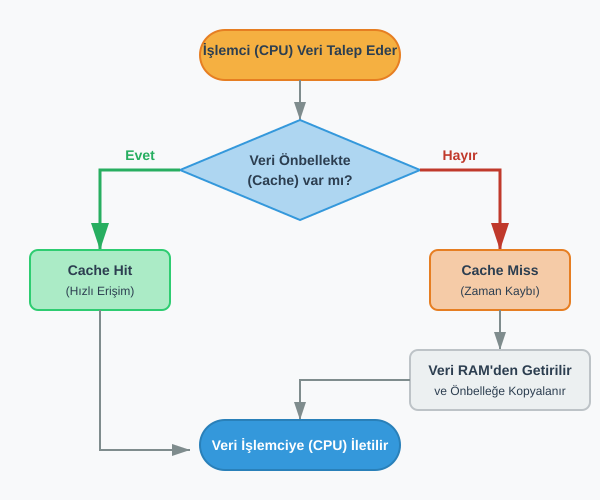

### 6.3 Yerellik İlkesi (Locality of Reference)

Önbelleğin işe yaraması rastlantı değildir; programların büyük çoğunluğunun **yerellik ilkesine** uygun davranmasından kaynaklanır.

İşlemciyi bir aşçı, tezgâhı önbellek, kileri ana bellek olarak düşünelim. Aşçı her baharat için kilere gidip gelmek yerine sık kullandıklarını tezgâhta tutar.

- **Zamansal yerellik (temporal locality):** Yakın zamanda erişilen bir veriye yakın gelecekte yeniden erişilme olasılığı yüksektir. Bir yemeğe tuz atan aşçının birkaç dakika sonra başka bir yemeğe de tuz atması olasıdır. Döngü sayaçları (örneğin `for` döngüsündeki `i`) bunun klasik örneğidir.
- **Uzamsal yerellik (spatial locality):** Bir bellek adresine erişildiğinde komşu adreslere de kısa süre içinde erişilme olasılığı yüksektir. Kilere tuz almaya giden aşçı, hemen yanındaki karabiberi de tezgâha getirir. Bir dizinin `dizi[i]` elemanı okunduktan sonra büyük olasılıkla `dizi[i+1]` okunur.

Sistemler uzamsal yerellikten yararlanmak için veriyi ana bellekten tek tek bayt olarak değil, **önbellek satırı** (cache line) adı verilen bitişik bloklar hâlinde alır. Günümüz x86 sistemlerinde önbellek satırı **64 bayttır**; bir `float` (4 bayt) değerine erişildiğinde aynı satırdaki diğer 15 `float` da önbelleğe gelir.

### 6.4 Önbellek Iskalamalarının Sınıflandırılması: Üç C

Önbellek ıskalamaları **üç C** (three C's) ile sınıflandırılır:

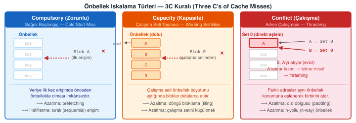

- **Zorunlu ıskalama (compulsory miss):** Veriye ilk erişimde veri henüz önbellekte olmadığı için kaçınılamaz. Önceden getirme (prefetching) ile etkisi azaltılabilir.
- **Kapasite ıskalaması (capacity miss):** Programın etkin çalışma kümesi (working set) önbellek kapasitesini aştığında önceden yüklenen veriler atılır. Döngü döşeme (loop tiling) ile çalışma kümesi küçültülerek azaltılır.
- **Çakışma ıskalaması (conflict miss):** Farklı bellek bloklarının aynı önbellek konumuna eşlenmesiyle birbirini sürekli atma (thrashing) durumu oluşur. Dizi dolgusu (padding) ve çok yollu (n-way set-associative) önbellekler bu sorunu azaltır.

### 6.5 Örnek: Önbelleğin Matris Çarpımına Etkisi

Grama ve ark. (2003, Örnek 2.3), 1 GHz hızında çalışan, DRAM gecikmesi 100 ns olan ve her çevrimde dört komut işleyebilen bir işlemcide iki $32 \times 32$ matrisin çarpımını inceler:

- A ve B matrislerindeki toplam 2K ($2 \times 1024$) sözcüğün önbelleğe getirilmesi yaklaşık $200~\mu s$ sürer.
- Matris çarpımı $2n^3 = 64\text{K}$ işlem gerektirir; çevrim başına dört komutla bu işlemler 16K çevrimde, yani $16~\mu s$'de tamamlanır.
- Toplam süre yaklaşık $216~\mu s$, başarım ise $64\text{K} / 216~\mu s \approx 303$ MFLOPS'tur (MFLOPS: saniyede milyon kayan noktalı işlem).

Aynı işlemci önbelleksiz çalışsaydı her kayan noktalı işlem için bellekten veri beklemek zorunda kalacak ve başarım, Örnek 2.2'deki gibi yaklaşık 10 MFLOPS'a düşecekti. Önbellek, veriye yeniden erişimi (bu örnekte her sözcük $n$ kez kullanılır) mümkün kılarak başarımı yaklaşık 30 kat artırmaktadır.

### 6.6 Örnek: Blok Boyutunun Etkisi

Grama ve ark. (2003, Örnek 2.2 ve 2.4), bellek gecikmesinin 100 ns olduğu bir sistemde iki vektörün nokta çarpımını (dot product) inceler:

- **Blok boyutu bir sözcükse:** İşlemci her erişimde yalnızca bir sözcük alır ve bunun için 100 ns bekler. Her kayan noktalı işlem için bir bellek erişimi gerektiğinden başarım 10 MFLOPS düzeyinde kalır. Bu, kütüphaneden her seferinde yalnızca tek bir sayfa alıp masaya dönmeye benzer.
- **Blok boyutu dört sözcükse (bir önbellek satırı):** Tek bir 100 ns'lik erişim dört sözcüğü birden getirir. Uzamsal yerellik sayesinde ilk gecikme sonraki dört işleme dağıtılır (amortize edilir) ve başarım 40 MFLOPS düzeyine çıkar. Bir sayfa için kütüphaneye gidilmişken bütün kitabı masaya getirmek gibidir.

Gerçek STREAM ölçümleri (Bölüm 8.3) bu kuramsal hesabın pratikteki karşılığını verir.

### 6.7 Bellek Gecikmesini Gizleme Teknikleri

Veri ne kadar iyi düzenlenirse düzenlensin, işlemci zaman zaman ana bellekten veri beklemek zorunda kalır. Bu bekleme süresini yararlı işle doldurmaya **gecikme gizleme** (latency hiding) denir.

**Çoklu iş parçacığı (multithreading).** Bir iş parçacığı bellekten veri beklemeye geçtiğinde donanım, hazır durumdaki başka bir iş parçacığının komutlarını yürütür. Donanım düzeyindeki bu iş parçacığı değişimi, işletim sisteminin yaptığı bağlam değişiminden (context switch) çok daha ucuzdur. Yürütme birimleri dolu tutularak gecikme maskelenir.

**Önceden getirme (prefetching).** Verinin, işlemci ona ihtiyaç duymadan biraz önce donanım veya derleyici tarafından önbelleğe getirilmesidir. *Pre-* öneki Latince *prae* (önce) kökünden gelir; *fetch* ise İngilizcedir. Bir makaleyi okurken bir asistanın sonraki sayfayı önceden önünüze koymasına benzer. Ancak önceden getirme yanlış tahmin edilirse ya da aşırıya kaçarsa bant genişliğini hiç kullanılmayacak verilerle doldurarak sistemi yavaşlatabilir.

> **Bant genişliği ve ödünleşim (trade-off).** Grama ve ark. (2003, Örnek 2.7): Tek bir iş parçacığı 1 GHz işlemcide önbelleği %90 isabet oranıyla kullanırken ana bellekten saniyede yaklaşık 400 MB veri çeker. Aynı çekirdekte 32 iş parçacığı çalıştırıldığında her birinin önbellek payı daralır; isabet oranı örneğin %25'e düşer ve toplam bant genişliği ihtiyacı yaklaşık 3 GB/s'ye çıkar. Gecikmeyi gizlerken darboğazı bant genişliğine kaydırmamaya dikkat edilmelidir.

---

## Bölüm 7 — Veri Odaklı Tasarım ve Veri Erişim Desenleri

Nesne yönelimli programlama (Object-Oriented Programming, OOP) kodun okunabilirliğini ve modülerliğini artırır; ancak büyük nesne koleksiyonları üzerinde toplu hesaplama yapılırken işlemci ve önbellek davranışını ikinci plana atabilir. Dallanma tahmin hataları, sanal işlev çağrıları ve dağınık bellek erişimleri SIMD kullanımını kısıtlar.

**Veri odaklı tasarım** (Data-Oriented Design, DOD) odağı nesne soyutlamasından veri akışına ve **bellek yerleşimine** (data layout) kaydırır. Temel soru şudur: "Bu veri, erişileceği sırayla bellekte duruyor mu?" Endüstriyel bir mutfakta OOP yaklaşımı her aşçıya tüm malzemeleri bir arada içeren bireysel bir set dağıtmaya benzer; DOD ise tüm patatesleri bir kasaya, tüm soğanları başka bir kasaya koyup her aşçının kendi kasasından sırayla çalışmasını sağlar. Verimlilik sıralı erişimden gelir.

### 7.1 AoS — Yapıların Dizisi (Array of Structures)

AoS yaklaşımında bir varlığın tüm alanları (örneğin üç boyutlu bir parçacığın `x`, `y`, `z` koordinatları) tek bir yapı (`struct`) içinde tutulur ve bu yapıların dizisi oluşturulur.

```c
struct Particle { float x, y, z; };
struct Particle particles[N];   /* AoS */
```

Bellekteki sıralama: `[X0 Y0 Z0 | X1 Y1 Z1 | X2 Y2 Z2 | X3 Y3 Z3 | ...]`. Tüm alanlar birlikte kullanıldığında (örneğin çarpışma hesabında) bu düzen avantajlıdır. Ancak yalnızca `x` değerlerini işleyen bir SIMD döngüsü, ardışık `x` değerlerine ulaşmak için 12 baytlık adımlar (stride) atmak zorunda kalır ve değerleri toplama (gather) işlemiyle bir araya getirmesi gerekir. Nesne yönelimli programlamanın doğasına uygun olan bu düzene nesne tabanlı yerleşim de denir.

### 7.2 SoA — Dizilerin Yapısı (Structure of Arrays)

SoA yaklaşımında her alan kendi dizisinde tutulur:

```c
struct Particles { float x[N], y[N], z[N]; };   /* SoA */
```

Bellek düzeni: `[X0 X1 X2 X3 ... | Y0 Y1 Y2 Y3 ... | Z0 Z1 Z2 Z3 ...]`. Yalnızca `x` değerleri işlendiğinde dizi ardışık ve kesintisizdir; SIMD birimi tek bir 128 bit ya da 256 bitlik yüklemeyle 4–8 `float` değeri birlikte alabilir. Bilimsel hesaplamada ve yüksek başarımlı yazılımlarda bu nedenle çoğunlukla SoA tercih edilir.

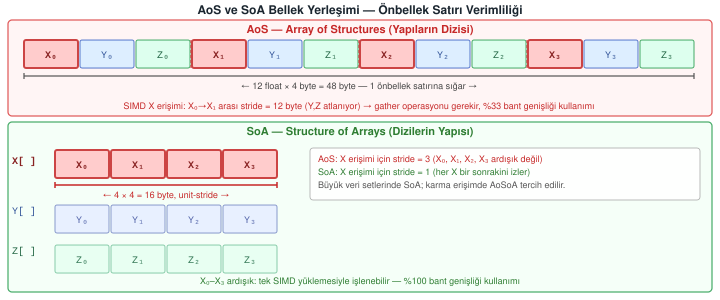

Şemada görüldüğü gibi, AoS düzeninde dört `x` değeri için 48 bayt yüklenir ama yalnızca 16 bayt kullanılır (%33 bant genişliği verimi). SoA düzeninde ise dört `x` değeri için tam 16 bayt yüklenir ve tamamı kullanılır (%100 verim).

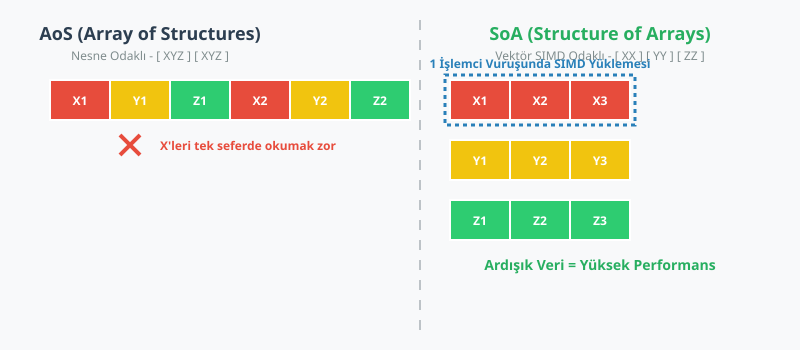

### 7.3 AoSoA — Dizilerin Yapılarının Dizisi (Array of Structures of Arrays)

AoSoA, AoS ve SoA'nın güçlü yönlerini birleştiren karma (hybrid) bir düzendir. Veriler önce SIMD genişliğine karşılık gelen boyutta **döşemelere** (tile) ayrılır, ardından her döşeme içinde SoA düzeni uygulanır.

```c
/* AVX2: 8 float -> döşeme genişliği 8 */
struct Tile { float x[8], y[8], z[8]; };
struct Tile tiles[N / 8];   /* AoSoA */
```

Döşeme boyutu SIMD yazmaç genişliğine bağlanır: SSE için 4, AVX/AVX2 için 8, AVX-512 için 16 `float`. Bu seçim hem ardışık SIMD yüklemesini hem de birden fazla alanın birlikte kullanıldığı durumlarda yönetilebilir sayıda veri akışını sağlar.

### 7.4 Yerleşim Seçim Rehberi

| Erişim kalıbı | Önerilen yerleşim |
| :--- | :---: |
| Tüm alanlar birlikte kullanılıyor (çarpışma, dönüşüm) | AoS |
| Tek alan üzerinde toplu işlem (SIMD, GPU) | SoA |
| Karma erişim ve SIMD uyumluluğu | AoSoA (döşeme = SIMD genişliği) |
| Önbellek kapasitesi kritik, döngü döşeme uygulanıyor | SoA veya AoSoA |

### 7.5 Adımlı Erişim (Strided Access) Problemi

C ve C++ dillerinde iki boyutlu diziler bellekte satır satır (row-major order) saklanır. Bir matris iç içe döngülerde satır yerine sütun boyunca dolaşılırsa bellekte ardışık olmayan, atlamalı (strided) adreslere gidilir.

Bu durumu, bir ansiklopediden bilgi ararken her seferinde raftan koca bir cildi masaya getirip içinden yalnızca tek bir sözcük okuyup cildi geri götürmeye benzetebiliriz. Getirilen sayfadaki diğer sözcükler okunmadığı için uzamsal yerellik boşa gider.

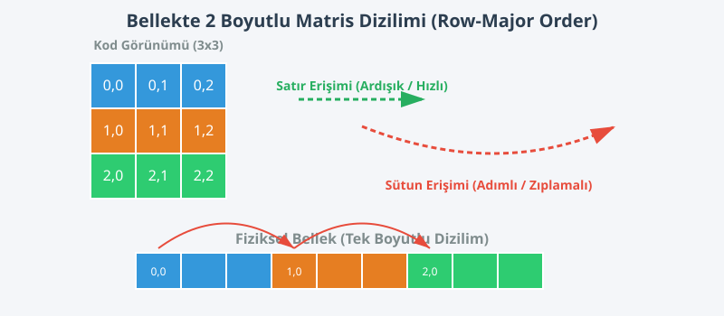

```c
/* Kötü uzamsal yerellik: sütun boyunca erişim */
for (int i = 0; i < 1000; i++) {
    for (int j = 0; j < 1000; j++) {
        /* İç döngüde j arttıkça satır değişir; ardışık erişimler
           bellekte 1000 eleman arayla durur. Matris önbelleğe
           sığmıyorsa hemen her erişim yeni bir önbellek satırı getirir. */
        column_sum[i] += b[j][i];
    }
}
```

Döngülerin yeri değiştirilerek (`b[i][j]` sırasıyla dolaşılarak) aynı toplam ardışık erişimle hesaplanabilir.

### 7.6 Döngü Döşeme (Loop Tiling / Blocking)

Matrisler önbelleğe sığmayacak kadar büyük olduğunda veriyi küçük bloklara (*tile*: fayans, karo) böleriz. Döşeme tekniği, büyük veri kümelerini önbelleğe sığacak alt matrislere ayırarak her bloğun önbellekte kaldığı süre boyunca olabildiğince çok kez kullanılmasını sağlar ve bellek bant genişliği gereksinimini azaltır. Kütüphaneden alabildiğimiz kadar kitabı masaya yığıp, o kitaplarla yapılabilecek tüm işi bitirmeden yenilerini almamak gibidir.

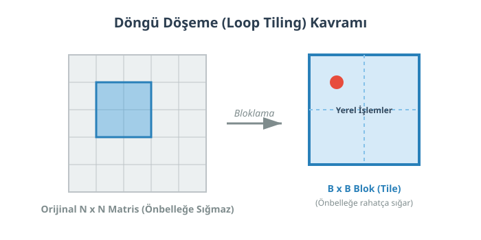

Aşağıdaki kod, $C = A \times B$ matris çarpımını $B \times B$ boyutlu bloklar üzerinden yapar:

```c
#define MIN(a, b) ((a) < (b) ? (a) : (b))

/* n x n matrisler; BS: blok kenarı (örneğin 32 veya 64).
   Üç blok (A, B ve C'den birer blok) aynı anda önbelleğe sığmalıdır. */
void blok_carpim(int n, int BS, double A[n][n], double B[n][n], double C[n][n]) {
    for (int ii = 0; ii < n; ii += BS)
        for (int kk = 0; kk < n; kk += BS)
            for (int jj = 0; jj < n; jj += BS)
                /* Blok içindeki çarpım */
                for (int i = ii; i < MIN(ii + BS, n); i++)
                    for (int k = kk; k < MIN(kk + BS, n); k++) {
                        double a_ik = A[i][k];
                        for (int j = jj; j < MIN(jj + BS, n); j++)
                            C[i][j] += a_ik * B[k][j];
                    }
}
```

`C` matrisinin önceden sıfırlanmış olması gerekir. `k` döngüsünün `j` döngüsünün dışında olması, en içteki döngünün `B` ve `C` matrislerini satır boyunca ardışık dolaşmasını sağlar.

---

## Bölüm 8 — Başarım Sınırları: Roofline Modeli ve STREAM

### 8.1 Hesaplama Sınırı ve Besleme Sınırı

Program başarımını belirleyen temel sınırlar iki başlıkta toplanır:

- **Hesaplama sınırı:** İşlemcinin saniyede yapabildiği en fazla kayan noktalı işlem sayısı. **FLOP** (floating-point operation) tek bir kayan noktalı işlemi, **FLOP/s** (FLOPS) ise saniyedeki kayan noktalı işlem sayısını gösterir.
- **Besleme sınırı:** Bellek ya da ağ bant genişliği.

Değerlendirmede iki ölçüt kullanılır:

- **Aritmetik yoğunluk (arithmetic intensity):** Bellekten aktarılan her bayt başına yapılan FLOP sayısı (FLOP/bayt).
- **Makine dengesi (machine balance):** Tepe FLOP/s değerinin tepe bant genişliğine oranı (FLOP/bayt). Aritmetik yoğunluğu makine dengesinden düşük olan bir uygulama bellek sınırlıdır.

### 8.2 Roofline Modeli

Roofline modeli (Williams, Waterman ve Patterson, 2009), bir uygulamanın donanım sınırlarına ne kadar yakın olduğunu gösteren görsel bir modeldir. Ulaşılabilir başarım şöyle verilir:

$$P_{\text{ulaşılabilir}} = \min\left(P_{\text{tepe}},\; \text{bant genişliği} \times \text{aritmetik yoğunluk}\right)$$

```math
\underbrace{P_{\text{ulaşılabilir}}}_{\substack{\text{ulaşılabilir}\\\text{başarım}}} = \min\left(\overbrace{P_{\text{tepe}}}^{\substack{\text{hesaplama sınırı}\\\text{(yatay çatı)}}},\; \overbrace{\underbrace{\text{bant genişliği}}_{\text{bayt/s}} \times \underbrace{\text{aritmetik yoğunluk}}_{\text{FLOP/bayt}}}^{\substack{\text{bellek sınırı}\\\text{(eğimli çizgi)}}}\right)
```

**Ne anlatıyor?** Bir uygulamanın başarımı, işlemcinin tepe hesaplama hızı ile belleğin taşıyabildiği veriyle yapılabilecek işlem hızından hangisi küçükse onunla sınırlanır. Aritmetik yoğunluk düşükse bellek, yüksekse işlemci darboğaz olur.

Model, "Hız yapmamıza motor mu izin vermiyor, yoksa yol mu dar?" sorusunun teknik karşılığıdır. Saatte 300 km hız yapabilen bir yarış arabası (güçlü işlemci) dar ve tek şeritli bir köy yolunda (düşük bellek bant genişliği) kullanıldığında gerçek potansiyeline ulaşamaz; başarımı sınırlayan motor değil yoldur (memory-bound, bellek sınırlı).

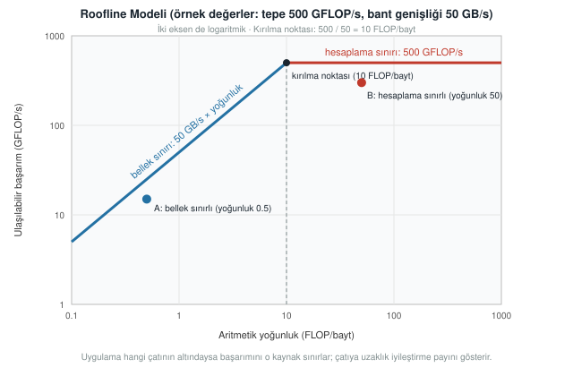

- Yatay eksen: aritmetik yoğunluk (FLOP/bayt), logaritmik ölçek.
- Dikey eksen: ulaşılabilir başarım (GFLOP/s), logaritmik ölçek.

Yatay "çatı" tepe hesaplama sınırını, eğimli çizgi ise bellek bant genişliği sınırını gösterir. İki çizginin kesiştiği kırılma noktası makine dengesine karşılık gelir. Şekildeki A uygulaması eğimli çizginin altında olduğundan bellek sınırlıdır; başarımını artırmanın yolu veri yeniden kullanımını artırmaktır (örneğin döngü döşeme). B uygulaması yatay çizginin altındadır ve hesaplama sınırlıdır; burada vektörleştirme ve daha fazla çekirdek kullanımı önem kazanır.

### 8.3 STREAM Benchmark

STREAM (McCalpin, 1995), sistemin pratik bellek bant genişliğini ölçmek için yaygın kullanılan bir sınama programıdır (benchmark). Önbelleğe sığmayacak kadar uzun vektörler üzerinde dört çekirdek işlem içerir:

- **COPY:** $A(i) = B(i)$ — B dizisinin A dizisine kopyalanması.
- **SCALE:** $A(i) = s \cdot B(i)$ — B'nin her elemanının bir $s$ sayısıyla çarpılması.
- **ADD:** $A(i) = B(i) + C(i)$ — B ve C'nin karşılıklı elemanlarının toplanması.
- **TRIAD:** $A(i) = B(i) + s \cdot C(i)$ — çarpma ve toplamanın birlikte yapıldığı, gerçek iş yüklerine en yakın işlem.

Bu işlemlerde hesaplama çok az, bellek erişimi çok fazladır; bu nedenle ölçülen değer, akış biçimindeki (streaming) erişimlerde belleğin ulaşabildiği GB/s düzeyini verir. TRIAD işleminde çift duyarlıklı sayılarla iki FLOP için en az 24 bayt taşındığından aritmetik yoğunluk yaklaşık $2/24 \approx 0.08$ FLOP/bayt'tır; işlem açıkça bellek sınırlıdır. Bir uygulamanın elde ettiği bant genişliği STREAM sonucunun belirgin biçimde altında kalıyorsa olası nedenler adımlı erişim, önbellek çakışmaları ve yüksek ıskalama oranlarıdır.

---

## Bölüm 9 — Paralel Algoritma Tasarımı ve Görev Bağımlılıkları

Bazı görevler, diğerlerinin ürettiği veriye ihtiyaç duyar. Problem küçük alt görevlere bölündüğünde görevler arasındaki zorunlu sıra bir **görev bağımlılık çizgesi** (task dependency graph) ile gösterilir. Bu çizge yönlü ve döngüsüzdür (DAG, Directed Acyclic Graph, yönlü döngüsüz çizge).

### 9.1 Temel Büyüklükler

Grama ve ark. (2003), bir ayrıştırmanın ne kadar iyi paralelleşebileceğini şu büyüklüklerle ölçer:

- **Toplam iş (W, work):** Tüm görevlerin sürelerinin toplamı; program tek işlemcide çalışsaydı alacağı süre.
- **Kritik yol uzunluğu (L, critical path length):** Çizgede başlangıçtan bitişe giden ve ağırlıkları toplamı en büyük olan bağımlı görevler zinciri. Sonsuz sayıda işlemci kullanılsa bile program bu süreden kısa sürede bitemez. İnşaatta temel atılmadan duvar, duvar örülmeden çatı yapılamaz; bu zincir kritik yoldur.
- **Ortalama eşzamanlılık derecesi (average degree of concurrency):** Ortalamada aynı anda yürütülebilen görev sayısı. *Concurrency* sözcüğü Latince *concurrere* (birlikte koşmak) kökünden gelir.

$$\text{Ortalama eşzamanlılık} = \frac{W}{L}$$

```math
\underbrace{\text{Ortalama eşzamanlılık}}_{\substack{\text{aynı anda ortalama}\\\text{yürütülen görev}}} = \frac{\overbrace{W}^{\text{toplam iş}}}{\underbrace{L}_{\substack{\text{kritik yol}\\\text{uzunluğu}}}}
```

**Ne anlatıyor?** Toplam iş, sonsuz sayıda işlemciyle bile kısaltılamayan kritik yol süresine bölünür; sonuç, ayrıştırmanın ortalamada kaç işlemciyi meşgul edebileceğini gösterir. Bu değer, söz konusu ayrıştırmayla ulaşılabilecek hızlanmanın da üst sınırıdır.

### 9.2 Örnek: Veritabanı Sorgusunun İki Ayrıştırması

Birden fazla tablonun birleştirilmesini gerektiren büyük bir veritabanı sorgusunun iki farklı stratejiyle görevlere bölündüğünü varsayalım (Grama ve ark., 2003, Şekil 3.2 ve 3.3).

**Strateji (a): Dengeli ayrıştırma**

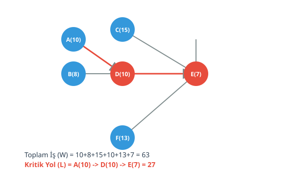

- Toplam iş: $W = 10 + 8 + 15 + 10 + 13 + 7 = 63$ birim.
- Kritik yol: $A \rightarrow D \rightarrow E$, $L = 10 + 10 + 7 = 27$ birim.
- Ortalama eşzamanlılık: $63 / 27 \approx 2.33$.

**Strateji (b): Ardışık ayrıştırma**

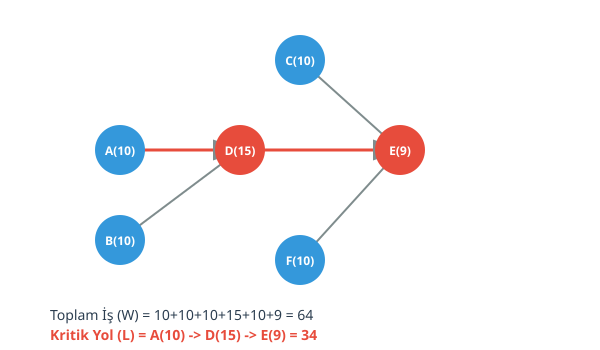

- Toplam iş: $W = 10 + 10 + 10 + 15 + 10 + 9 = 64$ birim.
- Kritik yol: $A \rightarrow D \rightarrow E$, $L = 10 + 15 + 9 = 34$ birim.
- Ortalama eşzamanlılık: $64 / 34 \approx 1.88$.

**Sonuç.** İki stratejide toplam iş neredeyse aynıdır (63 ve 64). Ancak Strateji (a) daha kısa bir kritik yola (27) ve dolayısıyla daha yüksek ortalama eşzamanlılığa (2.33) sahiptir. Algoritma tasarımında amaç yalnızca işi küçük parçalara bölmek değil, parçalar arasındaki bağımlılık zincirini kısaltarak işlemcilerin aynı anda çalışabileceği iş miktarını artırmaktır.

---

## Bölüm 10 — Paylaşımlı Bellek Programlama ve OpenMP

Hesaplama gerektiren büyük bir işi kısa sürede bitirmenin temel yolu, işi parçalara bölüp eldeki işlemcilere dağıtmaktır.

### 10.1 Süreç ve İş Parçacığı

Büyük bir restoranın her mutfağını kendine ait dolapları, ocağı ve tezgâhı olan kapalı bir birim olarak düşünelim. İşletim sisteminde bu birimlerin her birine **süreç** (process) denir. Farklı mutfaklardaki aşçılar birbirlerinin malzemelerini doğrudan kullanamaz; süreçlerin adres uzayları birbirinden ayrıdır.

Aynı mutfağın içindeki aşçılar ise aynı tezgâhı, buzdolabını ve malzemeleri paylaşır; yalnızca her birinin elinde üzerinde çalıştığı işin tarifi ve kendi bıçağı vardır. Aynı süreç içinde ortak belleği (genel değişkenler ve yığın bellek, heap) paylaşan ancak kendi yürütme sırasına ve kendi çağrı yığınına (stack) sahip olan bu hafif birimlere **iş parçacığı** (thread) denir. İngilizce *thread* "iplik" demektir ve program içindeki bağımsız yürütme akışlarını anlatır. Paylaşımlı bellek programlamanın temeli, iş parçacıklarının ortak bir bellek üzerinde doğru ve uyum içinde çalışmasını sağlamaktır.

### 10.2 OpenMP ve Derleyici Yönergeleri

**OpenMP** (Open Multi-Processing, açık çoklu işleme), paylaşımlı bellekli sistemlerde C, C++ ve Fortran programlarını paralelleştirmek için kullanılan bir uygulama programlama arayüzüdür (Application Programming Interface, API). Derleyici yönergeleri, çalışma zamanı kitaplık işlevleri (`omp_get_thread_num()` gibi) ve ortam değişkenlerinden (`OMP_NUM_THREADS` gibi) oluşur.

OpenMP'de iş parçacıkları doğrudan oluşturulmaz; bunun yerine **pragma** adı verilen derleyici yönergeleri yazılır. *Pragma* sözcüğü Yunanca "iş, eylem" anlamına gelir (*pragmatik* sözcüğü de aynı kökten türemiştir). C ve C++'ta OpenMP yönergeleri `#pragma omp` ile başlar. GCC'de bu yönergeler `-fopenmp` seçeneğiyle etkinleşir. Seçenek verilmezse derleyici bilmediği yönergeleri yok sayar (gerekirse bir uyarı vererek) ve döngüler seri çalışır. Ancak `omp_get_thread_num()` gibi kitaplık işlevleri kullanıldıysa program `-fopenmp` olmadan bağlanamaz; bu durumda `#ifdef _OPENMP` denetimi kullanılmalıdır.

### 10.3 Çatallanma–Birleşme (Fork–Join) Modeli

OpenMP, programın seri ve paralel bölümleri arasındaki geçişi **çatallanma–birleşme** (fork–join) modeliyle tanımlar.

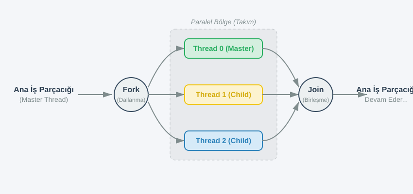


1. **Seri başlangıç:** Program başladığında yalnızca **ana iş parçacığı** (master thread) etkindir ve kodu sırayla yürütür.
2. **Çatallanma (fork):** Ana iş parçacığı bir paralel bölgeye (`#pragma omp parallel`) ulaştığında yeni iş parçacıkları oluşturur.
3. **Paralel bölge ve takım:** Oluşan iş parçacığı kümesine **takım** (team) denir. Takımdaki her iş parçacığı (iş parçacığı 0 ana iş parçacığıdır) paralel bölgedeki kodu aynı anda yürütür.
4. **Birleşme (join) ve örtük engel:** Paralel bölge sona erdiğinde tüm iş parçacıkları bir **örtük engelde** (implicit barrier) birbirini bekler. Takımın tamamı işini bitirince birleşme gerçekleşir ve yalnızca ana iş parçacığı kodu sırayla yürütmeye devam eder.

### 10.4 Döngü Düzeyinde Paralelleştirme

Bilimsel hesaplamada zamanın büyük kısmı `for` döngülerinde geçer. Döngünün iterasyonları birbirine bağımlı değilse döngüyü paralelleştirmek işlem süresini önemli ölçüde kısaltır. Döngünün hemen önüne şu yönerge yazılır:

```c
#pragma omp parallel for
for (int i = 0; i < N; i++) {
    /* Yapılacak işlemler */
}
```

Aşağıdaki şema bu kodun çalışma mantığını, yani iterasyonların iş parçacıkları arasında bölüşülmesini (work-sharing) ve çatallanma–birleşme modelini gösterir. Bu kodda indirgeme (reduction) olmadığı için sonuçları birleştirme adımı yoktur.

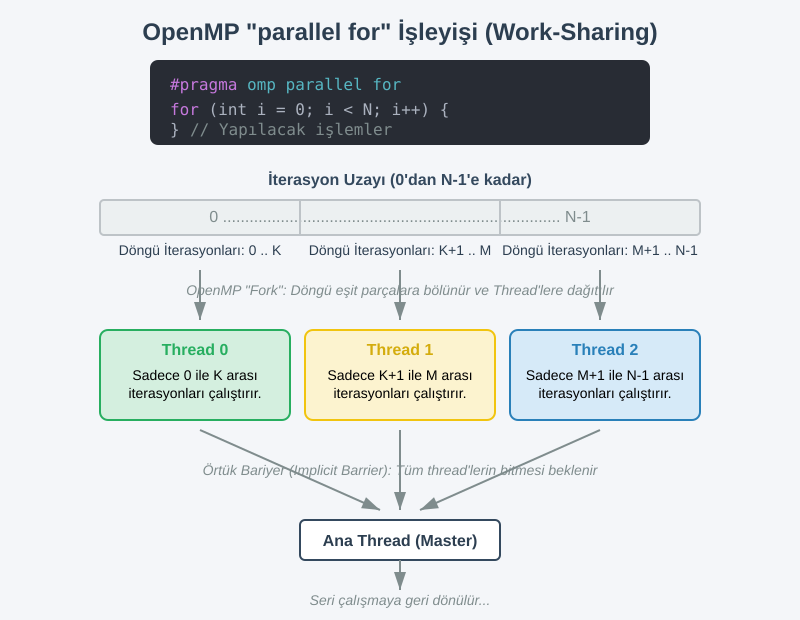

1. **Çatallanma:** Ana iş parçacığı `parallel for` yönergesine geldiğinde takımı oluşturur.
2. **İterasyon uzayının bölünmesi (work-sharing):** OpenMP, `0`'dan `N-1`'e kadar olan iterasyonları takımdaki iş parçacıkları arasında paylaştırır. Her iş parçacığı yalnızca kendisine düşen iterasyonlardan sorumludur.
3. **Bağımsız işlemler:** Her iş parçacığı kendi aralığındaki `i` değerleri için döngü gövdesini çalıştırır. Döngü değişkeni `i` otomatik olarak her iş parçacığına özeldir.
4. **Örtük engel ve birleşme:** Döngü tamamlandığında işini erken bitiren iş parçacıkları diğerlerini bekler; ardından ana iş parçacığı seri kodla devam eder.

Örneğin 1000 patatesin soyulması gereksin ve mutfakta dört aşçı (iş parçacığı) bulunsun. Statik bölmede ilk 250 patates birinci aşçıya, ikinci 250 ikinci aşçıya verilir. Hangi bölmenin kullanılacağı `schedule` maddesi belirtilmediğinde derleyiciye bağlıdır; GCC'de varsayılan, iterasyonları eşit bloklara bölen statik bölmedir (Bölüm 10.8).

### 10.5 Veri Paylaşım Kuralları (Data Scoping)

Paylaşımlı bellek programlamanın en hassas noktası, hangi verinin ortak, hangisinin iş parçacığına özel olacağıdır. Bu kurallar dikkatle belirlenmezse aynı bellek bölgesine aynı anda yazmaya çalışan iş parçacıkları **yarış durumu** (race condition) denen, sonucu çalıştırmadan çalıştırmaya değişen hatalara yol açar. Yarış durumu, en az biri yazma olan eşzamanlı ve korumasız erişimlerde ortaya çıkar.

**`shared` (paylaşılan).** Paralel bölgeden önce tanımlanmış değişkenler varsayılan olarak paylaşılır. Bellekte tek kopyaları vardır; tüm iş parçacıkları bu değişkeni görür ve değiştirebilir. Mutfaktaki tek tuzluk gibidir: İki aşçı aynı anda tuzluğa uzanırsa elleri çarpışır. Paylaşılan değişkene birden fazla iş parçacığı yazıyorsa koruma düzenekleri (Bölüm 10.7) gerekir.

**`private` (özel).** Her iş parçacığı değişkenin kendi kopyasını kullanır. Her aşçının kendi bıçağı gibidir. Önemli bir ayrıntı: Özel kopyanın **başlangıç değeri tanımsızdır**; dışarıdaki değer kopyalanmaz ve bölge sonunda dışarıya geri yazılmaz. Paralel döngünün döngü değişkeni ve paralel bölgenin içinde tanımlanan değişkenler kendiliğinden özeldir.

**`firstprivate`.** `private` gibidir; ancak her kopya, paralel bölgeden önceki değerle başlatılır.

**`lastprivate`.** Döngünün sıralı yürütmede **son** olacak iterasyonundaki değer, döngü bitince dışarıdaki değişkene yazılır.

**`default(none)`.** Varsayılan paylaşım kuralını kapatır; bölgede kullanılan her değişkenin paylaşım türünün açıkça yazılmasını zorunlu kılar. Yanlışlıkla paylaşılan değişkenleri derleme aşamasında yakalamanın en güvenli yoludur.

`Uygulamalar/OpenMP/paylasim.c` programının ilk bölümü bu farkları gösterir:

```c
int a = 10, b = 10, c = 10;
#pragma omp parallel for num_threads(4) private(a) firstprivate(b) lastprivate(c)
for (int i = 0; i < 8; i++) {
    a = i;        /* private: giriş değeri tanımsız, önce atanmalı */
    b += i;       /* firstprivate: her kopya 10 ile başlar */
    c = i * i;    /* lastprivate: son iterasyonun (i = 7) değeri dışarı çıkar */
}
```

Ölçülen çıktı: `a = 10 (degismez), b = 10 (degismez), c = 49`. `a` ve `b` dışarıda değişmez; çünkü bölge içindeki işlemler özel kopyalar üzerinde yapılmıştır. `c` ise son iterasyonun değerini ($7^2 = 49$) alır.

### 10.6 İndirgeme (Reduction)

**İndirgeme**, bir veri kümesini belirli bir işlemle tek bir sonuca dönüştürmektir. Terim Latince *reducere* (geri getirmek, küçültmek) kökünden gelir.

Örneğin tüm aşçıların soyduğu toplam patates sayısı bulunmak istensin. Herkes aynı "toplam" (paylaşılan) değişkene ekleme yapmaya kalkarsa yarış durumu oluşur. Bunun yerine her aşçı önce kendi özel sayacında sayar; mesai bitiminde herkes kendi sonucunu güvenli biçimde ana toplama ekler. OpenMP'de bu tek satırla yapılır:

```c
long long toplam = 0;
#pragma omp parallel for reduction(+:toplam)
for (int i = 0; i < N; i++) {
    toplam += dizi[i];
}
```

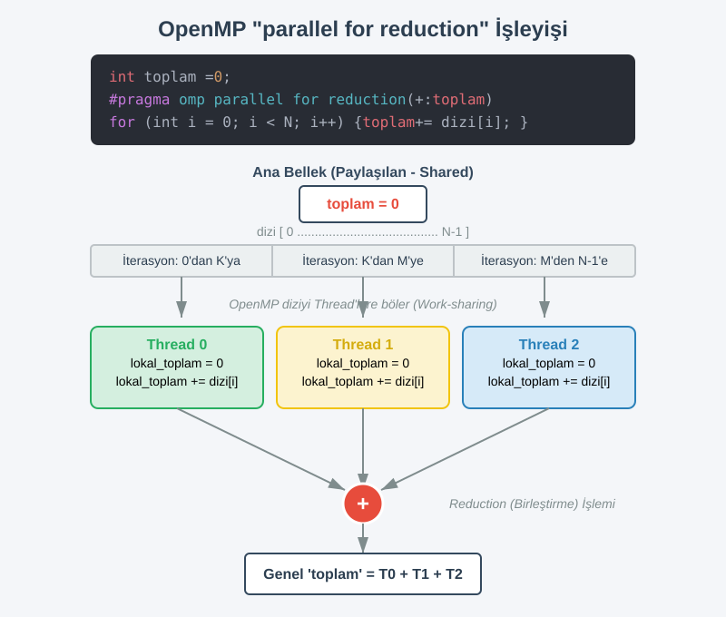

Her iş parçacığı, işlecin etkisiz elemanıyla başlatılan özel bir kopya üzerinde çalışır; döngü sonunda kopyalar işleçle birleştirilip özgün değişkene eklenir. C ve C++ için tanımlı indirgeme işleçleri şunlardır:

| İşleç | Anlamı | Özel kopyanın başlangıç değeri |
| :---: | :--- | :--- |
| `+` | toplama | 0 |
| `*` | çarpma | 1 |
| `-` | çıkarma (kopyalar toplanarak birleştirilir; OpenMP 5.2'de kullanımdan kaldırılmıştır) | 0 |
| `&` | bitsel VE | tüm bitleri 1 (`~0`) |
| `\|` | bitsel VEYA | 0 |
| `^` | bitsel dışlayıcı VEYA | 0 |
| `&&` | mantıksal VE | 1 |
| `\|\|` | mantıksal VEYA | 0 |
| `max` | en büyük (OpenMP 3.1 ve sonrası) | türün en küçük değeri |
| `min` | en küçük (OpenMP 3.1 ve sonrası) | türün en büyük değeri |

Kayan noktalı sayılarda indirgeme, toplama sırasını değiştirdiği için seri sonuçtan son basamaklarda farklı bir sonuç verebilir (bkz. `Uygulamalar/uygulamalar.md`, Örnek 2).

### 10.7 Yarış Durumu ve Eşzamanlama: `critical` ve `atomic`

Paylaşılan bir değişkene bir iş parçacığı yazmayı bitirmeden diğerinin müdahale etmesi engellenmelidir. Bu tür koruma gerektiren kod bölümlerine **kritik bölge** (critical section) denir. Yemekhanede tek bir kasiyer varken herkesin sırayla ödeme yapması buna benzer.

**`critical` yönergesi.** Blok içindeki kodun aynı anda yalnızca bir iş parçacığı tarafından yürütülmesine izin verir. İstenilen uzunlukta bir kod bloğunu koruyabildiği için esnektir; ancak bir kilit (lock) kullandığından maliyetlidir. Adı verilmemiş tüm `critical` bölgeleri programın tamamında **aynı** kilidi paylaşır; birbirinden bağımsız bölgeler için `#pragma omp critical(ad)` biçiminde ad verilmelidir.

```c
#pragma omp parallel for
for (int i = 0; i < N; i++) {
    double val = agir_hesaplama(i);
    #pragma omp critical
    {
        global_liste[boyut++] = val;   /* aynı anda tek iş parçacığı yazar */
    }
}
```

`agir_hesaplama(i)` çağrısı kritik bölgenin dışında olduğu için paralel çalışmaya devam eder; yalnızca listeye ekleme sırayla yapılır. Böylece işin büyük bölümü korumasız ve paralel biçimde yürür.

**`atomic` yönergesi.** Tek bir bellek güncellemesini (okuma–değiştirme–yazma) bölünmez kılar. Donanımın atomik komutlarına (örneğin x86 üzerinde `LOCK XADD`) dönüştürüldüğü için `critical`'a göre çok daha ucuzdur; ancak yalnızca skaler bir değişken üzerindeki basit güncellemeleri (`x += ifade`, `x++` gibi) destekler.

```c
int sayac = 0;
#pragma omp parallel for
for (int i = 0; i < N; i++) {
    if (kosul(i)) {
        #pragma omp atomic
        sayac++;
    }
}
```

**Ölçülmüş karşılaştırma.** `Uygulamalar/OpenMP/yaris.c` programı $0 + 1 + \dots + (N-1)$ toplamını ($N = 2 \times 10^7$) dört yolla hesaplar. Bölüm 4.5'teki makinede 8 iş parçacığıyla elde edilen sonuçlar:

| Yöntem | Sonuç | Süre (s) | Doğru mu? |
| :--- | ---: | ---: | :---: |
| korumasız | 68 749 997 500 000 | 0.018 | hayır |
| `atomic` | 199 999 990 000 000 | 0.463 | evet |
| `critical` | 199 999 990 000 000 | 1.142 | evet |
| `reduction` | 199 999 990 000 000 | 0.004 | evet |

Beklenen toplam 199 999 990 000 000'dur. Korumasız sürüm güncellemelerin bir kısmını kaybeder; ikinci bir çalıştırmada aynı program 9 374 998 750 000 sonucunu vermiştir. Yarış durumunun sonucu her çalıştırmada değişebilir. `atomic` ve `critical` doğru sonuç verir, ancak her iterasyonda eşzamanlama yaptıkları için seri koddan bile yavaştır. `reduction` hem doğru hem de en hızlıdır (bu platformda `omp_get_wtime()` çözünürlüğü yaklaşık 1 ms olduğundan çok kısa süreler yaklaşık değerlerdir).

Hangisi ne zaman kullanılır? Bir toplama ya da benzer bir birleştirme varsa `reduction`; tek bir değişken üzerinde seyrek ve basit güncelleme varsa `atomic`; birden fazla değişkeni ya da karmaşık bir veri yapısını etkileyen bloklar için `critical`.

### 10.8 Zamanlama (Scheduling)

OpenMP bir döngüyü iş parçacıklarına dağıtırken hangi iş parçacığının hangi iterasyonları alacağını `schedule` maddesi (clause) belirler. Doğru seçim, iterasyonların iş yüküne ve bu yükün iterasyonlar arasında ne kadar değiştiğine bağlıdır.

```c
#pragma omp parallel for schedule(tür, yığın_boyutu)
for (int i = 0; i < N; i++) { ... }
```

**`static`.** İterasyonlar döngü başlamadan önce bloklara bölünür ve iş parçacıklarına sabit biçimde atanır. `schedule(static, B)` yazıldığında $B$ boyutlu bloklar iş parçacıklarına sırayla (döngüsel olarak) dağıtılır; boyut belirtilmezse iterasyonlar yaklaşık $N/p$ boyutlu eşit bloklara bölünür. Çalışma zamanında karar verilmediği için ek yükü en düşüktür. Her iterasyon yaklaşık aynı süreyi alıyorsa en iyi seçimdir. Dört aşçıya 400 patatesi 100'er adetlik eşit paketler hâlinde vermek gibidir.

**`dynamic`.** İş parçacıkları ellerindeki işi bitirdikçe çalışma zamanından yeni bir blok ister. Her istek küçük bir eşzamanlama maliyeti doğurur; buna karşılık yük dengesizliğini kendiliğinden giderir. Blok boyutu belirtilmezse **1** kullanılır. Küçük blok dengelemeyi iyileştirir ama ek yükü artırır.

**`guided`.** Blok boyutu, kalan iterasyon sayısının iş parçacığı sayısına bölümüyle orantılıdır; başta büyük bloklar dağıtılır, bloklar giderek küçülür (belirtilen boyutun altına inmez). Büyük ilk bloklar ek yükü azaltır, küçük son bloklar bitiş zamanlarını dengeler.

**`runtime` ve `auto`.** `schedule(runtime)` seçimi programı yeniden derlemeden `OMP_SCHEDULE` ortam değişkeniyle yapmayı sağlar (örneğin `OMP_SCHEDULE="dynamic,16"`). `schedule(auto)` ise kararı derleyiciye ve çalışma zamanına bırakır.

| Zamanlama | Dağıtım | Ek yük | Ne zaman? |
| :--- | :--- | :--- | :--- |
| `static` | Önceden, eşit bloklar | En düşük | İterasyonlar eşit ağırlıkta |
| `dynamic` | Çalışma zamanında, istek üzerine | Orta–yüksek | Değişken ve öngörülemeyen yük |
| `guided` | Büyükten küçüğe bloklar | Orta | Değişken yük, daha az eşzamanlama |
| `runtime` | `OMP_SCHEDULE`'a göre | Seçime bağlı | Deneme ve ayar yaparken |

**Ölçülmüş karşılaştırma.** `Uygulamalar/OpenMP/zamanlama.c` programında $i$'inci iterasyonun maliyeti $i$ ile orantılıdır (üçgen iş yükü, $N = 20\,000$); son iterasyonlar ilk iterasyonlardan çok daha ağırdır. Bölüm 4.5'teki makinede 4 iş parçacığıyla ölçülen süreler:

| `schedule` | Süre (s) |
| :--- | ---: |
| seri | 6.967 |
| `static` (varsayılan bloklar) | 3.591 |
| `static,1` | 2.291 |
| `dynamic,1` | 2.057 |
| `dynamic,64` | 1.943 |
| `guided` | 2.085 |
| `runtime` (`OMP_SCHEDULE` tanımsız) | 1.904 |

İdeal süre $6.967/4 \approx 1.74$ s'dir. Varsayılan statik bölmede son bloğu alan iş parçacığı toplam işin yaklaşık $7/16$'sını üstlendiğinden süre idealin iki katına yaklaşır. `static,1` iterasyonları döngüsel dağıttığı için yükü büyük ölçüde dengeler; `dynamic` ve `guided` ise ideale en çok yaklaşır. 8 iş parçacığıyla yapılan bir ölçümde aynı sıralama korunmuş, ancak süreler Hyper-Threading nedeniyle daha az kısalmıştır (static: 2.285 s, dynamic,1: 1.289 s). Ölçümler birkaç on yüzde değişkenlik gösterebilir.

Doğru zamanlama seçimi çoğu zaman döngü gövdesini değiştirmeden ölçülebilir bir kazanç sağlar. Profil çıkarma sonucunda yük dengesizliği görülüyorsa `static`'ten `dynamic` ya da `guided`'a geçmek düşük maliyetli ilk adım olmalıdır.

### 10.9 `nowait` ve Engel Yönetimi

Her `omp for` iş paylaşım yapısının sonunda örtük bir engel bulunur: Tüm iş parçacıkları o noktada birbirini bekler. Bu davranış doğruluk açısından güvenlidir, ancak bazı durumlarda gereksiz beklemeye yol açar. Birbirinden bağımsız iki ardışık döngüde ilk döngüye `nowait` eklenerek engel kaldırılabilir:

```c
#pragma omp parallel
{
    #pragma omp for nowait
    for (int i = 0; i < N; i++) {
        A[i] = f(i);           /* B[] dizisinden bağımsız */
    }
    #pragma omp for
    for (int i = 0; i < N; i++) {
        B[i] = g(i);           /* bu döngünün sonunda engel vardır */
    }
}
```

İki döngünün verisi birbirinden bağımsızsa bu düzenleme boşta beklemeyi ortadan kaldırır. İkinci döngü ilk döngünün sonuçlarını okuyorsa `nowait` bir yarış durumuna yol açar; bu nedenle veri akışı dikkatle incelenmeden kullanılmamalıdır.

### 10.10 Yanlış Paylaşım (False Sharing)

Önbellek tutarlılığı (cache coherence) önbellek satırı düzeyinde sağlanır (Bölüm 6.3). Farklı iş parçacıkları **farklı** değişkenlere yazsa bile bu değişkenler aynı 64 baytlık satırdaysa, satır çekirdekler arasında sürekli el değiştirir. Mantıksal olarak hiçbir veri paylaşılmadığı hâlde ortaya çıkan bu yavaşlamaya **yanlış paylaşım** (false sharing) denir.

`Uygulamalar/OpenMP/paylasim.c` programının ikinci bölümünde her iş parçacığı kendi sayacını $10^8$ kez artırır. Sayaçlar önce bitişik bir dizide (aynı önbellek satırında), sonra her biri 64 baytlık ayrı bir satıra yerleştirilecek biçimde dolgulu (padded) bir yapıda tutulur:

```c
typedef struct {
    volatile long deger;
    char dolgu[64 - sizeof(long)];   /* her sayaç ayrı önbellek satırında */
} DolguluSayac;
```

Bölüm 4.5'teki makinede ölçülen süreler:

| İş parçacığı | Bitişik sayaçlar (s) | Dolgulu sayaçlar (s) | Oran |
| :---: | ---: | ---: | :---: |
| 4 | 0.421 | 0.274 | 1.5 |
| 8 | 0.561 | 0.333 | 1.7 |

Yalnızca veri yerleşimi değiştirilerek program 1.5–2 kat hızlanmıştır (8 iş parçacığıyla tekrarlanan bir ölçümde oran 2.0 çıkmıştır). Çözüm yolları: değişkenleri ayrı önbellek satırlarına dolgulamak, her iş parçacığının yerel bir değişkende biriktirip sonuçları en sonda yazması ya da doğrudan `reduction` kullanmaktır.

---

## Kaynaklar

- Grama, A., Gupta, A., Karypis, G. ve Kumar, V. (2003). *Introduction to Parallel Computing* (2. baskı). Addison-Wesley.
- Hennessy, J. L. ve Patterson, D. A. (2019). *Computer Architecture: A Quantitative Approach* (6. baskı). Morgan Kaufmann.
- Pacheco, P. S. ve Malensek, M. (2022). *An Introduction to Parallel Programming* (2. baskı). Morgan Kaufmann.
- Amdahl, G. M. (1967). Validity of the single processor approach to achieving large scale computing capabilities. *AFIPS Conference Proceedings*, 30, 483–485.
- Gustafson, J. L. (1988). Reevaluating Amdahl's law. *Communications of the ACM*, 31(5), 532–533.
- Karp, A. H. ve Flatt, H. P. (1990). Measuring parallel processor performance. *Communications of the ACM*, 33(5), 539–543.
- Williams, S., Waterman, A. ve Patterson, D. (2009). Roofline: An insightful visual performance model for multicore architectures. *Communications of the ACM*, 52(4), 65–76.
- McCalpin, J. D. (1995). Memory bandwidth and machine balance in current high performance computers. *IEEE TCCA Newsletter*, 19–25.
- OpenMP Architecture Review Board. *OpenMP Application Programming Interface*, sürüm 5.2 (2021). https://www.openmp.org/specifications/
