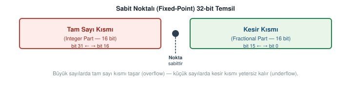
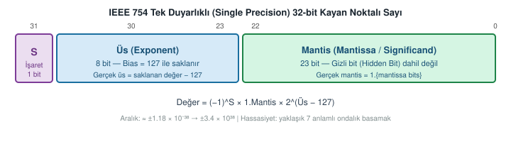
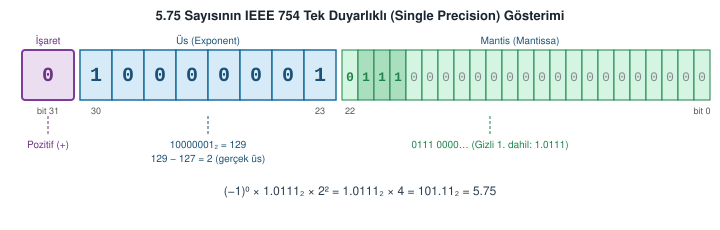

# Bölüm 1 — Giriş: Bilgisayarlar ve Sayıların Temsili

## 1.1 Konrad Zuse ve Bilgisayarların Etkisi

1941 yılında Konrad Zuse, ikili kayan noktalı aritmetik kullanan, programlanabilir ve tam otomatik ilk çalışan bilgisayar olarak kabul edilen Z3'ü inşa etti. Zuse, bu cihazın yalnızca bilim ve mühendislikte değil, yaşamın her alanında kullanılacağını öngörmüştü. Bugün bu öngörü gerçekleşmiştir: Bilgisayarlar hesaplama, görselleştirme ve veri işleme işlerini sürekli artan bir hızla yürüterek araştırmanın ve gündelik yaşamın vazgeçilmez aracı hâline gelmiştir. Bankacılıktan tıbba, eğitimden eğlenceye kadar her sektörde kritik bir rol oynarlar.

- **Hız:** Karmaşık problemler daha önce mümkün olmayan sürelerde çözülebilmektedir.
- **Verimlilik:** Rutin ve tekrarlayan görevlerin otomasyonu zaman ve emek tasarrufu sağlar.
- **İletişim:** Bilginin anında paylaşılması mümkün hâle gelmiştir.
- **Bilimsel araştırma:** Karmaşık modeller ve benzetimler (simulation) bilimsel araştırmaya yeni bir boyut kazandırmıştır.

## 1.2 Kayan Noktalı Aritmetik

Kayan noktalı aritmetik (floating-point arithmetic, FP), gerçek sayıların bir alt kümesini sabit hassasiyetli bir anlamlı kısım (significand) ile sabit bir tabanın tam sayı üssünün çarpımı olarak gösterir. Bu biçimde temsil edilen sayılara kayan noktalı sayılar denir. Sayıların bilgisayarda nasıl saklandığını anlamak, başarım odaklı kod yazmanın temel taşlarından biridir. Önce sorunu, ardından çözümü ele alalım.

### Sorun: Sabit Noktalı (Fixed-Point) Temsil

32 bitlik bir yazmacı ikiye böldüğümüzü düşünelim: 16 bit tam sayı, 16 bit kesir kısmı için. Bu tasarımda noktanın yeri kalıcı olarak sabittir.



Sorun açıktır: Büyük bir sayı temsil edilmek istendiğinde tam sayı kısmı taşar (overflow); çok küçük bir sayıda ise kesir kısmı yeterli çözünürlüğü sağlayamaz. Kilometrelik kumaş toplarını ve milimetrelik dikiş paylarını aynı mezurayla ölçmeye çalışan bir terzi, iki uçta da yetersiz kalır.

### Çözüm: Kayan Noktalı Temsil — IEEE 754

IEEE 754 standardı, sayıyı bilimsel gösterime benzer biçimde üç alana böler. Her 32 bitlik (tek duyarlıklı) kayan noktalı sayı şu yapıda saklanır:



- **S — İşaret (sign), 1 bit:** $0$ pozitif, $1$ negatif sayıyı gösterir.
- **Üs (exponent), 8 bit:** Noktanın kaç basamak kaydığını kodlar. Negatif üsleri de temsil edebilmek için gerçek üsse **sapma** (bias) adı verilen 127 sabiti eklenerek saklanır; bellekteki değer *gerçek üs + 127* olur.
- **Mantis (mantissa / significand, anlamlı kısım), 23 bit:** Sayının anlamlı basamaklarını taşır. Normalleştirilmiş sayılarda baştaki `1.` her zaman var kabul edildiğinden belleğe yazılmaz. Bu **gizli bit** (hidden bit) kuralı sayesinde 23 bit ile 24 bitlik hassasiyet elde edilir.

Genel formül:

$$\text{Değer} = (-1)^{S} \times 1.\text{Mantis} \times 2^{(\text{Üs} - 127)}$$

```math
\underbrace{\text{Değer}}_{\substack{\text{saklanan}\\\text{sayı}}} = \overbrace{(-1)^{S}}^{\substack{\text{işaret}\\(+1 \text{ ya da } -1)}} \times \underbrace{1.\text{Mantis}}_{\substack{\text{gizli bit ve}\\\text{anlamlı basamaklar}}} \times \overbrace{2^{(\text{Üs} - 127)}}^{\substack{\text{gerçek üs kadar}\\\text{kaydırma}}}
```

**Ne anlatıyor?** Saklanan bit alanlarından sayının değeri geri elde edilir: İşaret biti sayının pozitif mi negatif mi olduğunu belirler, gizli bitle tamamlanan mantis anlamlı basamakları verir, bellekteki üsten sapma (127) çıkarılarak noktanın kaç basamak kaydırılacağı bulunur. Sapma sayesinde bellekte yalnızca negatif olmayan üs değerleri tutularak hem çok büyük hem çok küçük sayılar gösterilebilir.

### Örnek: $5.75$ Sayısının IEEE 754 Gösterimi

**Adım 1 — İkili sisteme dönüştürme.** Tam sayı ve kesir kısımları ayrı ayrı dönüştürülür:

- $5_{10} = 101_{2}$
- $0.75_{10} = 0.5 + 0.25 = 0.11_{2}$
- Birleşim: $101.11_{2}$

**Adım 2 — Normalleştirme.** Nokta, en soldaki 1'in hemen sağına taşınır:

$$101.11_{2} \;\longrightarrow\; 1.0111 \times 2^{2}$$

Nokta iki basamak sola kaydığından gerçek üs 2'dir.

**Adım 3 — Alanları doldurma.**

- İşaret: Sayı pozitif olduğundan **0**.
- Üs: $2 + 127 = 129 = 10000001_{2}$.
- Mantis: Normalleştirme sonrasında noktadan sonraki kısım `0111`'dir. Gizli bit kuralı gereği baştaki `1.` saklanmaz; kalan 23 bit sona sıfır eklenerek doldurulur: `01110000000000000000000`.



Doğrulama: $(-1)^{0} \times 1.0111_{2} \times 2^{2} = 101.11_{2} = 5.75$.

---

[← Giriş](../Ders_Notu.md) · [İçindekiler](../Ders_Notu.md) · [Bölüm 2 — Paralel Hesaplamaya Neden İhtiyaç Duyarız? →](02-paralel-hesaplamaya-neden-ihtiyac-duyariz.md)
