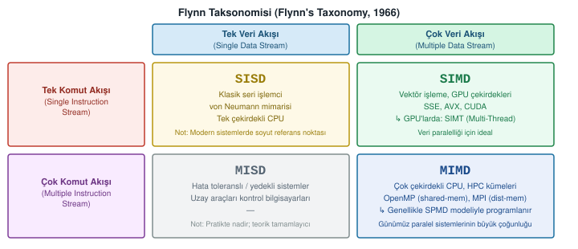
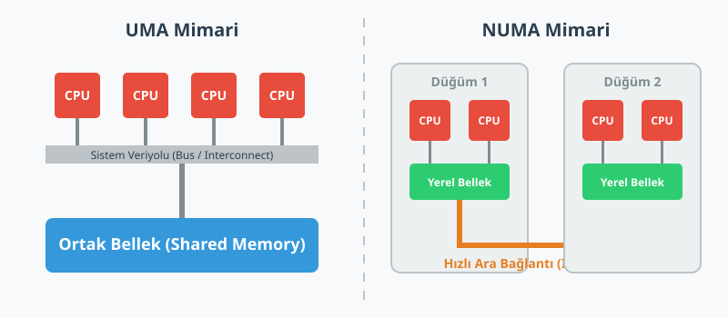

# Bölüm 3 — Paralel Mimariler ve Flynn Taksonomisi

Michael Flynn (1966), bilgisayar mimarilerini iki eksene göre sınıflandırdı: eşzamanlı işlenen **komut** (instruction) akışlarının sayısı ve **veri** (data) akışlarının sayısı. Her eksen tekli ya da çoklu olabilir; bu iki eksenin birleşimi dört kategori verir.

## 3.1 SISD — Tek Komut, Tek Veri (Single Instruction, Single Data)

Klasik von Neumann mimarisi bu tanıma uyar: Tek bir işlemci, tek bir komut dizisini tek bir veri akışı üzerinde sırayla yürütür. Çok çekirdekli bir sistemin her çekirdeği seri kodda SISD gibi davranır; bu nedenle SISD, paralel başarım değerlendirilirken başvurulan referans noktasıdır.

Kasabadaki tek eczacıyı düşünelim: Müşteriler reçetelerini sırayla getirir, eczacı her birini ayrı ayrı hazırlar. Hız tamamen eczacının kapasitesiyle sınırlıdır.

## 3.2 SIMD — Tek Komut, Çok Veri (Single Instruction, Multiple Data)

Tek bir denetim birimi, aynı komutu eşzamanlı olarak birçok veri öğesine uygular; buna **veri paralelliği** (data parallelism) denir. Döngü gövdelerindeki bağımsız aritmetik işlemler bu modele en uygun adaylardır.

İşlemcilerin vektör uzantıları olan **SSE** (Streaming SIMD Extensions) ve **AVX** (Advanced Vector Extensions), tek komutla 4 ya da 8 tek duyarlıklı kayan noktalı değeri aynı anda işler. Vektör işlemciler ve **GPU** (Graphics Processing Unit, grafik işlem birimi) çekirdekleri de bu yaklaşımı çok geniş veri genişliklerinde uygular.

Bir konserve fabrikasındaki doldurma hattında tek bir piston hareketi, bant üzerinde yan yana duran sekiz kutuyu aynı anda doldurur: Komut aynıdır, kutuların içindeki veri farklıdır.

GPU mimarilerinde SIMD'nin iş parçacığı düzeyine taşınmış biçimi olan **SIMT** (Single Instruction, Multiple Threads; tek komut, çok iş parçacığı) kullanılır. SIMT, iş parçacıklarının kendi koşullu dallanmalarını yazmasına izin vererek programlamayı kolaylaştırır.

**Maskeleme (masking).** SIMD ve SIMT birimlerinde her işlem birimi aynı komutu uygulamak zorundadır. Kodda bir `if-else` koşulu varsa önce `if` dalını sağlayan birimler çalışır, diğerleri maskelenerek bekler; ardından `else` dalı için tersi olur (Grama ve ark., 2003, Örnek 2.11). Dallar ayrıştığı ölçüde birimlerin bir kısmı atıl kalır ve gerçek verim düşer.

## 3.3 MIMD — Çok Komut, Çok Veri (Multiple Instruction, Multiple Data)

Birbirinden bağımsız işlem birimleri, her biri kendi komut akışıyla, farklı veri kümeleri üzerinde eşzamanlı çalışır. Çok çekirdekli masaüstü işlemcilerden yüz binlerce çekirdekli HPC sistemlerine kadar günümüz sistemlerinin büyük çoğunluğu bu kategoriye girer.

Büyük bir inşaat şantiyesinde elektrikçi tesisat çekerken sıvacı iç duvarları işler, çatı ustası kiremit döşer. Her ekip farklı araç kullanır, farklı malzeme işler ve bağımsız biçimde aynı anda çalışır.

MIMD sistemler çoğunlukla **SPMD** (Single Program, Multiple Data; tek program, çok veri) modeliyle programlanır: Her işlem birimi aynı programı çalıştırır, ancak kendi kimliğine (rank) göre farklı bir veri dilimini işler. **MPI** (Message Passing Interface, ileti geçirme arayüzü) tabanlı uygulamalar bu modelin en yaygın örneğidir. MIMD'nin esnekliği büyüktür; bunun karşılığı ise doğruluğu güvence altına alan eşzamanlama (synchronization) düzenekleri ve artan yazılım karmaşıklığıdır.

## 3.4 MISD — Çok Komut, Tek Veri (Multiple Instruction, Single Data)

Aynı veri akışı, farklı işlemler uygulayan birden fazla bağımsız birimden geçirilir. Uygulamada nadir görülen bu yapının başlıca kullanım alanı **hata toleransı** (fault tolerance) gerektiren kritik sistemlerdir: Uzay araçlarında ve uçuş denetim sistemlerinde aynı algılayıcı verisi birden fazla hesaplama birimince bağımsız olarak işlenir ve sonuçlar çoğunluk oylamasıyla (voting) doğrulanır.

Bir laboratuvarda aynı kan örneğinin birbirinden bağımsız üç analizörde farklı protokollerle test edilmesi buna benzer: Sonuçların tümü tutarlıysa tanıya güvenilir.

## 3.5 Paylaşılan Adres Uzayı: UMA ve NUMA

İşlemciler belleği ortak kullanıyorsa, belleğe fiziksel olarak nasıl eriştikleri başarımı doğrudan etkiler.

- **UMA (Uniform Memory Access, eşbiçimli bellek erişimi):** Tüm işlemcilerin belleğin herhangi bir noktasına erişim süresi aynıdır. *Uniform* sözcüğü Latince *unus* (bir) ve *forma* (biçim) sözcüklerinden türeyen *uniformis* kökünden gelir.
- **NUMA (Non-Uniform Memory Access, eşbiçimsiz bellek erişimi):** İşlemci sayısı arttığında belleği tek bir merkezde tutmak darboğaz yaratır. Bu nedenle bellek, işlemci düğümlerine dağıtılır. NUMA'da da tüm bellek **tek bir paylaşılan adres uzayı** oluşturur; her işlemci her adrese erişebilir. Fark yalnızca erişim süresindedir: Bir işlemcinin kendi düğümündeki (yerel) belleğe erişimi, ara bağlantı (interconnect) üzerinden başka düğümün (uzak) belleğine erişiminden hızlıdır. Kendi masanızdaki dosyaya uzanmak ile aynı binadaki başka bir odadan dosya istemek arasındaki fark gibidir.

NUMA, belleği ayrı adres uzaylarına bölen ve verinin ancak ileti geçirerek paylaşıldığı **dağıtık bellek** (distributed memory) sistemlerinden farklıdır; MPI ile programlanan kümeler bu ikinci gruba girer.

---

[← Bölüm 2 — Paralel Hesaplamaya Neden İhtiyaç Duyarız?](02-paralel-hesaplamaya-neden-ihtiyac-duyariz.md) · [İçindekiler](../Ders_Notu.md) · [Bölüm 4 — Paralel Başarımın Ölçütleri ve Yasaları →](04-paralel-basarimin-olcutleri-ve-yasalari.md)
