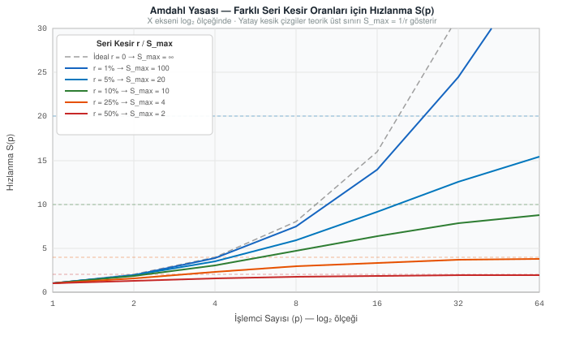

# Bölüm 4 — Paralel Başarımın Ölçütleri ve Yasaları

Paralel bir programın ne kadar başarılı çalıştığını anlamak için ölçülebilir büyüklüklere ihtiyaç vardır. Bu bölümde başarımı sayısallaştıran iki ölçüt ve bu ölçütlerin sınırlarını ortaya koyan iki yasa ele alınmaktadır.

## 4.1 Hızlanma (Speedup) ve Verimlilik (Efficiency)

Seri çalışma süresi $T_{\text{seri}}$, $p$ işlemcili paralel çalışma süresi $T_{\text{paralel}}$ ile gösterilirse **hızlanma** şöyle tanımlanır:

$$S(p) = \frac{T_{\text{seri}}}{T_{\text{paralel}}}$$

```math
\underbrace{S(p)}_{\substack{\text{p işlemcideki}\\\text{hızlanma}}} = \frac{\overbrace{T_{\text{seri}}}^{\substack{\text{seri çalışma}\\\text{süresi}}}}{\underbrace{T_{\text{paralel}}}_{\substack{\text{p işlemcili}\\\text{çalışma süresi}}}}
```

**Ne anlatıyor?** Seri çalışma süresinin paralel çalışma süresine oranı, paralel programın aynı işi kaç kat daha kısa sürede bitirdiğini gösterir. Oran ne kadar büyükse eklenen işlemcilerden o kadar çok yararlanılmış demektir.

İdeal durumda $p$ işlemciyle $S = p$ beklenir. Bu hedefe neredeyse hiç ulaşılamaz; temel engel **ek yüktür** (overhead). İngilizce *overhead* sözcüğü, işin kendisine değil yönetimine harcanan "üstteki" maliyeti anlatır: hesaplama yerine eşgüdüm için harcanan her türlü zaman. Başlıca ek yük kaynakları şunlardır:

- **Eşzamanlama (synchronization):** İş parçacıklarının ortak bir noktada birbirini beklemesi.
- **İletişim (communication):** İşlemciler arası veri aktarımı.
- **Yük dengesizliği (load imbalance):** Bazı iş parçacıklarının erken bitirip diğerlerini boşta beklemesi.
- **Başlatma maliyeti:** İş parçacıklarının oluşturulup zamanlayıcıya teslim edilmesi.

Büyük bir şantiyede yirmi işçiyi eşgüdümlü çalıştırmak için sabah toplantısı, öğle koordinasyonu ve akşam denetimi gerekir. Bu toplantılarda hiç tuğla örülmez; işçi sayısı arttıkça bu eşgüdüm zamanı azalmaz, çoğu durumda artar.

**Verimlilik**, hızlanmanın ideal değere oranıdır:

$$E(p) = \frac{S(p)}{p} = \frac{T_{\text{seri}}}{p \cdot T_{\text{paralel}}}$$

```math
\underbrace{E(p)}_{\text{verimlilik}} = \frac{\overbrace{S(p)}^{\substack{\text{elde edilen}\\\text{hızlanma}}}}{\underbrace{p}_{\substack{\text{ideal hızlanma}\\\text{(işlemci sayısı)}}}} = \frac{T_{\text{seri}}}{\underbrace{p \cdot T_{\text{paralel}}}_{\substack{\text{tüm işlemcilerin}\\\text{harcadığı toplam süre}}}}
```

**Ne anlatıyor?** Elde edilen hızlanmanın işlemci sayısına oranı, işlemcilerin zamanının ne kadarının yararlı hesaplamaya harcandığını gösterir. İkinci biçimde payda, $p$ işlemcinin birlikte harcadığı toplam süredir; bu süre seri süreye ne kadar yakınsa ek yük o kadar azdır.

$E = 1$ mükemmel verimlilik demektir; $E < 1$ ek yük ya da yük dengesizliği olduğunu gösterir. Kabul edilebilir verimlilik eşiği uygulamaya ve sistemin maliyetine göre değişir; verimlilik düştükçe eklenen her işlemcinin kazandırdığı süre azalır.

## 4.2 Amdahl Yasası (Amdahl's Law)

Gene Amdahl (1967), bir programın **seri kalmak zorunda olan** kısmının en büyük hızlanmayı doğrudan sınırladığını gösterdi. $r$, programın **tek işlemcili çalışma süresi içindeki** seri payı olmak üzere $p$ işlemciyle:

$$S(p) = \frac{1}{r + \dfrac{1-r}{p}}$$

```math
\underbrace{S(p)}_{\text{hızlanma}} = \frac{1}{\underbrace{r}_{\substack{\text{seri pay}\\\text{(kısalmaz)}}} + \underbrace{\dfrac{1-r}{p}}_{\substack{\text{paralel pay,}\\\text{p işlemciye bölünür}}}}
```

**Ne anlatıyor?** Tek işlemcili süre 1 kabul edildiğinde paralel süre, kısaltılamayan seri pay ile işlemcilere bölünen paralel payın toplamıdır; hızlanma bu sürenin tersidir. İşlemci sayısı ne kadar artırılırsa artırılsın payda $r$'nin altına inemez.

$p \to \infty$ sınırında kuramsal üst sınır elde edilir:

$$S_{\max} = \frac{1}{r}$$

```math
\underbrace{S_{\max}}_{\substack{\text{ulaşılabilecek}\\\text{en büyük hızlanma}}} = \frac{1}{\underbrace{r}_{\text{seri pay}}}
```

**Ne anlatıyor?** İşlemci sayısı sonsuza giderken paralel payın süresi sıfıra iner ve geriye yalnızca seri pay kalır; bu nedenle hızlanma, seri payın tersini aşamaz.

Bir fabrikanın üretim hattını düşünelim: Bantların taşıma hızı istenildiği kadar artırılabilir, ancak her partinin başındaki kalıp kurma süresi (seri bölüm) sabit kalır. Bant ne kadar hızlanırsa hızlansın, kalıp kurma süresi toplam sürenin alt sınırını belirler.

| Seri pay $r$ | $S_{\max}$ (kuramsal üst sınır) |
| :---: | :---: |
| %50 | 2 |
| %25 | 4 |
| %10 | 10 |
| %5 | 20 |
| %1 | 100 |



Grafikten çıkan sonuç şudur: Seri payı %10'dan %1'e indirmek, işlemci sayısını iki katına çıkarmaktan çok daha büyük kazanç sağlar. Bu nedenle HPC programcıları donanıma yatırım yapmadan önce profil çıkarıcı (profiler) araçlarla darboğazları bulup seri kısımları küçültmeye odaklanır.

## 4.3 Gustafson–Barsis Yasası (Gustafson's Law)

Amdahl, **sabit** bir problem boyutunun daha fazla işlemciyle çözülmesine bakıyordu; buna **güçlü ölçekleme** (strong scaling) denir. Oysa HPC sistemlerine geçişin asıl gerekçesi çoğunlukla aynı sürede çok daha büyük bir problemi çözmektir.

John Gustafson (1988), Ed Barsis'in gözlemlerine dayanarak bu bakış açısında tablonun değiştiğini gösterdi. Problem boyutu işlemci sayısıyla birlikte büyütüldüğünde (**zayıf ölçekleme**, weak scaling) seri bölümün göreli ağırlığı küçülür ve **ölçeklenmiş hızlanma** (scaled speedup) şöyle olur:

$$S(p) = p - s\,(p - 1)$$

Buradaki $s$, Amdahl'daki $r$'den farklı bir büyüklüktür: **$p$ işlemcili paralel çalışmanın süresi içindeki** seri paydır. Problem büyüdükçe seri kısım aynı kalıp paralel kısım büyüdüğünden, paralel çalışma süresine göre ölçülen bu pay, tek işlemcili süreye göre ölçülen Amdahl payından çok küçük olur.

```math
\underbrace{S(p)}_{\substack{\text{ölçeklenmiş}\\\text{hızlanma}}} = \overbrace{p}^{\substack{\text{ideal}\\\text{hızlanma}}} - \underbrace{s\,(p - 1)}_{\substack{\text{seri payın}\\\text{yol açtığı kayıp}}}
```

**Ne anlatıyor?** Problem işlemci sayısıyla birlikte büyütüldüğünde ideal hızlanmadan yalnızca seri bölüm yürütülürken boşta kalan $p - 1$ işlemcinin kaybı düşülür. Seri pay küçük kaldıkça hızlanma işlemci sayısıyla neredeyse doğrusal biçimde artar.

$s = 0.1$, $p = 32$ için:

$$S(32) = 32 - 0.1 \times 31 = 28.9$$

Karşılaştırma için Amdahl Yasası, $r = 0.1$ ve $p = 32$ için $S(32) = 1 / (0.1 + 0.9/32) \approx 7.8$ verir; $p \to \infty$ sınırındaki üst değer ise 10'dur. İki sonuç çelişmez: Seri pay farklı biçimde tanımlanmıştır ve iki yasa farklı sorulara yanıt verir.

> **Amdahl:** "Aynı işi $p$ kat daha hızlı yapabilir miyim?"
> **Gustafson:** "Aynı sürede $p$ kat daha büyük bir işi yapabilir miyim?"

## 4.4 Güçlü ve Zayıf Ölçekleme: Ölçüm ve Yorum

**Güçlü ölçekleme testi:** Problem boyutu sabit tutulur, işlemci sayısı artırılır. İdeal davranış $T(p) = T(1)/p$'dir. Gerçek eğri idealin altına düştüğünde seri bölüm ve ek yük devreye girmiştir.

**Zayıf ölçekleme testi:** İşlemci başına düşen iş miktarı sabit tutularak işlemci sayısı artırılır. İdeal davranışta duvar saati süresi (wall-clock time) değişmez: $T(p) = T(1)$. Sürenin artması iletişim ve eşzamanlama maliyetini gösterir.

| | Güçlü ölçekleme | Zayıf ölçekleme |
| :--- | :---: | :---: |
| **Problem boyutu** | Sabit | $p$ ile orantılı büyür |
| **Sorulan soru** | Kaç kat daha hızlı? | Aynı sürede ne kadar büyük? |
| **İdeal ölçüt** | $S(p) = p$ | $T(p) = T(1)$ |
| **Sınırlayan etken** | Seri pay $r$ | İletişim ve eşzamanlama ek yükü |
| **Yasa** | Amdahl | Gustafson–Barsis |

## 4.5 Ölçülmüş Bir Örnek: Pi Hesabında Hızlanma

`Uygulamalar/OpenMP/hizlanma.c` programı, $\pi = \int_0^1 \frac{4}{1+x^2}\,dx$ integralini orta nokta kuralıyla $4 \times 10^8$ adımda 1, 2, 4 ve 8 iş parçacığıyla hesaplar; her ölçümü üç kez tekrarlayıp en kısa süreyi alır. Ayrıca **Karp–Flatt metriği** (Karp ve Flatt, 1990) ile ölçülen hızlanmadan deneysel seri payı kestirir:

$$e(p) = \frac{1/S(p) - 1/p}{1 - 1/p}$$

```math
\underbrace{e(p)}_{\substack{\text{deneysel}\\\text{seri pay}}} = \frac{\overbrace{1/S(p)}^{\substack{\text{ölçülen hızlanmanın}\\\text{tersi}}} - \overbrace{1/p}^{\substack{\text{ideal hızlanmanın}\\\text{tersi}}}}{\underbrace{1 - 1/p}_{\substack{\text{normalleştirme}\\\text{terimi}}}}
```

**Ne anlatıyor?** Amdahl Yasası, ölçülen hızlanma değeri kullanılarak seri pay için çözülür; böylece ölçülen davranışı açıklayan deneysel seri pay elde edilir. $p$ arttıkça $e(p)$'nin de büyümesi, hızlanmayı seri bölümden çok ek yükün sınırladığını gösterir.

Aşağıdaki değerler Intel Core i7-4790K (4 fiziksel çekirdek, Hyper-Threading ile 8 mantıksal çekirdek, 4.0 GHz), Windows 11 ve MSYS2 GCC 14.2 (`gcc -O2 -fopenmp`) ile ölçülmüştür:

| $p$ | $T(p)$ (s) | $S(p)$ | $E(p)$ | $e(p)$ |
| :---: | :---: | :---: | :---: | :---: |
| 1 | 1.779 | 1.00 | 1.00 | — |
| 2 | 1.036 | 1.72 | 0.86 | 0.165 |
| 4 | 0.623 | 2.86 | 0.71 | 0.134 |
| 8 | 0.396 | 4.49 | 0.56 | 0.112 |

Yorum: Bu döngüde seri kod yok denecek kadar azdır; buna rağmen $e(p)$ yaklaşık 0.11–0.17 çıkmaktadır. Bu değer gerçek bir seri bölümü değil, iş parçacığı başlatma ek yükünü, turbo frekansının çekirdek sayısı arttıkça düşmesini ve $p = 8$'de Hyper-Threading'in iki mantıksal çekirdeği aynı fiziksel çekirdeğin birimlerini paylaşmaya zorlamasını yansıtır. $e(p)$'nin $p$ ile birlikte artması ek yükün baskın olduğunu, azalması ise sınırın gerçek bir seri bölümden kaynaklandığını düşündürür. Ölçümler makinenin o anki yüküne göre birkaç on yüzde değişebilir; kendi makinenizde tekrarlayarak karşılaştırınız.

---

[← Bölüm 3 — Paralel Mimariler ve Flynn Taksonomisi](03-paralel-mimariler-ve-flynn-taksonomisi.md) · [İçindekiler](../Ders_Notu.md) · [Bölüm 5 — İşlemci Mimarisinde Örtük Paralellik →](05-islemci-mimarisinde-ortuk-paralellik.md)
