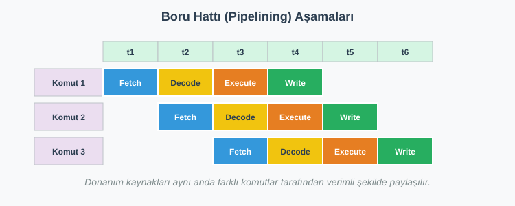
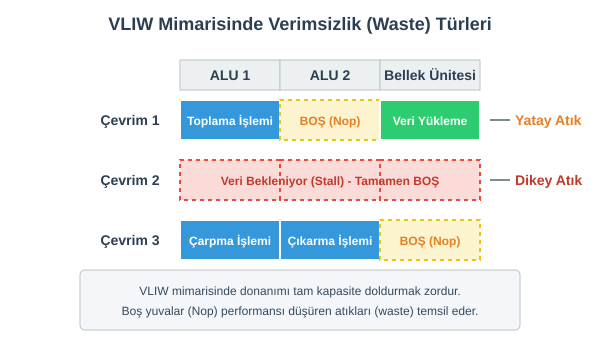

# Bölüm 5 — İşlemci Mimarisinde Örtük Paralellik

Kod özel olarak paralelleştirilmese bile modern donanım ve derleyiciler (compiler) işleri hızlandırmak için çeşitli teknikler kullanır. Programcının doğrudan müdahalesi olmadan donanım ve derleyici düzeyinde sağlanan bu eşzamanlı çalışmaya **örtük paralellik** (implicit parallelism) denir.

## 5.1 Boru Hattı (Pipelining)

Bir mikroişlemcinin komutları nasıl işlediğini anlamak için profesyonel bir restoran mutfağını düşünelim. Bir siparişin hazırlanması dört aşamadan oluşsun: malzemenin kilerden getirilmesi, tarifin okunup malzemenin doğranması, ocakta pişirme ve tabağa alıp servis bandına koyma.

Mutfakta tek bir aşçı varsa bir siparişi bitirmeden diğerine geçemez. İş istasyonlara bölündüğünde ise (malzemeci, doğrayıcı, pişirici, sunumcu) birinci sipariş pişme aşamasına geçtiği anda doğrayıcı ikinci siparişi kesmeye, malzemeci üçüncü siparişin malzemesini getirmeye başlayabilir. Bilgisayar mimarisinde buna **boru hattı** (pipelining) denir; terim İngilizce *pipe* (boru) sözcüğünden türemiştir ve işlerin bir borudan kesintisiz akmasını anlatır.

İşlemcide bir komutun işlenmesi temelde dört aşamadan geçer:

1. **Getirme (fetch):** Komutun bellekten işlemciye alınması (malzemenin getirilmesi).
2. **Çözme (decode):** Komutun ne anlama geldiğinin çözümlenmesi. *Decode* sözcüğü, Latince *codex* (kitap, kayıt) kökünden gelen *code* sözcüğüne ayırma bildiren *de-* önekinin eklenmesiyle oluşmuştur.
3. **Yürütme (execute):** Aritmetik veya mantıksal işlemin aritmetik mantık biriminde (ALU) yapılması (yemeğin pişirilmesi).
4. **Geri yazma (write-back):** Sonucun yazmaçlara (registers) kaydedilmesi (yemeğin servise sunulması).

*Şekil 7. Boru hattında ardışık komutların zaman içindeki yürütülme aşamaları. Her saat vuruşunda (t) donanımın farklı birimleri farklı komutların aşamalarını işler.*

Boru hattı tek bir komutun süresini kısaltmaz; ancak aşamalar üst üste bindiği için birim zamanda tamamlanan komut sayısını (throughput, iş çıkarma hızı) önemli ölçüde artırır.

## 5.2 Süperskaler (Superscalar) Yürütme ve Bağımlılıklar

**Süperskaler işlemciler**, mutfağa fazladan ocak ve kesme tahtası eklenmesine benzer biçimde birden fazla boru hattına sahiptir ve her saat vuruşunda birden fazla komut başlatabilir. Bu mimaride başarımı üç tür bağımlılık sınırlar:

1. **Gerçek veri bağımlılığı (true data dependency):** Domatesler doğranmadan menemen pişirilemez. Bir komutun ürettiği sonuç hemen ardından gelen komutun girdisiyse bekleme (stall) yaşanır.
2. **Kaynak bağımlılığı (resource dependency):** Mutfakta tek fırın varsa ve iki yemek aynı anda fırına ihtiyaç duyuyorsa biri bekler. Donanımda tek bir kayan nokta biriminin iki komut tarafından istenmesi aynı durumu yaratır.
3. **Yordamsal bağımlılık (procedural dependency):** Müşterinin yemeğe acı sos isteyip istemeyeceği belli değildir (dallanma, branch). Aşçı zaman kazanmak için sosu hazırlamaya başlar; garson müşterinin sos istemediğini söylerse yapılan hazırlık çöpe gider. İşlemcide yanlış dallanma tahmini, **boru hattının boşaltılmasına** (pipeline flush) ve ciddi başarım kaybına yol açar.

## 5.3 VLIW (Very Long Instruction Word, Çok Uzun Komut Sözcüğü) Mimarisi

Süperskaler mimaride donanım, telaşlı bir aşçıbaşı gibi her an "Hangi ocak boş? Hangi yemek bekliyor? Veri hazır mı?" sorularına yanıt vermek zorundadır. Bu durum donanımı karmaşıklaştırır ve ısıyı artırır.

VLIW mimarisi bu karar yükünü donanımdan alır ve derleyiciye aktarır. Derleyiciyi, mutfağın saniye saniye planını bir gün önceden yapan bir şef gibi düşünebiliriz: Şef, hangi personelin hangi anda hangi işi yapacağını büyük bir "uzun sözcük" (paket) hâlinde yazar; donanım bağımlılık analizi yapmadan paketteki komutları uygular.

| Özellik | Süperskaler mimari | VLIW mimarisi (IA-64 vb.) |
| :--- | :--- | :--- |
| **Zamanlama kararı** | Çalışma zamanında (donanım) | Derleme zamanında (derleyici) |
| **Bağımlılık analizi** | Karmaşık donanım mantığı | Derleyici eniyilemesi |
| **Donanım karmaşıklığı** | Yüksek | Düşük |
| **Verim kaybının görünümü** | Çalışma zamanında beklemeler | Paketlerde boş kalan yuvalar |

Bir saat çevriminde yürütme birimlerinden yalnızca bir kısmının kullanılmasına **yatay atık** (horizontal waste), hiçbir komutun başlatılamadığı çevrimlere ise **dikey atık** (vertical waste) denir. Grama ve ark. (2003) bu kavramları süperskaler yürütme üzerinden tanımlar; aynı kayıplar, derleyicinin dolduramadığı yuvalar biçiminde VLIW paketlerinde de görülür.

*Şekil 8. Çok uzun komut sözcüğü içindeki boş yuvalar (yatay atık) ve donanımın tamamen durakladığı çevrimler (dikey atık).*

İşlemciler iç yapılarını bu tekniklerle büyük ölçüde hızlandırmış olsa da ana bellek veriyi aynı hızda ulaştıramaz. İşlemci ile bellek arasındaki bu tek veri yolunun yarattığı darboğaza **von Neumann darboğazı** (von Neumann bottleneck), işlemci hızı ile bellek erişim hızı arasında yıllar içinde açılan makasa ise **bellek duvarı** (memory wall) denir. Bir sonraki bölüm bu sorunu ele alır.

---

[← Bölüm 4 — Paralel Başarımın Ölçütleri ve Yasaları](04-paralel-basarimin-olcutleri-ve-yasalari.md) · [İçindekiler](../Ders_Notu.md) · [Bölüm 6 — Bellek Hiyerarşisi ve Bellek Sistemi Başarımı →](06-bellek-hiyerarsisi.md)
