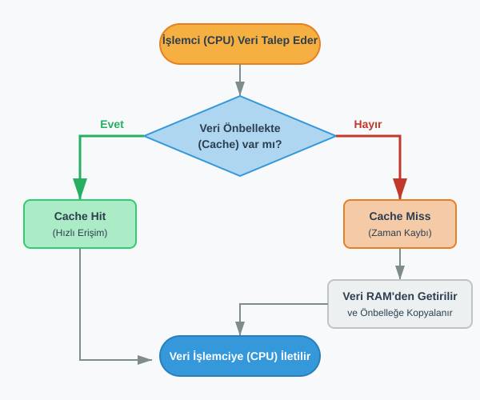
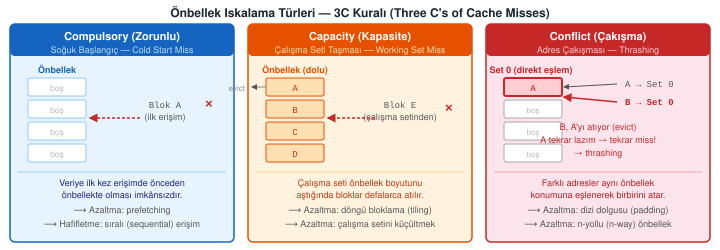

# Bölüm 6 — Bellek Hiyerarşisi ve Bellek Sistemi Başarımı

Grama ve ark. (2003), işlemci saat hızlarının yılda yaklaşık %40 iyileşmesine karşın DRAM (Dynamic Random-Access Memory) erişim sürelerinin yılda yalnızca yaklaşık %10 iyileştiğini belirtir. Modern bir işlemci bir komutu, aynı komutun ihtiyaç duyduğu veriyi DRAM'den getirmekten çok daha kısa sürede tamamlar. Bu nedenle başarım yalnızca verinin ne kadar hızlı işlendiğiyle değil, bellek hiyerarşisi içindeki veri taşıma maliyetiyle de sınırlıdır.

## 6.1 Gecikme (Latency) ve Bant Genişliği (Bandwidth)

Grama ve ark. (2003) bu ayrımı bir itfaiye hortumu benzetmesiyle açıklar:

- **Gecikme:** Vananın açıldığı an ile suyun hortumun ucundan çıktığı an arasında geçen süredir. Bilgisayarda işlemcinin bellekten veri istediği an ile verinin işlemciye ulaştığı an arasındaki süreye karşılık gelir (genellikle nanosaniye mertebesindedir).
- **Bant genişliği:** Su akmaya başladıktan sonra saniyede kaç litre aktığıdır. Bilgisayarda birim zamanda aktarılan veri miktarıdır (örneğin GB/s).

## 6.2 Önbellek (Cache)

Mimarlar bu açığı kapatmak için işlemcinin içine ana bellekten çok daha hızlı fakat kapasitesi sınırlı SRAM (Static RAM) birimleri yerleştirdi. Bu bellek katmanlarına **önbellek** denir. İngilizce *cache* sözcüğü, Fransızca "saklamak, gizlemek" anlamındaki *cacher* fiilinden gelir. Bir işlemcide genellikle üç düzey bulunur: L1 en hızlı ve en küçük, L3 en yavaş ve en büyük olanıdır. L1 erişimi yaklaşık bir nanosaniye (birkaç saat çevrimi) sürerken DRAM erişimi 60–100 ns'yi bulabilir.

İşlemci bir veriye ihtiyaç duyduğunda önce önbelleğe bakar. Veri oradaysa buna **önbellek isabeti** (cache hit) denir ve veri hemen yürütme birimine iletilir. Veri önbellekte yoksa **önbellek ıskalaması** (cache miss) yaşanır; işlemci veri DRAM'den gelene kadar bekler (stall).

## 6.3 Yerellik İlkesi (Locality of Reference)

Önbelleğin işe yaraması rastlantı değildir; programların büyük çoğunluğunun **yerellik ilkesine** uygun davranmasından kaynaklanır.

İşlemciyi bir aşçı, tezgâhı önbellek, kileri ana bellek olarak düşünelim. Aşçı her baharat için kilere gidip gelmek yerine sık kullandıklarını tezgâhta tutar.

- **Zamansal yerellik (temporal locality):** Yakın zamanda erişilen bir veriye yakın gelecekte yeniden erişilme olasılığı yüksektir. Bir yemeğe tuz atan aşçının birkaç dakika sonra başka bir yemeğe de tuz atması olasıdır. Döngü sayaçları (örneğin `for` döngüsündeki `i`) bunun klasik örneğidir.
- **Uzamsal yerellik (spatial locality):** Bir bellek adresine erişildiğinde komşu adreslere de kısa süre içinde erişilme olasılığı yüksektir. Kilere tuz almaya giden aşçı, hemen yanındaki karabiberi de tezgâha getirir. Bir dizinin `dizi[i]` elemanı okunduktan sonra büyük olasılıkla `dizi[i+1]` okunur.

Sistemler uzamsal yerellikten yararlanmak için veriyi ana bellekten tek tek bayt olarak değil, **önbellek satırı** (cache line) adı verilen bitişik bloklar hâlinde alır. Günümüz x86 sistemlerinde önbellek satırı **64 bayttır**; bir `float` (4 bayt) değerine erişildiğinde aynı satırdaki diğer 15 `float` da önbelleğe gelir.

## 6.4 Önbellek Iskalamalarının Sınıflandırılması: Üç C

Önbellek ıskalamaları **üç C** (three C's) ile sınıflandırılır:

- **Zorunlu ıskalama (compulsory miss):** Veriye ilk erişimde veri henüz önbellekte olmadığı için kaçınılamaz. Önceden getirme (prefetching) ile etkisi azaltılabilir.
- **Kapasite ıskalaması (capacity miss):** Programın etkin çalışma kümesi (working set) önbellek kapasitesini aştığında önceden yüklenen veriler atılır. Döngü döşeme (loop tiling) ile çalışma kümesi küçültülerek azaltılır.
- **Çakışma ıskalaması (conflict miss):** Farklı bellek bloklarının aynı önbellek konumuna eşlenmesiyle birbirini sürekli atma (thrashing) durumu oluşur. Dizi dolgusu (padding) ve çok yollu (n-way set-associative) önbellekler bu sorunu azaltır.

## 6.5 Örnek: Önbelleğin Matris Çarpımına Etkisi

Grama ve ark. (2003, Örnek 2.3), 1 GHz hızında çalışan, DRAM gecikmesi 100 ns olan ve her çevrimde dört komut işleyebilen bir işlemcide iki $32 \times 32$ matrisin çarpımını inceler:

- A ve B matrislerindeki toplam 2K ($2 \times 1024$) sözcüğün önbelleğe getirilmesi yaklaşık $200~\mu s$ sürer.
- Matris çarpımı $2n^3 = 64\text{K}$ işlem gerektirir; çevrim başına dört komutla bu işlemler 16K çevrimde, yani $16~\mu s$'de tamamlanır.
- Toplam süre yaklaşık $216~\mu s$, başarım ise $64\text{K} / 216~\mu s \approx 303$ MFLOPS'tur (MFLOPS: saniyede milyon kayan noktalı işlem).

Aynı işlemci önbelleksiz çalışsaydı her kayan noktalı işlem için bellekten veri beklemek zorunda kalacak ve başarım, Örnek 2.2'deki gibi yaklaşık 10 MFLOPS'a düşecekti. Önbellek, veriye yeniden erişimi (bu örnekte her sözcük $n$ kez kullanılır) mümkün kılarak başarımı yaklaşık 30 kat artırmaktadır.

## 6.6 Örnek: Blok Boyutunun Etkisi

Grama ve ark. (2003, Örnek 2.2 ve 2.4), bellek gecikmesinin 100 ns olduğu bir sistemde iki vektörün nokta çarpımını (dot product) inceler:

- **Blok boyutu bir sözcükse:** İşlemci her erişimde yalnızca bir sözcük alır ve bunun için 100 ns bekler. Her kayan noktalı işlem için bir bellek erişimi gerektiğinden başarım 10 MFLOPS düzeyinde kalır. Bu, kütüphaneden her seferinde yalnızca tek bir sayfa alıp masaya dönmeye benzer.
- **Blok boyutu dört sözcükse (bir önbellek satırı):** Tek bir 100 ns'lik erişim dört sözcüğü birden getirir. Uzamsal yerellik sayesinde ilk gecikme sonraki dört işleme dağıtılır (amortize edilir) ve başarım 40 MFLOPS düzeyine çıkar. Bir sayfa için kütüphaneye gidilmişken bütün kitabı masaya getirmek gibidir.

Gerçek STREAM ölçümleri (Bölüm 8.3) bu kuramsal hesabın pratikteki karşılığını verir.

## 6.7 Bellek Gecikmesini Gizleme Teknikleri

Veri ne kadar iyi düzenlenirse düzenlensin, işlemci zaman zaman ana bellekten veri beklemek zorunda kalır. Bu bekleme süresini yararlı işle doldurmaya **gecikme gizleme** (latency hiding) denir.

**Çoklu iş parçacığı (multithreading).** Bir iş parçacığı bellekten veri beklemeye geçtiğinde donanım, hazır durumdaki başka bir iş parçacığının komutlarını yürütür. Donanım düzeyindeki bu iş parçacığı değişimi, işletim sisteminin yaptığı bağlam değişiminden (context switch) çok daha ucuzdur. Yürütme birimleri dolu tutularak gecikme maskelenir.

**Önceden getirme (prefetching).** Verinin, işlemci ona ihtiyaç duymadan biraz önce donanım veya derleyici tarafından önbelleğe getirilmesidir. *Pre-* öneki Latince *prae* (önce) kökünden gelir; *fetch* ise İngilizcedir. Bir makaleyi okurken bir asistanın sonraki sayfayı önceden önünüze koymasına benzer. Ancak önceden getirme yanlış tahmin edilirse ya da aşırıya kaçarsa bant genişliğini hiç kullanılmayacak verilerle doldurarak sistemi yavaşlatabilir.

> **Bant genişliği ve ödünleşim (trade-off).** Grama ve ark. (2003, Örnek 2.7): Tek bir iş parçacığı 1 GHz işlemcide önbelleği %90 isabet oranıyla kullanırken ana bellekten saniyede yaklaşık 400 MB veri çeker. Aynı çekirdekte 32 iş parçacığı çalıştırıldığında her birinin önbellek payı daralır; isabet oranı örneğin %25'e düşer ve toplam bant genişliği ihtiyacı yaklaşık 3 GB/s'ye çıkar. Gecikmeyi gizlerken darboğazı bant genişliğine kaydırmamaya dikkat edilmelidir.

---

[← Bölüm 5 — İşlemci Mimarisinde Örtük Paralellik](05-islemci-mimarisinde-ortuk-paralellik.md) · [İçindekiler](../Ders_Notu.md) · [Bölüm 7 — Veri Odaklı Tasarım ve Veri Erişim Desenleri →](07-veri-odakli-tasarim.md)
