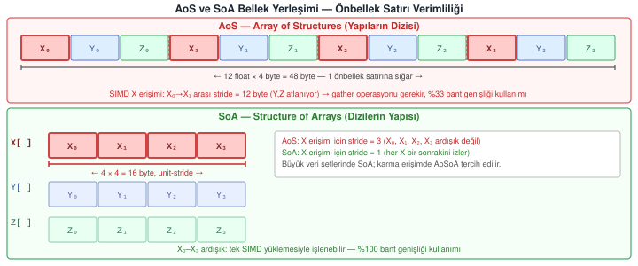
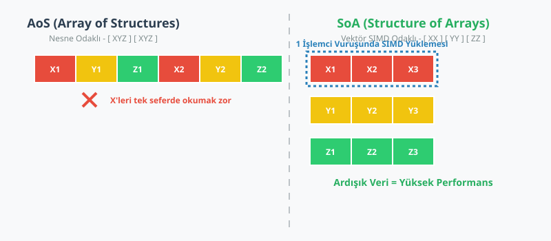
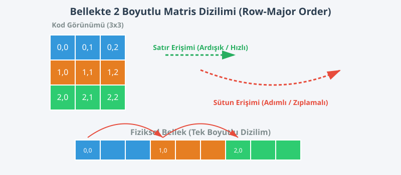
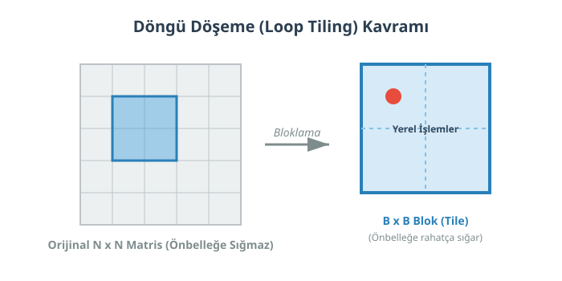

# Bölüm 7 — Veri Odaklı Tasarım ve Veri Erişim Desenleri

Nesne yönelimli programlama (Object-Oriented Programming, OOP) kodun okunabilirliğini ve modülerliğini artırır; ancak büyük nesne koleksiyonları üzerinde toplu hesaplama yapılırken işlemci ve önbellek davranışını ikinci plana atabilir. Dallanma tahmin hataları, sanal işlev çağrıları ve dağınık bellek erişimleri SIMD kullanımını kısıtlar.

**Veri odaklı tasarım** (Data-Oriented Design, DOD) odağı nesne soyutlamasından veri akışına ve **bellek yerleşimine** (data layout) kaydırır. Temel soru şudur: "Bu veri, erişileceği sırayla bellekte duruyor mu?" Endüstriyel bir mutfakta OOP yaklaşımı her aşçıya tüm malzemeleri bir arada içeren bireysel bir set dağıtmaya benzer; DOD ise tüm patatesleri bir kasaya, tüm soğanları başka bir kasaya koyup her aşçının kendi kasasından sırayla çalışmasını sağlar. Verimlilik sıralı erişimden gelir.

## 7.1 AoS — Yapıların Dizisi (Array of Structures)

AoS yaklaşımında bir varlığın tüm alanları (örneğin üç boyutlu bir parçacığın `x`, `y`, `z` koordinatları) tek bir yapı (`struct`) içinde tutulur ve bu yapıların dizisi oluşturulur.

```c
struct Particle { float x, y, z; };
struct Particle particles[N];   /* AoS */
```

Bellekteki sıralama: `[X0 Y0 Z0 | X1 Y1 Z1 | X2 Y2 Z2 | X3 Y3 Z3 | ...]`. Tüm alanlar birlikte kullanıldığında (örneğin çarpışma hesabında) bu düzen avantajlıdır. Ancak yalnızca `x` değerlerini işleyen bir SIMD döngüsü, ardışık `x` değerlerine ulaşmak için 12 baytlık adımlar (stride) atmak zorunda kalır ve değerleri toplama (gather) işlemiyle bir araya getirmesi gerekir. Nesne yönelimli programlamanın doğasına uygun olan bu düzene nesne tabanlı yerleşim de denir.

## 7.2 SoA — Dizilerin Yapısı (Structure of Arrays)

SoA yaklaşımında her alan kendi dizisinde tutulur:

```c
struct Particles { float x[N], y[N], z[N]; };   /* SoA */
```

Bellek düzeni: `[X0 X1 X2 X3 ... | Y0 Y1 Y2 Y3 ... | Z0 Z1 Z2 Z3 ...]`. Yalnızca `x` değerleri işlendiğinde dizi ardışık ve kesintisizdir; SIMD birimi tek bir 128 bit ya da 256 bitlik yüklemeyle 4–8 `float` değeri birlikte alabilir. Bilimsel hesaplamada ve yüksek başarımlı yazılımlarda bu nedenle çoğunlukla SoA tercih edilir.



Şemada görüldüğü gibi, AoS düzeninde dört `x` değeri için 48 bayt yüklenir ama yalnızca 16 bayt kullanılır (%33 bant genişliği verimi). SoA düzeninde ise dört `x` değeri için tam 16 bayt yüklenir ve tamamı kullanılır (%100 verim).



## 7.3 AoSoA — Dizilerin Yapılarının Dizisi (Array of Structures of Arrays)

AoSoA, AoS ve SoA'nın güçlü yönlerini birleştiren karma (hybrid) bir düzendir. Veriler önce SIMD genişliğine karşılık gelen boyutta **döşemelere** (tile) ayrılır, ardından her döşeme içinde SoA düzeni uygulanır.

```c
/* AVX2: 8 float -> döşeme genişliği 8 */
struct Tile { float x[8], y[8], z[8]; };
struct Tile tiles[N / 8];   /* AoSoA */
```

Döşeme boyutu SIMD yazmaç genişliğine bağlanır: SSE için 4, AVX/AVX2 için 8, AVX-512 için 16 `float`. Bu seçim hem ardışık SIMD yüklemesini hem de birden fazla alanın birlikte kullanıldığı durumlarda yönetilebilir sayıda veri akışını sağlar.

## 7.4 Yerleşim Seçim Rehberi

| Erişim kalıbı | Önerilen yerleşim |
| :--- | :---: |
| Tüm alanlar birlikte kullanılıyor (çarpışma, dönüşüm) | AoS |
| Tek alan üzerinde toplu işlem (SIMD, GPU) | SoA |
| Karma erişim ve SIMD uyumluluğu | AoSoA (döşeme = SIMD genişliği) |
| Önbellek kapasitesi kritik, döngü döşeme uygulanıyor | SoA veya AoSoA |

## 7.5 Adımlı Erişim (Strided Access) Problemi

C ve C++ dillerinde iki boyutlu diziler bellekte satır satır (row-major order) saklanır. Bir matris iç içe döngülerde satır yerine sütun boyunca dolaşılırsa bellekte ardışık olmayan, atlamalı (strided) adreslere gidilir.

Bu durumu, bir ansiklopediden bilgi ararken her seferinde raftan koca bir cildi masaya getirip içinden yalnızca tek bir sözcük okuyup cildi geri götürmeye benzetebiliriz. Getirilen sayfadaki diğer sözcükler okunmadığı için uzamsal yerellik boşa gider.



```c
/* Kötü uzamsal yerellik: sütun boyunca erişim */
for (int i = 0; i < 1000; i++) {
    for (int j = 0; j < 1000; j++) {
        /* İç döngüde j arttıkça satır değişir; ardışık erişimler
           bellekte 1000 eleman arayla durur. Matris önbelleğe
           sığmıyorsa hemen her erişim yeni bir önbellek satırı getirir. */
        column_sum[i] += b[j][i];
    }
}
```

Döngülerin yeri değiştirilerek (`b[i][j]` sırasıyla dolaşılarak) aynı toplam ardışık erişimle hesaplanabilir.

## 7.6 Döngü Döşeme (Loop Tiling / Blocking)

Matrisler önbelleğe sığmayacak kadar büyük olduğunda veriyi küçük bloklara (*tile*: fayans, karo) böleriz. Döşeme tekniği, büyük veri kümelerini önbelleğe sığacak alt matrislere ayırarak her bloğun önbellekte kaldığı süre boyunca olabildiğince çok kez kullanılmasını sağlar ve bellek bant genişliği gereksinimini azaltır. Kütüphaneden alabildiğimiz kadar kitabı masaya yığıp, o kitaplarla yapılabilecek tüm işi bitirmeden yenilerini almamak gibidir.



Aşağıdaki kod, $C = A \times B$ matris çarpımını $B \times B$ boyutlu bloklar üzerinden yapar:

```c
#define MIN(a, b) ((a) < (b) ? (a) : (b))

/* n x n matrisler; BS: blok kenarı (örneğin 32 veya 64).
   Üç blok (A, B ve C'den birer blok) aynı anda önbelleğe sığmalıdır. */
void blok_carpim(int n, int BS, double A[n][n], double B[n][n], double C[n][n]) {
    for (int ii = 0; ii < n; ii += BS)
        for (int kk = 0; kk < n; kk += BS)
            for (int jj = 0; jj < n; jj += BS)
                /* Blok içindeki çarpım */
                for (int i = ii; i < MIN(ii + BS, n); i++)
                    for (int k = kk; k < MIN(kk + BS, n); k++) {
                        double a_ik = A[i][k];
                        for (int j = jj; j < MIN(jj + BS, n); j++)
                            C[i][j] += a_ik * B[k][j];
                    }
}
```

`C` matrisinin önceden sıfırlanmış olması gerekir. `k` döngüsünün `j` döngüsünün dışında olması, en içteki döngünün `B` ve `C` matrislerini satır boyunca ardışık dolaşmasını sağlar.

---

[← Bölüm 6 — Bellek Hiyerarşisi ve Bellek Sistemi Başarımı](06-bellek-hiyerarsisi.md) · [İçindekiler](../Ders_Notu.md) · [Bölüm 8 — Başarım Sınırları: Roofline Modeli ve STREAM →](08-roofline-modeli-ve-stream.md)
