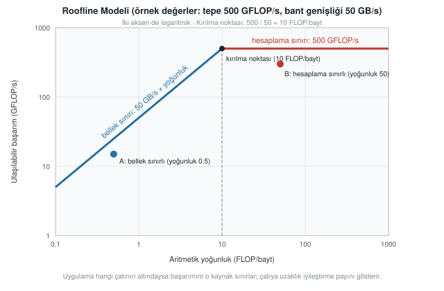

# Bölüm 8 — Başarım Sınırları: Roofline Modeli ve STREAM

## 8.1 Hesaplama Sınırı ve Besleme Sınırı

Program başarımını belirleyen temel sınırlar iki başlıkta toplanır:

- **Hesaplama sınırı:** İşlemcinin saniyede yapabildiği en fazla kayan noktalı işlem sayısı. **FLOP** (floating-point operation) tek bir kayan noktalı işlemi, **FLOP/s** (FLOPS) ise saniyedeki kayan noktalı işlem sayısını gösterir.
- **Besleme sınırı:** Bellek ya da ağ bant genişliği.

Değerlendirmede iki ölçüt kullanılır:

- **Aritmetik yoğunluk (arithmetic intensity):** Bellekten aktarılan her bayt başına yapılan FLOP sayısı (FLOP/bayt).
- **Makine dengesi (machine balance):** Tepe FLOP/s değerinin tepe bant genişliğine oranı (FLOP/bayt). Aritmetik yoğunluğu makine dengesinden düşük olan bir uygulama bellek sınırlıdır.

## 8.2 Roofline Modeli

Roofline modeli (Williams, Waterman ve Patterson, 2009), bir uygulamanın donanım sınırlarına ne kadar yakın olduğunu gösteren görsel bir modeldir. Ulaşılabilir başarım şöyle verilir:

$$P_{\text{ulaşılabilir}} = \min\left(P_{\text{tepe}},\; \text{bant genişliği} \times \text{aritmetik yoğunluk}\right)$$

```math
\underbrace{P_{\text{ulaşılabilir}}}_{\substack{\text{ulaşılabilir}\\\text{başarım}}} = \min\left(\overbrace{P_{\text{tepe}}}^{\substack{\text{hesaplama sınırı}\\\text{(yatay çatı)}}},\; \overbrace{\underbrace{\text{bant genişliği}}_{\text{bayt/s}} \times \underbrace{\text{aritmetik yoğunluk}}_{\text{FLOP/bayt}}}^{\substack{\text{bellek sınırı}\\\text{(eğimli çizgi)}}}\right)
```

**Ne anlatıyor?** Bir uygulamanın başarımı, işlemcinin tepe hesaplama hızı ile belleğin taşıyabildiği veriyle yapılabilecek işlem hızından hangisi küçükse onunla sınırlanır. Aritmetik yoğunluk düşükse bellek, yüksekse işlemci darboğaz olur.

Model, "Hız yapmamıza motor mu izin vermiyor, yoksa yol mu dar?" sorusunun teknik karşılığıdır. Saatte 300 km hız yapabilen bir yarış arabası (güçlü işlemci) dar ve tek şeritli bir köy yolunda (düşük bellek bant genişliği) kullanıldığında gerçek potansiyeline ulaşamaz; başarımı sınırlayan motor değil yoldur (memory-bound, bellek sınırlı).



- Yatay eksen: aritmetik yoğunluk (FLOP/bayt), logaritmik ölçek.
- Dikey eksen: ulaşılabilir başarım (GFLOP/s), logaritmik ölçek.

Yatay "çatı" tepe hesaplama sınırını, eğimli çizgi ise bellek bant genişliği sınırını gösterir. İki çizginin kesiştiği kırılma noktası makine dengesine karşılık gelir. Şekildeki A uygulaması eğimli çizginin altında olduğundan bellek sınırlıdır; başarımını artırmanın yolu veri yeniden kullanımını artırmaktır (örneğin döngü döşeme). B uygulaması yatay çizginin altındadır ve hesaplama sınırlıdır; burada vektörleştirme ve daha fazla çekirdek kullanımı önem kazanır.

## 8.3 STREAM Benchmark

STREAM (McCalpin, 1995), sistemin pratik bellek bant genişliğini ölçmek için yaygın kullanılan bir sınama programıdır (benchmark). Önbelleğe sığmayacak kadar uzun vektörler üzerinde dört çekirdek işlem içerir:

- **COPY:** $A(i) = B(i)$ — B dizisinin A dizisine kopyalanması.
- **SCALE:** $A(i) = s \cdot B(i)$ — B'nin her elemanının bir $s$ sayısıyla çarpılması.
- **ADD:** $A(i) = B(i) + C(i)$ — B ve C'nin karşılıklı elemanlarının toplanması.
- **TRIAD:** $A(i) = B(i) + s \cdot C(i)$ — çarpma ve toplamanın birlikte yapıldığı, gerçek iş yüklerine en yakın işlem.

Bu işlemlerde hesaplama çok az, bellek erişimi çok fazladır; bu nedenle ölçülen değer, akış biçimindeki (streaming) erişimlerde belleğin ulaşabildiği GB/s düzeyini verir. TRIAD işleminde çift duyarlıklı sayılarla iki FLOP için en az 24 bayt taşındığından aritmetik yoğunluk yaklaşık $2/24 \approx 0.08$ FLOP/bayt'tır; işlem açıkça bellek sınırlıdır. Bir uygulamanın elde ettiği bant genişliği STREAM sonucunun belirgin biçimde altında kalıyorsa olası nedenler adımlı erişim, önbellek çakışmaları ve yüksek ıskalama oranlarıdır.

---

[← Bölüm 7 — Veri Odaklı Tasarım ve Veri Erişim Desenleri](07-veri-odakli-tasarim.md) · [İçindekiler](../Ders_Notu.md) · [Bölüm 9 — Paralel Algoritma Tasarımı ve Görev Bağımlılıkları →](09-paralel-algoritma-tasarimi.md)
