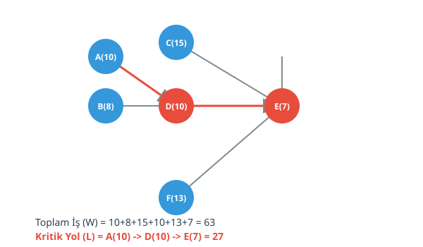
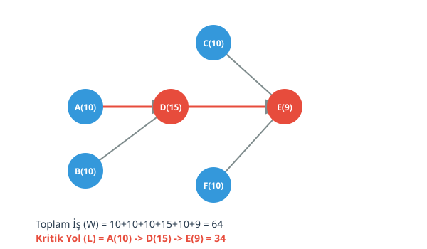

# Bölüm 9 — Paralel Algoritma Tasarımı ve Görev Bağımlılıkları

Bazı görevler, diğerlerinin ürettiği veriye ihtiyaç duyar. Problem küçük alt görevlere bölündüğünde görevler arasındaki zorunlu sıra bir **görev bağımlılık çizgesi** (task dependency graph) ile gösterilir. Bu çizge yönlü ve döngüsüzdür (DAG, Directed Acyclic Graph, yönlü döngüsüz çizge).

## 9.1 Temel Büyüklükler

Grama ve ark. (2003), bir ayrıştırmanın ne kadar iyi paralelleşebileceğini şu büyüklüklerle ölçer:

- **Toplam iş (W, work):** Tüm görevlerin sürelerinin toplamı; program tek işlemcide çalışsaydı alacağı süre.
- **Kritik yol uzunluğu (L, critical path length):** Çizgede başlangıçtan bitişe giden ve ağırlıkları toplamı en büyük olan bağımlı görevler zinciri. Sonsuz sayıda işlemci kullanılsa bile program bu süreden kısa sürede bitemez. İnşaatta temel atılmadan duvar, duvar örülmeden çatı yapılamaz; bu zincir kritik yoldur.
- **Ortalama eşzamanlılık derecesi (average degree of concurrency):** Ortalamada aynı anda yürütülebilen görev sayısı. *Concurrency* sözcüğü Latince *concurrere* (birlikte koşmak) kökünden gelir.

$$\text{Ortalama eşzamanlılık} = \frac{W}{L}$$

```math
\underbrace{\text{Ortalama eşzamanlılık}}_{\substack{\text{aynı anda ortalama}\\\text{yürütülen görev}}} = \frac{\overbrace{W}^{\text{toplam iş}}}{\underbrace{L}_{\substack{\text{kritik yol}\\\text{uzunluğu}}}}
```

**Ne anlatıyor?** Toplam iş, sonsuz sayıda işlemciyle bile kısaltılamayan kritik yol süresine bölünür; sonuç, ayrıştırmanın ortalamada kaç işlemciyi meşgul edebileceğini gösterir. Bu değer, söz konusu ayrıştırmayla ulaşılabilecek hızlanmanın da üst sınırıdır.

## 9.2 Örnek: Veritabanı Sorgusunun İki Ayrıştırması

Birden fazla tablonun birleştirilmesini gerektiren büyük bir veritabanı sorgusunun iki farklı stratejiyle görevlere bölündüğünü varsayalım (Grama ve ark., 2003, Şekil 3.2 ve 3.3).

**Strateji (a): Dengeli ayrıştırma**



- Toplam iş: $W = 10 + 8 + 15 + 10 + 13 + 7 = 63$ birim.
- Kritik yol: $A \rightarrow D \rightarrow E$, $L = 10 + 10 + 7 = 27$ birim.
- Ortalama eşzamanlılık: $63 / 27 \approx 2.33$.

**Strateji (b): Ardışık ayrıştırma**



- Toplam iş: $W = 10 + 10 + 10 + 15 + 10 + 9 = 64$ birim.
- Kritik yol: $A \rightarrow D \rightarrow E$, $L = 10 + 15 + 9 = 34$ birim.
- Ortalama eşzamanlılık: $64 / 34 \approx 1.88$.

**Sonuç.** İki stratejide toplam iş neredeyse aynıdır (63 ve 64). Ancak Strateji (a) daha kısa bir kritik yola (27) ve dolayısıyla daha yüksek ortalama eşzamanlılığa (2.33) sahiptir. Algoritma tasarımında amaç yalnızca işi küçük parçalara bölmek değil, parçalar arasındaki bağımlılık zincirini kısaltarak işlemcilerin aynı anda çalışabileceği iş miktarını artırmaktır.

---

[← Bölüm 8 — Başarım Sınırları: Roofline Modeli ve STREAM](08-roofline-modeli-ve-stream.md) · [İçindekiler](../Ders_Notu.md) · [Bölüm 10 — Paylaşımlı Bellek Programlama ve OpenMP →](10-paylasimli-bellek-ve-openmp.md)
