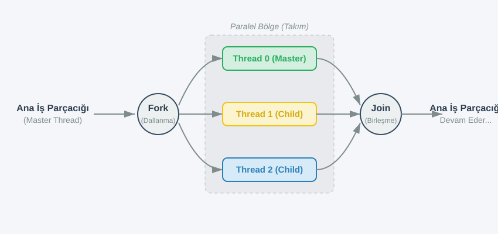
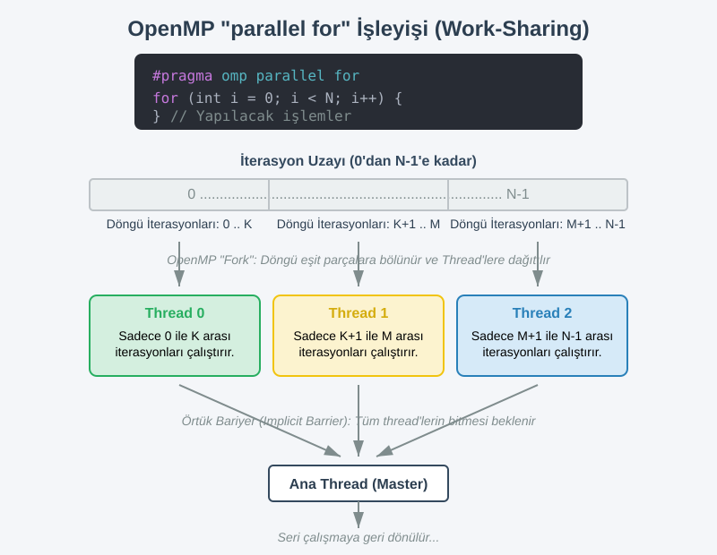
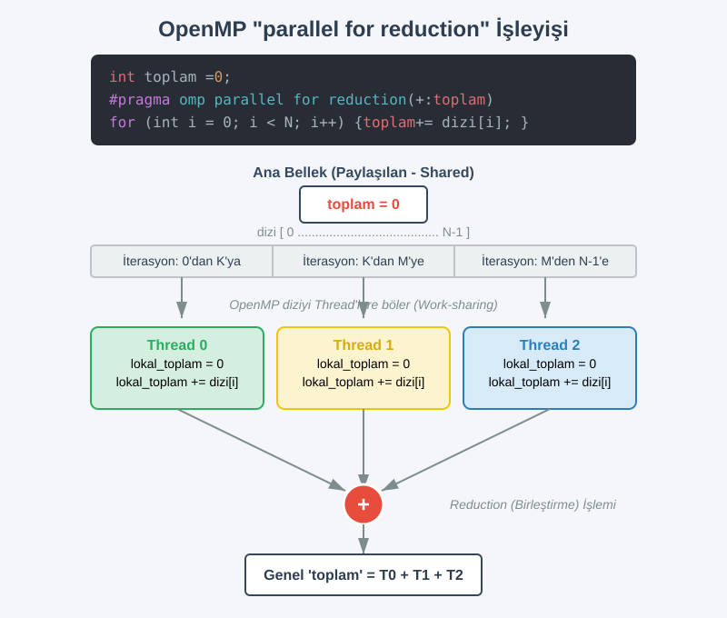

# Bölüm 10 — Paylaşımlı Bellek Programlama ve OpenMP

Hesaplama gerektiren büyük bir işi kısa sürede bitirmenin temel yolu, işi parçalara bölüp eldeki işlemcilere dağıtmaktır.

## 10.1 Süreç ve İş Parçacığı

Büyük bir restoranın her mutfağını kendine ait dolapları, ocağı ve tezgâhı olan kapalı bir birim olarak düşünelim. İşletim sisteminde bu birimlerin her birine **süreç** (process) denir. Farklı mutfaklardaki aşçılar birbirlerinin malzemelerini doğrudan kullanamaz; süreçlerin adres uzayları birbirinden ayrıdır.

Aynı mutfağın içindeki aşçılar ise aynı tezgâhı, buzdolabını ve malzemeleri paylaşır; yalnızca her birinin elinde üzerinde çalıştığı işin tarifi ve kendi bıçağı vardır. Aynı süreç içinde ortak belleği (genel değişkenler ve yığın bellek, heap) paylaşan ancak kendi yürütme sırasına ve kendi çağrı yığınına (stack) sahip olan bu hafif birimlere **iş parçacığı** (thread) denir. İngilizce *thread* "iplik" demektir ve program içindeki bağımsız yürütme akışlarını anlatır. Paylaşımlı bellek programlamanın temeli, iş parçacıklarının ortak bir bellek üzerinde doğru ve uyum içinde çalışmasını sağlamaktır.

## 10.2 OpenMP ve Derleyici Yönergeleri

**OpenMP** (Open Multi-Processing, açık çoklu işleme), paylaşımlı bellekli sistemlerde C, C++ ve Fortran programlarını paralelleştirmek için kullanılan bir uygulama programlama arayüzüdür (Application Programming Interface, API). Derleyici yönergeleri, çalışma zamanı kitaplık işlevleri (`omp_get_thread_num()` gibi) ve ortam değişkenlerinden (`OMP_NUM_THREADS` gibi) oluşur.

OpenMP'de iş parçacıkları doğrudan oluşturulmaz; bunun yerine **pragma** adı verilen derleyici yönergeleri yazılır. *Pragma* sözcüğü Yunanca "iş, eylem" anlamına gelir (*pragmatik* sözcüğü de aynı kökten türemiştir). C ve C++'ta OpenMP yönergeleri `#pragma omp` ile başlar. GCC'de bu yönergeler `-fopenmp` seçeneğiyle etkinleşir. Seçenek verilmezse derleyici bilmediği yönergeleri yok sayar (gerekirse bir uyarı vererek) ve döngüler seri çalışır. Ancak `omp_get_thread_num()` gibi kitaplık işlevleri kullanıldıysa program `-fopenmp` olmadan bağlanamaz; bu durumda `#ifdef _OPENMP` denetimi kullanılmalıdır.

## 10.3 Çatallanma–Birleşme (Fork–Join) Modeli

OpenMP, programın seri ve paralel bölümleri arasındaki geçişi **çatallanma–birleşme** (fork–join) modeliyle tanımlar.





1. **Seri başlangıç:** Program başladığında yalnızca **ana iş parçacığı** (master thread) etkindir ve kodu sırayla yürütür.
2. **Çatallanma (fork):** Ana iş parçacığı bir paralel bölgeye (`#pragma omp parallel`) ulaştığında yeni iş parçacıkları oluşturur.
3. **Paralel bölge ve takım:** Oluşan iş parçacığı kümesine **takım** (team) denir. Takımdaki her iş parçacığı (iş parçacığı 0 ana iş parçacığıdır) paralel bölgedeki kodu aynı anda yürütür.
4. **Birleşme (join) ve örtük engel:** Paralel bölge sona erdiğinde tüm iş parçacıkları bir **örtük engelde** (implicit barrier) birbirini bekler. Takımın tamamı işini bitirince birleşme gerçekleşir ve yalnızca ana iş parçacığı kodu sırayla yürütmeye devam eder.

## 10.4 Döngü Düzeyinde Paralelleştirme

Bilimsel hesaplamada zamanın büyük kısmı `for` döngülerinde geçer. Döngünün iterasyonları birbirine bağımlı değilse döngüyü paralelleştirmek işlem süresini önemli ölçüde kısaltır. Döngünün hemen önüne şu yönerge yazılır:

```c
#pragma omp parallel for
for (int i = 0; i < N; i++) {
    /* Yapılacak işlemler */
}
```

Aşağıdaki şema bu kodun çalışma mantığını, yani iterasyonların iş parçacıkları arasında bölüşülmesini (work-sharing) ve çatallanma–birleşme modelini gösterir. Bu kodda indirgeme (reduction) olmadığı için sonuçları birleştirme adımı yoktur.



1. **Çatallanma:** Ana iş parçacığı `parallel for` yönergesine geldiğinde takımı oluşturur.
2. **İterasyon uzayının bölünmesi (work-sharing):** OpenMP, `0`'dan `N-1`'e kadar olan iterasyonları takımdaki iş parçacıkları arasında paylaştırır. Her iş parçacığı yalnızca kendisine düşen iterasyonlardan sorumludur.
3. **Bağımsız işlemler:** Her iş parçacığı kendi aralığındaki `i` değerleri için döngü gövdesini çalıştırır. Döngü değişkeni `i` otomatik olarak her iş parçacığına özeldir.
4. **Örtük engel ve birleşme:** Döngü tamamlandığında işini erken bitiren iş parçacıkları diğerlerini bekler; ardından ana iş parçacığı seri kodla devam eder.

Örneğin 1000 patatesin soyulması gereksin ve mutfakta dört aşçı (iş parçacığı) bulunsun. Statik bölmede ilk 250 patates birinci aşçıya, ikinci 250 ikinci aşçıya verilir. Hangi bölmenin kullanılacağı `schedule` maddesi belirtilmediğinde derleyiciye bağlıdır; GCC'de varsayılan, iterasyonları eşit bloklara bölen statik bölmedir (Bölüm 10.8).

## 10.5 Veri Paylaşım Kuralları (Data Scoping)

Paylaşımlı bellek programlamanın en hassas noktası, hangi verinin ortak, hangisinin iş parçacığına özel olacağıdır. Bu kurallar dikkatle belirlenmezse aynı bellek bölgesine aynı anda yazmaya çalışan iş parçacıkları **yarış durumu** (race condition) denen, sonucu çalıştırmadan çalıştırmaya değişen hatalara yol açar. Yarış durumu, en az biri yazma olan eşzamanlı ve korumasız erişimlerde ortaya çıkar.

**`shared` (paylaşılan).** Paralel bölgeden önce tanımlanmış değişkenler varsayılan olarak paylaşılır. Bellekte tek kopyaları vardır; tüm iş parçacıkları bu değişkeni görür ve değiştirebilir. Mutfaktaki tek tuzluk gibidir: İki aşçı aynı anda tuzluğa uzanırsa elleri çarpışır. Paylaşılan değişkene birden fazla iş parçacığı yazıyorsa koruma düzenekleri (Bölüm 10.7) gerekir.

**`private` (özel).** Her iş parçacığı değişkenin kendi kopyasını kullanır. Her aşçının kendi bıçağı gibidir. Önemli bir ayrıntı: Özel kopyanın **başlangıç değeri tanımsızdır**; dışarıdaki değer kopyalanmaz ve bölge sonunda dışarıya geri yazılmaz. Paralel döngünün döngü değişkeni ve paralel bölgenin içinde tanımlanan değişkenler kendiliğinden özeldir.

**`firstprivate`.** `private` gibidir; ancak her kopya, paralel bölgeden önceki değerle başlatılır.

**`lastprivate`.** Döngünün sıralı yürütmede **son** olacak iterasyonundaki değer, döngü bitince dışarıdaki değişkene yazılır.

**`default(none)`.** Varsayılan paylaşım kuralını kapatır; bölgede kullanılan her değişkenin paylaşım türünün açıkça yazılmasını zorunlu kılar. Yanlışlıkla paylaşılan değişkenleri derleme aşamasında yakalamanın en güvenli yoludur.

`Uygulamalar/OpenMP/paylasim.c` programının ilk bölümü bu farkları gösterir:

```c
int a = 10, b = 10, c = 10;
#pragma omp parallel for num_threads(4) private(a) firstprivate(b) lastprivate(c)
for (int i = 0; i < 8; i++) {
    a = i;        /* private: giriş değeri tanımsız, önce atanmalı */
    b += i;       /* firstprivate: her kopya 10 ile başlar */
    c = i * i;    /* lastprivate: son iterasyonun (i = 7) değeri dışarı çıkar */
}
```

Ölçülen çıktı: `a = 10 (degismez), b = 10 (degismez), c = 49`. `a` ve `b` dışarıda değişmez; çünkü bölge içindeki işlemler özel kopyalar üzerinde yapılmıştır. `c` ise son iterasyonun değerini ($7^2 = 49$) alır.

## 10.6 İndirgeme (Reduction)

**İndirgeme**, bir veri kümesini belirli bir işlemle tek bir sonuca dönüştürmektir. Terim Latince *reducere* (geri getirmek, küçültmek) kökünden gelir.

Örneğin tüm aşçıların soyduğu toplam patates sayısı bulunmak istensin. Herkes aynı "toplam" (paylaşılan) değişkene ekleme yapmaya kalkarsa yarış durumu oluşur. Bunun yerine her aşçı önce kendi özel sayacında sayar; mesai bitiminde herkes kendi sonucunu güvenli biçimde ana toplama ekler. OpenMP'de bu tek satırla yapılır:

```c
long long toplam = 0;
#pragma omp parallel for reduction(+:toplam)
for (int i = 0; i < N; i++) {
    toplam += dizi[i];
}
```



Her iş parçacığı, işlecin etkisiz elemanıyla başlatılan özel bir kopya üzerinde çalışır; döngü sonunda kopyalar işleçle birleştirilip özgün değişkene eklenir. C ve C++ için tanımlı indirgeme işleçleri şunlardır:

| İşleç | Anlamı | Özel kopyanın başlangıç değeri |
| :---: | :--- | :--- |
| `+` | toplama | 0 |
| `*` | çarpma | 1 |
| `-` | çıkarma (kopyalar toplanarak birleştirilir; OpenMP 5.2'de kullanımdan kaldırılmıştır) | 0 |
| `&` | bitsel VE | tüm bitleri 1 (`~0`) |
| `\|` | bitsel VEYA | 0 |
| `^` | bitsel dışlayıcı VEYA | 0 |
| `&&` | mantıksal VE | 1 |
| `\|\|` | mantıksal VEYA | 0 |
| `max` | en büyük (OpenMP 3.1 ve sonrası) | türün en küçük değeri |
| `min` | en küçük (OpenMP 3.1 ve sonrası) | türün en büyük değeri |

Kayan noktalı sayılarda indirgeme, toplama sırasını değiştirdiği için seri sonuçtan son basamaklarda farklı bir sonuç verebilir (bkz. `Uygulamalar/uygulamalar.md`, Örnek 2).

## 10.7 Yarış Durumu ve Eşzamanlama: `critical` ve `atomic`

Paylaşılan bir değişkene bir iş parçacığı yazmayı bitirmeden diğerinin müdahale etmesi engellenmelidir. Bu tür koruma gerektiren kod bölümlerine **kritik bölge** (critical section) denir. Yemekhanede tek bir kasiyer varken herkesin sırayla ödeme yapması buna benzer.

**`critical` yönergesi.** Blok içindeki kodun aynı anda yalnızca bir iş parçacığı tarafından yürütülmesine izin verir. İstenilen uzunlukta bir kod bloğunu koruyabildiği için esnektir; ancak bir kilit (lock) kullandığından maliyetlidir. Adı verilmemiş tüm `critical` bölgeleri programın tamamında **aynı** kilidi paylaşır; birbirinden bağımsız bölgeler için `#pragma omp critical(ad)` biçiminde ad verilmelidir.

```c
#pragma omp parallel for
for (int i = 0; i < N; i++) {
    double val = agir_hesaplama(i);
    #pragma omp critical
    {
        global_liste[boyut++] = val;   /* aynı anda tek iş parçacığı yazar */
    }
}
```

`agir_hesaplama(i)` çağrısı kritik bölgenin dışında olduğu için paralel çalışmaya devam eder; yalnızca listeye ekleme sırayla yapılır. Böylece işin büyük bölümü korumasız ve paralel biçimde yürür.

**`atomic` yönergesi.** Tek bir bellek güncellemesini (okuma–değiştirme–yazma) bölünmez kılar. Donanımın atomik komutlarına (örneğin x86 üzerinde `LOCK XADD`) dönüştürüldüğü için `critical`'a göre çok daha ucuzdur; ancak yalnızca skaler bir değişken üzerindeki basit güncellemeleri (`x += ifade`, `x++` gibi) destekler.

```c
int sayac = 0;
#pragma omp parallel for
for (int i = 0; i < N; i++) {
    if (kosul(i)) {
        #pragma omp atomic
        sayac++;
    }
}
```

**Ölçülmüş karşılaştırma.** `Uygulamalar/OpenMP/yaris.c` programı $0 + 1 + \dots + (N-1)$ toplamını ($N = 2 \times 10^7$) dört yolla hesaplar. Bölüm 4.5'teki makinede 8 iş parçacığıyla elde edilen sonuçlar:

| Yöntem | Sonuç | Süre (s) | Doğru mu? |
| :--- | ---: | ---: | :---: |
| korumasız | 68 749 997 500 000 | 0.018 | hayır |
| `atomic` | 199 999 990 000 000 | 0.463 | evet |
| `critical` | 199 999 990 000 000 | 1.142 | evet |
| `reduction` | 199 999 990 000 000 | 0.004 | evet |

Beklenen toplam 199 999 990 000 000'dur. Korumasız sürüm güncellemelerin bir kısmını kaybeder; ikinci bir çalıştırmada aynı program 9 374 998 750 000 sonucunu vermiştir. Yarış durumunun sonucu her çalıştırmada değişebilir. `atomic` ve `critical` doğru sonuç verir, ancak her iterasyonda eşzamanlama yaptıkları için seri koddan bile yavaştır. `reduction` hem doğru hem de en hızlıdır (bu platformda `omp_get_wtime()` çözünürlüğü yaklaşık 1 ms olduğundan çok kısa süreler yaklaşık değerlerdir).

Hangisi ne zaman kullanılır? Bir toplama ya da benzer bir birleştirme varsa `reduction`; tek bir değişken üzerinde seyrek ve basit güncelleme varsa `atomic`; birden fazla değişkeni ya da karmaşık bir veri yapısını etkileyen bloklar için `critical`.

## 10.8 Zamanlama (Scheduling)

OpenMP bir döngüyü iş parçacıklarına dağıtırken hangi iş parçacığının hangi iterasyonları alacağını `schedule` maddesi (clause) belirler. Doğru seçim, iterasyonların iş yüküne ve bu yükün iterasyonlar arasında ne kadar değiştiğine bağlıdır.

```c
#pragma omp parallel for schedule(tür, yığın_boyutu)
for (int i = 0; i < N; i++) { ... }
```

**`static`.** İterasyonlar döngü başlamadan önce bloklara bölünür ve iş parçacıklarına sabit biçimde atanır. `schedule(static, B)` yazıldığında $B$ boyutlu bloklar iş parçacıklarına sırayla (döngüsel olarak) dağıtılır; boyut belirtilmezse iterasyonlar yaklaşık $N/p$ boyutlu eşit bloklara bölünür. Çalışma zamanında karar verilmediği için ek yükü en düşüktür. Her iterasyon yaklaşık aynı süreyi alıyorsa en iyi seçimdir. Dört aşçıya 400 patatesi 100'er adetlik eşit paketler hâlinde vermek gibidir.

**`dynamic`.** İş parçacıkları ellerindeki işi bitirdikçe çalışma zamanından yeni bir blok ister. Her istek küçük bir eşzamanlama maliyeti doğurur; buna karşılık yük dengesizliğini kendiliğinden giderir. Blok boyutu belirtilmezse **1** kullanılır. Küçük blok dengelemeyi iyileştirir ama ek yükü artırır.

**`guided`.** Blok boyutu, kalan iterasyon sayısının iş parçacığı sayısına bölümüyle orantılıdır; başta büyük bloklar dağıtılır, bloklar giderek küçülür (belirtilen boyutun altına inmez). Büyük ilk bloklar ek yükü azaltır, küçük son bloklar bitiş zamanlarını dengeler.

**`runtime` ve `auto`.** `schedule(runtime)` seçimi programı yeniden derlemeden `OMP_SCHEDULE` ortam değişkeniyle yapmayı sağlar (örneğin `OMP_SCHEDULE="dynamic,16"`). `schedule(auto)` ise kararı derleyiciye ve çalışma zamanına bırakır.

| Zamanlama | Dağıtım | Ek yük | Ne zaman? |
| :--- | :--- | :--- | :--- |
| `static` | Önceden, eşit bloklar | En düşük | İterasyonlar eşit ağırlıkta |
| `dynamic` | Çalışma zamanında, istek üzerine | Orta–yüksek | Değişken ve öngörülemeyen yük |
| `guided` | Büyükten küçüğe bloklar | Orta | Değişken yük, daha az eşzamanlama |
| `runtime` | `OMP_SCHEDULE`'a göre | Seçime bağlı | Deneme ve ayar yaparken |

**Ölçülmüş karşılaştırma.** `Uygulamalar/OpenMP/zamanlama.c` programında $i$'inci iterasyonun maliyeti $i$ ile orantılıdır (üçgen iş yükü, $N = 20\,000$); son iterasyonlar ilk iterasyonlardan çok daha ağırdır. Bölüm 4.5'teki makinede 4 iş parçacığıyla ölçülen süreler:

| `schedule` | Süre (s) |
| :--- | ---: |
| seri | 6.967 |
| `static` (varsayılan bloklar) | 3.591 |
| `static,1` | 2.291 |
| `dynamic,1` | 2.057 |
| `dynamic,64` | 1.943 |
| `guided` | 2.085 |
| `runtime` (`OMP_SCHEDULE` tanımsız) | 1.904 |

İdeal süre $6.967/4 \approx 1.74$ s'dir. Varsayılan statik bölmede son bloğu alan iş parçacığı toplam işin yaklaşık $7/16$'sını üstlendiğinden süre idealin iki katına yaklaşır. `static,1` iterasyonları döngüsel dağıttığı için yükü büyük ölçüde dengeler; `dynamic` ve `guided` ise ideale en çok yaklaşır. 8 iş parçacığıyla yapılan bir ölçümde aynı sıralama korunmuş, ancak süreler Hyper-Threading nedeniyle daha az kısalmıştır (static: 2.285 s, dynamic,1: 1.289 s). Ölçümler birkaç on yüzde değişkenlik gösterebilir.

Doğru zamanlama seçimi çoğu zaman döngü gövdesini değiştirmeden ölçülebilir bir kazanç sağlar. Profil çıkarma sonucunda yük dengesizliği görülüyorsa `static`'ten `dynamic` ya da `guided`'a geçmek düşük maliyetli ilk adım olmalıdır.

## 10.9 `nowait` ve Engel Yönetimi

Her `omp for` iş paylaşım yapısının sonunda örtük bir engel bulunur: Tüm iş parçacıkları o noktada birbirini bekler. Bu davranış doğruluk açısından güvenlidir, ancak bazı durumlarda gereksiz beklemeye yol açar. Birbirinden bağımsız iki ardışık döngüde ilk döngüye `nowait` eklenerek engel kaldırılabilir:

```c
#pragma omp parallel
{
    #pragma omp for nowait
    for (int i = 0; i < N; i++) {
        A[i] = f(i);           /* B[] dizisinden bağımsız */
    }
    #pragma omp for
    for (int i = 0; i < N; i++) {
        B[i] = g(i);           /* bu döngünün sonunda engel vardır */
    }
}
```

İki döngünün verisi birbirinden bağımsızsa bu düzenleme boşta beklemeyi ortadan kaldırır. İkinci döngü ilk döngünün sonuçlarını okuyorsa `nowait` bir yarış durumuna yol açar; bu nedenle veri akışı dikkatle incelenmeden kullanılmamalıdır.

## 10.10 Yanlış Paylaşım (False Sharing)

Önbellek tutarlılığı (cache coherence) önbellek satırı düzeyinde sağlanır (Bölüm 6.3). Farklı iş parçacıkları **farklı** değişkenlere yazsa bile bu değişkenler aynı 64 baytlık satırdaysa, satır çekirdekler arasında sürekli el değiştirir. Mantıksal olarak hiçbir veri paylaşılmadığı hâlde ortaya çıkan bu yavaşlamaya **yanlış paylaşım** (false sharing) denir.

`Uygulamalar/OpenMP/paylasim.c` programının ikinci bölümünde her iş parçacığı kendi sayacını $10^8$ kez artırır. Sayaçlar önce bitişik bir dizide (aynı önbellek satırında), sonra her biri 64 baytlık ayrı bir satıra yerleştirilecek biçimde dolgulu (padded) bir yapıda tutulur:

```c
typedef struct {
    volatile long deger;
    char dolgu[64 - sizeof(long)];   /* her sayaç ayrı önbellek satırında */
} DolguluSayac;
```

Bölüm 4.5'teki makinede ölçülen süreler:

| İş parçacığı | Bitişik sayaçlar (s) | Dolgulu sayaçlar (s) | Oran |
| :---: | ---: | ---: | :---: |
| 4 | 0.421 | 0.274 | 1.5 |
| 8 | 0.561 | 0.333 | 1.7 |

Yalnızca veri yerleşimi değiştirilerek program 1.5–2 kat hızlanmıştır (8 iş parçacığıyla tekrarlanan bir ölçümde oran 2.0 çıkmıştır). Çözüm yolları: değişkenleri ayrı önbellek satırlarına dolgulamak, her iş parçacığının yerel bir değişkende biriktirip sonuçları en sonda yazması ya da doğrudan `reduction` kullanmaktır.

---

[← Bölüm 9 — Paralel Algoritma Tasarımı ve Görev Bağımlılıkları](09-paralel-algoritma-tasarimi.md) · [İçindekiler](../Ders_Notu.md) · [Kaynaklar →](kaynaklar.md)
