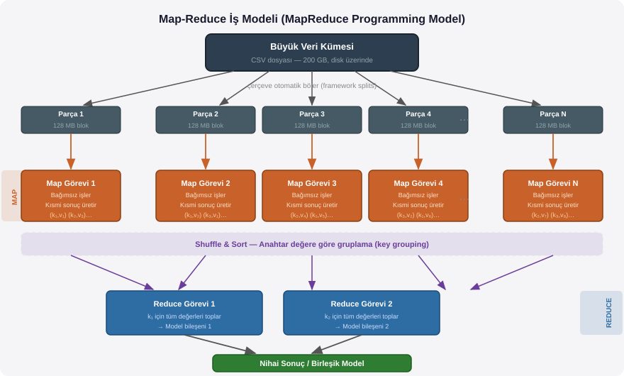
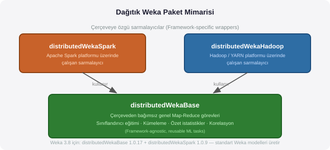
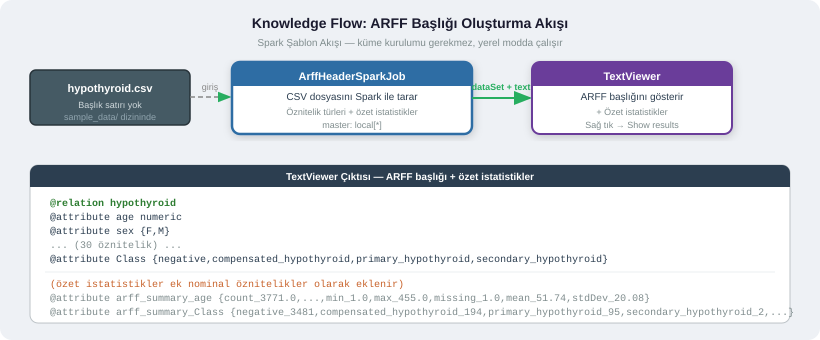
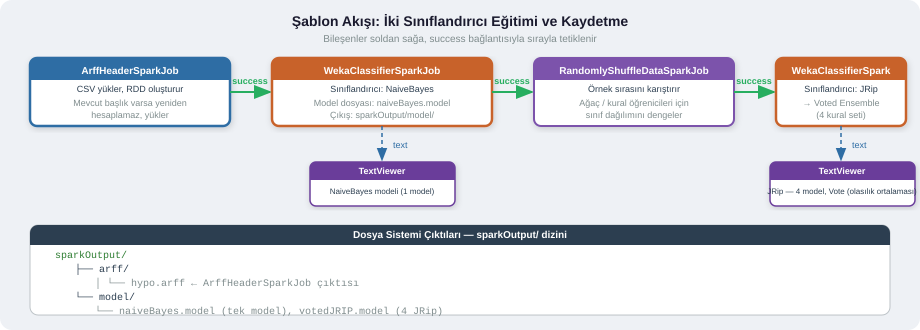
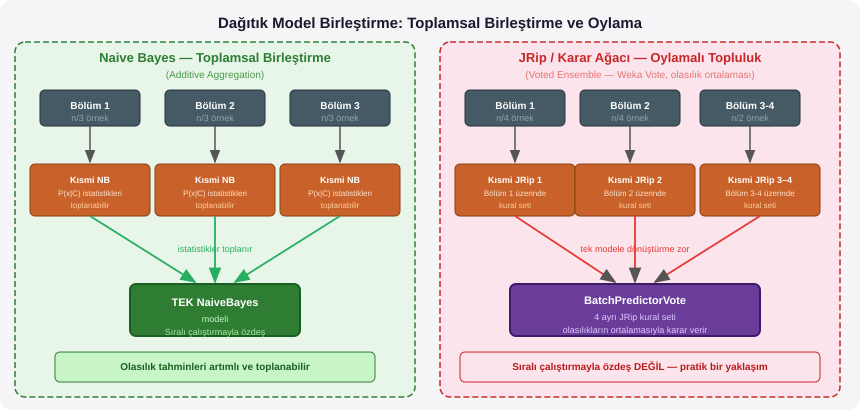
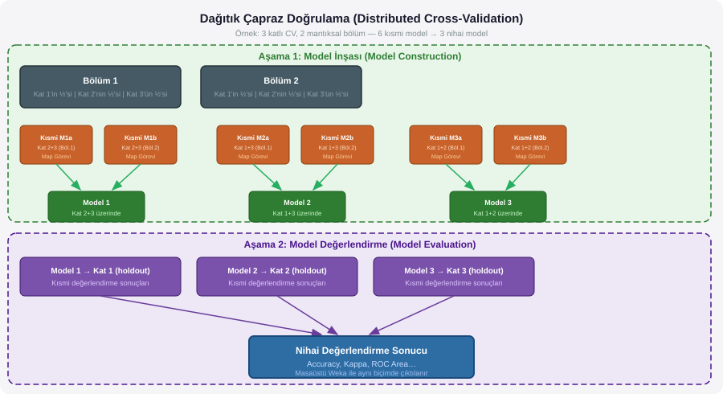

# Dağıtık Weka ile Apache Spark: Temel Kavramlar ve İlk Adımlar

> **Sürüm notu.** Bu notlar Weka 3.8.x ile uyumlu **`distributedWekaSpark` 1.0.9** paketine (bağımlılığı `distributedWekaBase` 1.0.17) göre hazırlanmıştır. Sınıf adları, şablon adları ve varsayılan yollar bu paketin kaynak kodundan ve paket içindeki Knowledge Flow şablonlarından doğrulanmıştır. Aynı yazarın `distributedWekaSparkDev` paketi bu çalışmanın geliştirme devamıdır (Spark DataFrame kaynakları ve MLlib desteği ekler); bu notlarda kullanılmaz. Paketin 1.1.x sürümleri Weka 3.9 (geliştirici sürümü) gerektirir.

## Sorun: Veri Masaüstüne Sığmıyor

Bir veri kümesi 200 GB büyüklüğündeyse ve makinenin belleği (RAM) 32 GB ise, tek bir Weka oturumunda bu veriyle çalışmak mümkün değildir. Sorun kolayca görülür, ancak çözümü biraz düşünce gerektirir.

İki çözüm yolu vardır. Birincisi daha güçlü bir makine almak, yani **dikey büyümektir** (vertical scaling). Bu yol bir noktada teknik ve ekonomik sınıra dayanır; hiçbir masaüstü yüz terabaytlık veriyi belleğe sığdıramaz. İkincisi veriyi birden fazla makineye dağıtıp hesabı paralel yürütmek, yani **yatay büyümektir** (horizontal scaling). Dağıtık Weka (Distributed Weka), bu ikinci yolun Weka ekosistemindeki uygulamasıdır.

Dağıtık işleme, bir algoritmanın tek makinede çok uzun sürdüğü durumlarda da kullanılır. Büyük bir Rastgele Orman (Random Forest) modelini yüz milyon örnek üzerinde eğitmek tek bir süreçte saatler alabilir; aynı iş paralel makinelerde çok daha kısa sürede tamamlanabilir.

---

## Veri Akışı Madenciliğinden Farkı

Önceki derslerde MOA (Massive Online Analysis, büyük ölçekli çevrimiçi analiz) çerçevesi ve veri akışı madenciliği (data stream mining) ele alınmıştı. O yaklaşımda algoritmalar sıralı (sequential) ve çevrimiçi (online) çalışır: Bir örnek gelir, işlenir, model güncellenir, ardından sıradaki örnek işlenir. Veri hiçbir zaman toplu olarak yüklenmediği için bellek taşmaz.

Dağıtık Weka farklı bir senaryoyu hedefler. Burada veri büyüktür ama **sabittir** (çevrimdışı, toplu; offline, batch): diske yazılmış çok büyük bir CSV dosyası. Amaç bu verinin tamamını işleyerek bir model elde etmektir. Bu durumda dağıtık toplu işleme (distributed batch processing) gerekir. Fark, bir fabrikada konveyör bantla gelen parçaları tek tek işlemek ile büyük bir depodaki tüm parçaları aynı anda birden fazla tezgâhta işlemek arasındaki farka benzer.

---

## MapReduce: İki Aşamalı İş Modeli

Dağıtık hesaplama çerçevelerinin önemli bir kısmı **MapReduce** (Türkçede "Eşle–İndirge" olarak karşılanabilir) programlama modeline dayanır (Dean ve Ghemawat, 2008). Adı, işlevsel programlamadaki *map* (her öğeye bir işlev uygulama, eşleme) ve *reduce* (öğeleri tek bir sonuçta birleştirme, indirgeme) işlemlerinden gelir. Hadoop MapReduce modeli doğrudan uygular; Spark ise bu modeli daha genel bir işlem çizgesine (DAG) genişletir.



### Map Aşaması

Çerçeve, büyük veri kümesini birbirinden bağımsız parçalara (split) böler ve her parçayı ayrı bir işlem düğümüne gönderir. Her **map görevi** (map task) yalnızca kendi parçasını görür ve diğer görevlerin ne yaptığından habersizdir. Bu bağımsızlık sayesinde map görevleri birbirini beklemeden paralel çalışır.

Map görevlerinin çıktısı **anahtar–değer çiftleridir** (key-value pairs). Örneğin her map görevi kendi parçasındaki örneklerden kısmi bir model ya da özet istatistik hesaplar ve bunu bir anahtarla etiketler.

Mutfak benzetmesiyle: Yüz masalık bir siparişi karşılamak için hazırlık işi birden fazla aşçıya bölünür. Her aşçı kendi bölümündeki malzemeyi bağımsız olarak doğrar, pişirir ve tepsilere koyar.

### Karıştırma (Shuffle) ve Sıralama (Sort)

Map aşamasının çıktıları anahtarlarına göre gruplanır ve sıralanır; aynı anahtara ait tüm kısmi sonuçlar aynı yere getirilir. Bu adıma **karıştırma** (shuffle) denir. Veri ağ üzerinden taşındığı için genellikle en maliyetli adımdır.

### Reduce Aşaması

**Reduce görevi** (reduce task), belirli bir anahtara ait tüm kısmi sonuçları alıp birleştirir: toplar, ortalamasını alır ya da başka bir birleştirme (aggregation) işlemi uygular. Çıktı nihai sonuçtur; makine öğrenmesinde bu bir model, bir istatistik ya da bir değerlendirme raporu olabilir. Restoran benzetmesiyle, şef aşçıların hazırladığı tepsileri birleştirerek yemeği servis eder.

Çerçeve veriyi bölmeyi, görevleri başlatıp izlemeyi ve hata durumunda görevleri yeniden başlatmayı kendisi üstlenir. Bir düğüm çökerse işi başka bir düğüm devralır. Bu **hata toleransı** (fault tolerance) MapReduce'un temel güçlerinden biridir.

### Spark'ın Farkı

Hadoop MapReduce, aşamalar arasındaki ara sonuçları diske (HDFS'e) yazar. Makine öğrenmesi algoritmaları genellikle aynı veri üzerinden defalarca geçer; her geçişte diskten okumak başarımı ciddi biçimde düşürür. Spark ara sonuçları mümkün olduğunca bellekte tutar; bu nedenle yinelemeli (iterative) öğrenme algoritmalarında Hadoop MapReduce'tan çok daha hızlıdır.

---

## Dağıtık Weka Paket Yapısı

Dağıtık Weka iki katmanlı bir paket mimarisinden oluşur.



**`distributedWekaBase`**, belirli bir dağıtık sisteme bağlı olmayan genel görevleri içerir: CSV'den ARFF başlığı ve özet istatistik üretimi, sınıflandırıcı eğitimi ve değerlendirmesi, korelasyon matrisi, k-ortalamalar kümelemesi. Bu görevler bir soyutlama katmanı işlevi görür.

**`distributedWekaSpark`**, bu görevleri Apache Spark üzerinde çalıştıran bir sarmalayıcıdır (wrapper); Spark'a özgü veri yapılarını ve iletişimi yönetir. Benzer biçimde Hadoop için `distributedWekaHadoop` paketleri vardır.

Bu ayrımın pratik anlamı şudur: Temel algoritmalar bir kez yazılır, her çerçeve için yeniden yazılmaz. Yeni bir dağıtık platform desteği eklemek için yalnızca yeni bir sarmalayıcı yazmak yeterlidir.

---

## Tasarım Hedefleri

**Tanıdık deneyim.** Dağıtık Weka'nın çıktıları masaüstü Weka'nınkilerle aynı biçimdedir. Üretilen modeller standart Weka modelleridir: dosyaya kaydedilebilir, masaüstü Weka'ya yüklenebilir ve tahmin için kullanılabilir.

**Her sınıflandırıcı çalışabilir.** Weka'daki herhangi bir sınıflandırıcı ya da regresyon yöntemi dağıtık ortamda kullanılabilir. Kısaca, her veri parçası üzerinde bağımsız bir model eğitilir ve bu modeller birleştirilir (ayrıntılar aşağıda).

**Algoritmaya özgü dağıtık uygulamalar.** Her algoritmanın ayrı bir dağıtık sürümünü yazmak başlangıç hedefleri arasında değildi. İstisnalardan biri k-ortalamalar (k-means) kümelemesidir; algoritma doğası gereği yinelemeli olduğundan Spark ve Hadoop üzerinde çalışacak biçimde özel olarak yazılmıştır.

---

## Kurulum

### Paket Yöneticisinden Kurulum

Weka'yı başlatın. Karşınıza **GUI Chooser** penceresi çıkar. Menü çubuğundan **Tools → Package Manager** seçin.

1. Listede `distributedWekaSpark` paketini bulun ve satırına tıklayın; paket açıklaması alt panelde görünür.
2. **Install** düğmesine tıklayın.
3. Weka, `distributedWekaBase` bağımlılığının da kurulacağını bildirir; onay verin. İki paket birlikte indirilip kurulur.

> İndirme tamamlanana kadar Package Manager penceresini kapatmayın. Paket yaklaşık 60 MB büyüklüğündedir ve yerel modda çalışmak için gereken Spark 1.1.1 kitaplıklarını içerir; ayrıca Spark kurmanız gerekmez.

### Yeniden Başlatma

Kurulum bittikten sonra Package Manager penceresini ve Weka GUI Chooser'ı kapatıp Weka'yı yeniden başlatın; yeni paketler ancak bu adımdan sonra etkin olur.

### Kurulumun Doğrulanması

GUI Chooser'da **KnowledgeFlow** düğmesine tıklayın. Sol taraftaki **Design** paletinde **Spark** adlı bir klasör görünüyorsa kurulum başarılıdır. Klasör şu bileşenleri (step) içerir:

- `ArffHeaderSparkJob`
- `WekaClassifierSparkJob`
- `WekaClassifierEvaluationSparkJob`
- `WekaScoringSparkJob`
- `CorrelationMatrixSparkJob`
- `RandomizedDataSparkJob`
- `KMeansClustererSparkJob`

Ayrıca **Templates** menüsünde `Spark:` ile başlayan hazır akışlar listelenir.

---

## Neden CSV? ARFF Değil?

Hadoop ve Spark, büyük dosyaları **bloklara** (block) bölerek kümedeki farklı disklere dağıtır. Bunun iki amacı vardır: büyük dosyaların dağıtık olarak saklanması ve **veri yerelliği** (data locality), yani veriyi ağ üzerinden taşımak yerine hesabı verinin bulunduğu makineye götürmek. Her düğüm kendi diskindeki bloğu işler.

ARFF biçimi burada sorun çıkarır. Bir ARFF dosyasının **başlık bilgisi** (header) — öznitelik adları, türleri ve kategorik değerlerin listesi — yalnızca dosyanın başındadır. Dosya bloklara bölündüğünde bu bilgi yalnızca **ilk blokta** bulunur; diğer bloklar ne tür veri içerdiklerini bilmez.

Bir gazetenin içindekiler sayfası yalnızca ilk sayfada olsun ve gazete kırk parçaya bölünüp kırk okuyucuya dağıtılsın. Okuyuculardan otuz dokuzu hangi haberin hangi bölümde olduğunu bilemez.

CSV (Comma-Separated Values, virgülle ayrılmış değerler) dosyalarında her satır kendi başına bir kayıttır ve başlık bilgisi içermez; bu nedenle bloklara bölünmeye uygundur. Dağıtık Weka bu yüzden CSV dosyalarıyla çalışır ve ARFF başlığını ayrı bir iş adımında (`ArffHeaderSparkJob`) bütün veriyi tarayarak oluşturur. Başlık bir kez oluşturulup saklanır; sonraki işler onu yeniden hesaplamadan kullanır.

---

## Örnek Veri Kümesi: Hypothyroid

Bu derste UCI Machine Learning Repository'deki **hypothyroid** (hipotiroidi, tiroit bezinin yetersiz çalışması) veri kümesi kullanılır. Klinik bir sınıflandırma problemidir: Hastanın yaşı, cinsiyeti ve çeşitli tıbbi ölçümleri kullanılarak tiroit hastalığının türü tahmin edilir.

| Özellik | Değer |
| :--- | :---: |
| Örnek sayısı | 3772 |
| Öznitelik sayısı (sınıf dahil) | 30 |
| Sınıf sayısı | 4 |

Sınıf dağılımı dengesizdir; bu, gerçek dünya verilerinde çok sık karşılaşılan bir durumdur:

| Sınıf | Sayı |
| :--- | ---: |
| `negative` (hastalık yok) | 3481 |
| `compensated_hypothyroid` | 194 |
| `primary_hypothyroid` | 95 |
| `secondary_hypothyroid` | 2 |

Verinin başlık satırı olmayan CSV sürümü ve öznitelik adlarını içeren `hypothyroid.names` dosyası, kurulan paketin `sample_data/` dizinindedir:

- **Linux / macOS:** `~/wekafiles/packages/distributedWekaSpark/sample_data/`
- **Windows:** `C:\Users\<KullanıcıAdı>\wekafiles\packages\distributedWekaSpark\sample_data\`

ARFF sürümü Weka kurulum dizinindeki `data/hypothyroid.arff` dosyasıdır; veriyi Explorer'da incelemek için bu sürüm kullanılabilir.

---

## Knowledge Flow ile İlk İş: ARFF Başlığı Oluşturma

### Şablon Akışlar

`distributedWekaSpark` paketi hazır şablon akışlarla (template flows) gelir. Bu akışlar Spark kümesi kurmadan doğrudan çalıştırılabilir; Spark'ın **yerel modu** (`local[*]`) makinenin tüm işlemci çekirdeklerini işçi olarak kullanır. Paketteki şablonlar şunlardır:

| Şablon adı | İçerik |
| :--- | :--- |
| Spark: create an ARFF header | Başlık ve özet istatistik üretimi |
| Spark: create header with quartiles and graphs | Başlığa çeyrek değerler ekler, öznitelik grafiklerini çizer |
| Spark: compute a correlation matrix and run PCA | Korelasyon matrisi ve temel bileşenler analizi |
| Spark: train and save two classifiers | İki sınıflandırıcı eğitip kaydeder |
| Spark: cross-validate two classifiers | İki sınıflandırıcıyı çapraz doğrulamayla değerlendirir |
| Spark: run k-means parallel | k-ortalamalar (k-means‖ başlatmalı) kümeleme |
| Spark: train a random forest and score data | Rastgele orman eğitip veriyi puanlar (scoring) |

Şablonu yüklemek için Knowledge Flow araç çubuğundaki **Templates** düğmesine tıklayın ve **"Spark: create an ARFF header"** satırını seçin. Tuvale iki bileşen yerleşir: `ArffHeaderSparkJob` ve `TextViewer`; aralarında bir bağlantı oku bulunur.

### Akış Yapısı



1. **`ArffHeaderSparkJob`** — CSV dosyasını Spark üzerinden tarayarak ARFF başlığını ve özet istatistikleri hesaplar.
2. **`TextViewer`** — Sonucu metin olarak görüntüler.

Şablonda `ArffHeaderSparkJob` ile `TextViewer` arasında iki bağlantı vardır: `dataSet` (oluşturulan başlık bir veri kümesi nesnesi olarak) ve `text` (aynı başlık metin olarak). Spark işlerini birbirine bağlayan bağlantı türü ise `success`'tir; bkz. sonraki bölümler.

### Ayarların Kontrol Edilmesi

Şablonlar, örnek veri için gereken ayarlarla hazır gelir. Çalıştırmadan önce ayarları görmek için tuvaldeki `ArffHeaderSparkJob` kutusuna çift tıklayın. Açılan pencerede iki sekme vardır:

1. **Spark configuration** sekmesi:
   - **inputFile:** `${WEKA_HOME}/packages/distributedWekaSpark/sample_data/hypothyroid.csv`
   - **outputDir:** `${user.home}/sparkOutput` — çıktıların yazılacağı dizin; çalışma sırasında kendiliğinden oluşturulur.
   - **masterHost:** `local[*]` — yerel mod, tüm çekirdekler.
   - **minInputSlices:** `4` — verinin en az kaç bölüme (partition) ayrılacağı.
2. **ArffHeaderSparkJob** sekmesi:
   - **attributeNamesFile:** `hypothyroid.names` dosyasının yolu. Bu dosya her satırda bir öznitelik adı içerir; Weka sütunları bu adlarla etiketler.
   - **outputHeaderFileName:** `hypo.arff`.

`${WEKA_HOME}` Weka'nın paket dizinini (`wekafiles`), `${user.home}` ise kullanıcının ev dizinini gösteren ortam değişkenleridir. Kendi verinizle çalışırken bu alanları değiştirmeniz yeterlidir.

### Akışın Çalıştırılması

Araç çubuğundaki **çalıştır** (▶) düğmesine tıklayın. Spark çok sayıda günlük (log) satırı üretir; işin durumu Knowledge Flow'un alt kısmındaki günlük panelinden izlenebilir. İş bittiğinde günlükte Spark bağlamının (`SparkContext`) kapatıldığına ilişkin bir satır görülür. `SparkContext`, Spark'ın bir uygulamayı yürütmek için oluşturduğu merkezi nesnedir.

### Sonuçların Okunması

`TextViewer` bileşenine sağ tıklayıp **Show results** seçin. Çıktı standart bir ARFF başlığıdır; ancak her özniteliğin özet istatistikleri, adı `arff_summary_` ile başlayan ek nominal öznitelikler olarak başlığa eklenmiştir. Kısaltılmış biçimi şöyledir (değerler, `sample_data/hypothyroid.csv` dosyasından ayrıca hesaplanarak doğrulanmış ve yuvarlanmıştır):

```text
@relation hypothyroid

@attribute age numeric
@attribute sex {F,M}
...
@attribute Class {negative,compensated_hypothyroid,primary_hypothyroid,secondary_hypothyroid}
@attribute arff_summary_age {count_3771.0,sum_195096.0,sumSq_11614302.0,min_1.0,max_455.0,missing_1.0,mean_51.74,stdDev_20.08}
@attribute arff_summary_sex {F_2480,M_1142,**missing**_150}
...
@attribute arff_summary_Class {negative_3481,compensated_hypothyroid_194,primary_hypothyroid_95,secondary_hypothyroid_2,**missing**_0}

@data
```

**Sayısal öznitelikler için** adet (count), toplam (sum), kareler toplamı (sumSq), en küçük (min), en büyük (max), eksik değer sayısı (missing), ortalama (mean) ve standart sapma (stdDev) hesaplanır. Kareler toplamının saklanması rastlantı değildir: Ortalama ve standart sapma, parçalar üzerinde ayrı ayrı hesaplanan adet, toplam ve kareler toplamının basitçe toplanmasıyla elde edilebilir. Bu, MapReduce'a uygun bir istatistiktir.

**Nominal öznitelikler için** her değerin kaç kez geçtiği (frekans dağılımı) ve eksik değer sayısı hesaplanır. Sınıf özniteliğinde `negative` sınıfının baskınlığı hemen görülür.

**Özet istatistiklerin öğrettiği ilk ders: aykırı değer.** `age` özniteliğinin en büyük değeri **455**'tir. Bir insanın 455 yaşında olamayacağı açıktır; bu bir veri giriş hatasıdır ve verideki 3771 yaş değerinden yalnızca biridir (diğer en büyük değerler 93–94). Tek bir aykırı değer, ortalamayı 51,63'ten 51,74'e, standart sapmayı ise 18,98'den 20,08'e çıkarmaktadır. Büyük veri kümelerinde veriyi satır satır incelemek mümkün olmadığından, ilk özet istatistiklere bakarak bu tür hataları yakalamak veri hazırlamanın vazgeçilmez adımıdır.

### Bu İş Neden Önemli?

ARFF başlığı sonraki tüm Spark işlerinin **ön koşuludur**. Sınıflandırıcı eğitimi ya da değerlendirme işleri, CSV verisini doğru yorumlayabilmek için öznitelik bilgisine ihtiyaç duyar. Başlık bir kez üretilip diske (`sparkOutput/arff/hypo.arff`) kaydedildiğinde sonraki işler onu yeniden hesaplamak zorunda kalmaz; bu, büyük veri kümelerinde önemli bir zaman tasarrufudur.

---

## İşlerin Yapılandırılması

Her Spark bileşeni bağımsız olarak yapılandırılabilir. Bir bileşene çift tıklandığında ya da sağ tıklanıp **Configure...** seçildiğinde bir yapılandırma penceresi açılır.

### Spark Configuration Sekmesi

İlk sekme Spark altyapısına ait genel ayarları içerir:

| Parametre | Açıklama |
| :--- | :--- |
| **inputFile** | İşlenecek CSV dosyasının yolu (yerel yol ya da `hdfs://...`) |
| **outputDir** | Sonuçların yazılacağı dizin (yerel ya da HDFS yolu) |
| **masterHost** | Spark ana sürecinin adresi. Yerel çalışma için `local[*]` (tüm çekirdekler) ya da `local[4]` (dört iş parçacığı) |
| **masterPort** | Gerçek bir kümede ana sürecin dinlediği port (bağımsız Spark kümesinde varsayılan 7077) |
| **minInputSlices** | Verinin en az kaç mantıksal bölüme (partition) ayrılacağı; paralellik derecesini belirler |
| **maxInputSlices** | Bölüm sayısının üst sınırı |

`minInputSlices`, aynı anda kaç görevin çalışabileceğini doğrudan etkiler. Örneğin 25 makineli ve her biri 4 çekirdekli bir kümede en az 100 bölüm kullanmak, tüm çekirdeklere aynı anda iş verilmesini sağlar.

### İşe Özgü Sekmeler

`ArffHeaderSparkJob` dışındaki işlerin penceresinde ayrıca **ARFF header/CSV parsing** sekmesi ve işin kendi sekmesi bulunur. `ArffHeaderSparkJob` için ayarlar şunlardır:

- **CSV ayrıştırma seçenekleri:** alan ayırıcı, eksik değer simgesi, tarih biçimi vb.
- **attributeNames / attributeNamesFile:** Başlıksız CSV için öznitelik adları virgülle ayrılmış bir liste olarak ya da her satırda bir ad bulunan bir dosyadan verilir.
- **pathToExistingHeader:** Başlık daha önce oluşturulduysa dosya yolu buraya yazılır; Weka veriyi yeniden taramaz, başlığı doğrudan yükler.
- **outputHeaderFileName:** Oluşturulacak başlık dosyasının adı (örneğin `hypo.arff`).

---

## İki Sınıflandırıcı Eğitmek

**Templates** menüsünden **"Spark: train and save two classifiers"** şablonunu seçin.



Akış şu bileşenlerden oluşur:

1. **`ArffHeaderSparkJob`** — CSV verisini yükler ve başlığı hazırlar. `pathToExistingHeader` alanı önceki işin ürettiği `sparkOutput/arff/hypo.arff` dosyasını gösterdiğinden veri yeniden taranmaz.
2. **`WekaClassifierSparkJob`** — Naive Bayes sınıflandırıcısını eğitir; model `naiveBayes.model` adıyla kaydedilir.
3. **`RandomlyShuffleDataSparkJob`** — Sınıfı `RandomizedDataSparkJob` olan bu bileşen, verinin sırasını karıştırır ve veriyi dört bölüme (`numRandomlyShuffledSplits = 4`) ayırır (aşağıda ayrıca ele alınmıştır).
4. **`WekaClassifierSparkJob2`** — JRip kural öğrenicisini eğitir; model `votedJRIP.model` adıyla kaydedilir.

Spark işleri birbirine `success` bağlantısıyla bağlanır: Bir iş başarıyla bittiğinde sonraki iş başlar. Her iki `WekaClassifierSparkJob` bileşeni de bir `TextViewer`'a `text` bağlantısıyla bağlıdır ve model açıklaması ekranda görüntülenir.

### Ayarlar

Şablonun ayarları hazırdır; yapılandırma pencerelerinde şunları görebilirsiniz:

- Sınıflandırıcı işlerinin kendi sekmesinde **classAttribute** (`last`, yani son öznitelik `Class`), **modelFileName** ve **classifier** alanları bulunur. Sınıflandırıcıyı değiştirmek için classifier alanına tıklanıp Weka'nın sınıflandırıcı seçicisinden istenen yöntem seçilir.
- **numIterations** alanı veri üzerinden kaç kez geçileceğini belirtir. Varsayılan değer 1'dir; 1'den büyük değerler yalnızca SGD gibi artımlı (incremental) sınıflandırıcılarda anlamlıdır. Bu alan verinin kaç parçaya bölüneceğini **belirlemez**; bölüm sayısını `minInputSlices` ve karıştırma işindeki bölüm sayısı belirler.

### Akışın Çalıştırılması ve Sonuçların Okunması

Çalıştır düğmesine tıklayın. İki sınıflandırıcı sırayla eğitilir. Akış bitince her `TextViewer` bileşenine sağ tıklayıp **Show results** seçin:

- **Naive Bayes çıktısı:** Tek bir Naive Bayes modeli; masaüstü Weka'nın çıktısıyla aynı biçimdedir.
- **JRip çıktısı:** Tek bir kural kümesi yerine, Weka'nın `Vote` meta sınıflandırıcısından türetilmiş `weka.classifiers.meta.BatchPredictorVote` içinde birleştirilmiş dört ayrı JRip kural kümesi görülür. Bunun nedeni bir sonraki başlıkta açıklanmıştır.

---

## Sınıflandırıcı Sonuçları: Neden Farklı Model Yapıları?



Veri, bellekte N bölümlü bir Spark veri yapısı (RDD) olarak tutulur. Her bölüm bir işçi (worker; yerel modda bir işlemci çekirdeği) tarafından işlenir. Her map görevi kendi bölümünde **kısmi bir model** (partial model) eğitir; reduce aşaması bu modelleri birleştirir.

**Birleştirilebilir modeller (Naive Bayes).** Weka'da `Aggregateable` arayüzünü uygulayan sınıflandırıcıların kısmi modelleri tek bir modelde birleştirilebilir. Naive Bayes bunlardan biridir: Her bölümde hesaplanan sayımlar ve istatistikler toplanabilir. Bu nedenle reduce aşaması tek ve tam bir Naive Bayes modeli üretir; model, tüm veri üzerinde sıralı eğitimle elde edilen modelle aynıdır.

**Birleştirilemeyen modeller (JRip, karar ağaçları).** Kural kümelerini ya da ağaçları matematiksel olarak tek bir modelde birleştirmek mümkün değildir. Dağıtık Weka burada pratik bir yol izler: Kısmi modelleri olduğu gibi alır ve bunları bir **oylamalı topluluk** (voted ensemble) modelinde bir araya getirir. Dört bölüm varsa dört JRip kural kümesi elde edilir. Tahmin sırasında Weka'nın `Vote` sınıflandırıcısının varsayılan kuralı uygulanır: Dört modelin sınıf olasılıklarının **ortalaması** alınır ve en yüksek ortalamalı sınıf seçilir.

Bu yaklaşım sıralı eğitimle aynı modeli vermez; ancak pratikte makul doğruluk sağlar ve çok büyük veri kümelerinde uygulanabilir bir çözümdür. Algoritmanın bu konuda nasıl davrandığını bilmek, sonuçları yorumlarken yanılgıya düşmeyi önler.

---

## Çıktılar Dosya Sisteminde

Akış tamamlandığında çıktılar yapılandırmada belirtilen dizine (`outputDir`, şablonlarda `${user.home}/sparkOutput`) yazılır. Her iş kendi alt dizinini kullanır:

```text
sparkOutput/
├── arff/
│   └── hypo.arff            ← ArffHeaderSparkJob çıktısı
├── randomized/              ← RandomizedDataSparkJob çıktısı (karıştırılmış bölümler)
└── model/
    ├── naiveBayes.model     ← Tek Naive Bayes modeli
    └── votedJRIP.model      ← BatchPredictorVote (4 JRip modeli)
```

Model dosyaları standart Weka biçimindedir; masaüstü Weka'ya yüklenip tahmin için kullanılabilir.

---

## Verinin Karıştırılması: `RandomizedDataSparkJob`

Bu iş, veri kümesindeki örneklerin sırasını dağıtık biçimde rastgele karıştırır ve veriyi istenen sayıda bölüme ayırır. Sınıf özniteliği belirtilmişse bölümleri **katmanlandırır** (stratify): Her bölümdeki sınıf oranları tüm verideki oranlara yakın olur.

Peki bu neden gereklidir? Veri sistematik biçimde toplanmışsa (örneğin önce tüm negatif vakalar, ardından pozitif vakalar sıralanmışsa) Spark'ın oluşturduğu bölümler sınıf dağılımı açısından dengesiz olabilir. En kötü durumda bir bölümde bazı sınıflar hiç bulunmaz ve o bölümde eğitilen kısmi model bu sınıfları hiç öğrenemez.

Naive Bayes bu durumdan etkilenmez; çünkü kısmi modeller birleştirilerek tüm verinin istatistikleri elde edilir. Ancak her bölümde ayrı bir model eğitilip oylamayla birleştirilen karar ağacı ve kural öğrenicileri için karıştırma ve katmanlandırma önemlidir. Bu nedenle `RandomizedDataSparkJob`, bu tür sınıflandırıcılardan önce akışa eklenir.

---

## Dağıtık Çapraz Doğrulama

**Templates** menüsünden **"Spark: cross-validate two classifiers"** şablonunu seçin. Akışta iki `WekaClassifierEvaluationSparkJob` bileşeni vardır: biri Naive Bayes, diğeri Rastgele Orman (Random Forest) için. Her ikisi de 10 katlı çapraz doğrulama (10-fold cross-validation) yapar; kat sayısı sınıflandırıcı ayarlarındaki **totalFolds** değeriyle belirlenir. Akışın sırası şöyledir: `ArffHeaderSparkJob` → `RandomlyShuffleDataSparkJob` → Naive Bayes değerlendirmesi → Rastgele Orman değerlendirmesi. Katlar, karıştırılmış ve katmanlandırılmış veri üzerinden oluşturulur.

Çalıştır düğmesine basın; iş bitince her `TextViewer` bileşenine sağ tıklayıp **Show results** seçin.

Dağıtık çapraz doğrulama iki aşamadan oluşur.



### Aşama 1: Modellerin Oluşturulması

3 katlı bir çapraz doğrulama düşünelim ve verinin 2 mantıksal bölüme ayrıldığını varsayalım. Her bölüm her katın bir kısmını içerir. Bu durumda:

- Model 1: Kat 2 ve Kat 3 üzerinde eğitilir → her bölümde bir tane, toplam 2 kısmi model.
- Model 2: Kat 1 ve Kat 3 üzerinde eğitilir → 2 kısmi model.
- Model 3: Kat 1 ve Kat 2 üzerinde eğitilir → 2 kısmi model.

Toplamda **6 kısmi model** üretilir. Reduce aşaması bunları birleştirerek beklenen **3 nihai modeli** oluşturur; her model ayrı bir reduce göreviyle birleştirilebildiği için bu aşama da paraleldir.

### Aşama 2: Modellerin Değerlendirilmesi

Her nihai model, eğitimde kullanılmayan kendi katına uygulanır. Map görevleri kısmi değerlendirme sonuçları üretir; reduce görevi bunları birleştirerek tek bir değerlendirme raporu oluşturur.

Rapor masaüstü Weka'nın raporuyla aynı biçimdedir: doğruluk (accuracy), Kappa istatistiği, sınıf başına TP ve FP oranları, ROC eğrisi altındaki alan ve karışıklık matrisi (confusion matrix).

---

## Korelasyon Matrisi ve Temel Bileşenler Analizi

**Templates** menüsünden **"Spark: compute a correlation matrix and run PCA"** şablonunu seçin. Akış şu bileşenlerden oluşur:

```text
ArffHeaderSparkJob → CorrelationMatrixSparkJob → TextViewer
                                               → ImageViewer
```

`CorrelationMatrixSparkJob` penceresinin kendi sekmesinde korelasyon yerine kovaryans matrisi hesaplanması ve **runPCA** seçeneğiyle temel bileşenler analizi (Principal Component Analysis, PCA) yapılması ayarlanabilir.

İş bitince:

- `TextViewer` → **Show results**: korelasyon matrisi ve (seçildiyse) PCA çıktısı.
- `ImageViewer` → **Show results**: korelasyon matrisinin ısı haritası (heat map); renk yoğunluğu korelasyonun büyüklüğünü gösterir.

Bu analize yalnızca sayısal öznitelikler katılır; nominal öznitelikler atlanır.

---

## Paralel k-Ortalamalar

**Templates** menüsünden **"Spark: run k-means parallel"** şablonunu seçin (akış: `ArffHeaderSparkJob` → `RandomlyShuffleDataSparkJob` → `KMeansClustererSparkJob` → `TextViewer`). Bu akış, k-ortalamalar algoritmasını başlangıç merkezlerini **k-means‖** (k-means parallel; Bahmani ve ark., 2012) yöntemiyle seçerek çalıştırır. k-means‖, k-means++ başlatma yönteminin, her turda birden fazla aday merkezi birlikte seçerek az sayıda turda tamamlanan paralel bir sürümüdür.

`KMeansClustererSparkJob` penceresinde şu alanlar bulunur:

- **numClusters:** küme sayısı (şablonda 4; veri kümesindeki sınıf sayısı kadar).
- **numIterations:** en fazla yineleme sayısı (şablonda 20).
- **numRuns:** farklı başlangıçlarla kaç kez çalıştırılacağı.
- **kMeansParallelInitSteps:** k-means‖ başlatma tur sayısı.

İş bitince `TextViewer` → **Show results** ile sonuç görülür; çıktı masaüstü Weka'daki `SimpleKMeans` çıktısına benzer.

Kümeleme için neden özel olarak yazılmış işlere ihtiyaç vardır? Sınıflandırmada kullanılan oylamalı topluluk yaklaşımı kümelemede işe yaramaz: Bağımsız bölümlerde eğitilen kümeleme modellerinin küme numaraları birbiriyle örtüşmediğinden modeller doğrudan birleştirilemez. Bu nedenle k-ortalamalar algoritması dağıtık çalışacak biçimde yeniden yazılmıştır. Paketin kaynak kodunda ayrıca `CanopyClustererSparkJob` adlı bir kanopi (canopy) kümeleme işi de bulunur; bu iş Knowledge Flow paletinde yer almaz, Java API'si ya da komut satırı üzerinden kullanılır.

Yerel modda küçük bir veri kümesiyle çalışıldığında dağıtık k-ortalamalar, masaüstü Weka'dan yavaş olabilir. Bunun nedeni Spark'ın veri yapılarını oluşturma ve görevleri yönetme maliyetinin paralel işlemenin kazancını aşmasıdır. Bu durum olağandır; gerçek bir kümede büyük veriyle çalışıldığında denge tersine döner.

---

## Gerçek Kümeye Geçmek

Yerel mod, Dağıtık Weka'yı öğrenmek ve denemek için doğal bir başlangıç noktasıdır: Kurulum gerektirmez; tüm Spark süreçleri Weka'nın Java sanal makinesi (JVM) içinde çalışır.

Gerçek bir kümede en basit seçenek Spark'ın **bağımsız küme modudur** (standalone cluster mode). Bu modda ayrı Java süreçleri olarak çalışan bir ana süreç (master) ve bir ya da daha fazla işçi (worker) başlatılır. Daha ileri seçenekler olarak Apache Mesos ve YARN (Yet Another Resource Negotiator) kullanılabilir; YARN, mevcut bir Hadoop kümesi üzerinde Spark çalıştırmanın standart yoludur. Hangi mod seçilirse seçilsin Knowledge Flow bileşenlerinde `masterHost` ve `masterPort` alanları kümenin adresine göre güncellenir.

**Sürüm uyumu.** Spark istemcisi ile kümenin aynı Spark sürümünü kullanması gerekir. `distributedWekaSpark` 1.0.9 paketi Spark 1.1.1 kitaplıklarını içerdiğinden güncel bir Spark 3.x kümesine doğrudan bağlanamaz. Paket açıklamasına göre HDFS ya da Hadoop kümesiyle çalışmak için `wekafiles/packages/distributedWekaSpark/lib` dizinindeki Spark kitaplıklarının, kümenin Hadoop sürümü için derlenmiş `spark-assembly-...-hadoop....jar` dosyasıyla değiştirilmesi gerekir.

---

## Özet

- **Ne zaman kullanılır:** Veri belleğe sığmıyorsa ya da tek makinede işlem çok uzun sürüyorsa.
- **Veri akışı madenciliğinden farkı:** Toplu ve çevrimdışı işleme; MOA ise çevrimiçidir.
- **MapReduce:** Veriyi böl → bağımsız işle (map) → anahtara göre grupla (shuffle) → birleştir (reduce).
- **Paket yapısı:** `distributedWekaBase` + `distributedWekaSpark` (ya da Hadoop sarmalayıcıları).
- **Neden CSV:** ARFF başlığı yalnızca ilk blokta bulunur; CSV bloklara bölünmeye uygundur.
- **İlk iş:** `ArffHeaderSparkJob` CSV'yi tarar; başlık ve özet istatistikleri (`arff_summary_*`) üretir; sonraki işler bunu yeniden kullanır. Özet istatistikler aykırı değerleri (yaş = 455) yakalamanın ilk aracıdır.
- **Model birleştirme:** Birleştirilebilir (`Aggregateable`) sınıflandırıcılar (Naive Bayes) tek model üretir; ağaç ve kural tabanlı sınıflandırıcılar olasılıkları ortalayan bir oylamalı topluluk (`Vote`) oluşturur.
- **`RandomizedDataSparkJob`:** Oylamalı topluluk oluşturan öğrenicilerden önce veriyi karıştırıp katmanlandırır.
- **Dağıtık çapraz doğrulama:** İki aşama — model oluşturma (kısmi modeller → reduce → nihai modeller) ve değerlendirme.
- **Korelasyon / PCA:** `CorrelationMatrixSparkJob` hem metin hem ısı haritası çıktısı üretir.
- **Kümeleme:** `KMeansClustererSparkJob` (k-means‖ başlatmalı); kaynak kodda ayrıca `CanopyClustererSparkJob` vardır. Yerel modda küçük veriyle yavaş olabilir.
- **Küme:** Öğrenme için yerel mod; gerçek kullanımda paketin Spark sürümüyle uyumlu bir bağımsız, Mesos ya da YARN kümesi.

---

## Kaynaklar

- Weka paket listesi: [waikato.github.io/weka-wiki/packages/list](https://waikato.github.io/weka-wiki/packages/list/)
- distributedWekaSpark paket bilgisi: [weka.sourceforge.io/packageMetaData/distributedWekaSpark](https://weka.sourceforge.io/packageMetaData/distributedWekaSpark/index.html)
- Hall, M. (2015). Weka and Spark. [markahall.blogspot.com/2015/03/weka-and-spark.html](http://markahall.blogspot.com/2015/03/weka-and-spark.html)
- UCI ML Repository — Thyroid Disease: [archive.ics.uci.edu/dataset/102/thyroid+disease](https://archive.ics.uci.edu/dataset/102/thyroid+disease)
- Apache Spark — Küme modu: [spark.apache.org/docs/latest/cluster-overview.html](https://spark.apache.org/docs/latest/cluster-overview.html)
- Dean, J. ve Ghemawat, S. (2008). MapReduce: Simplified data processing on large clusters. *Communications of the ACM*, 51(1), 107–113.
- Zaharia, M. ve ark. (2012). Resilient distributed datasets: A fault-tolerant abstraction for in-memory cluster computing. *NSDI'12*.
- Bahmani, B., Moseley, B., Vattani, A., Kumar, R. ve Vassilvitskii, S. (2012). Scalable k-means++. *Proceedings of the VLDB Endowment*, 5(7), 622–633.
