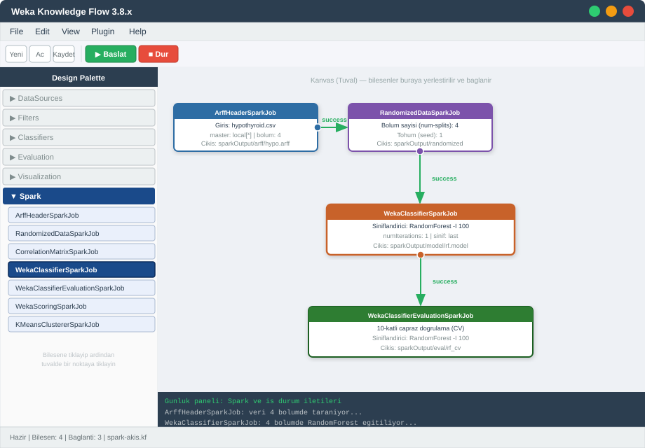
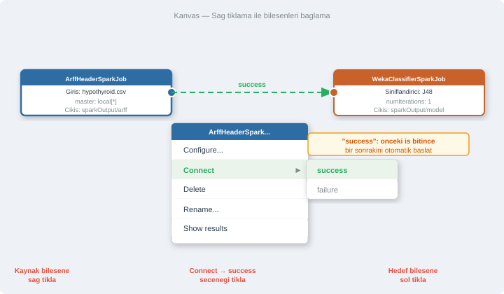
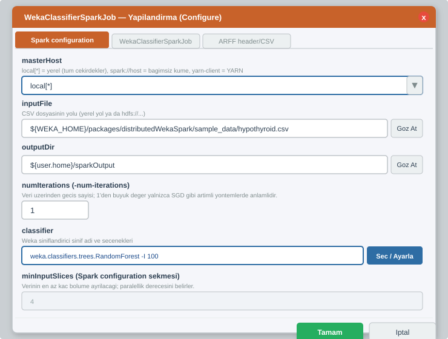

# Weka Knowledge Flow ile Dağıtık Spark İşlemleri

Önceki bölümde ([weka_spark_kullanimi.md](weka_spark_kullanimi.md)) Spark işleri komut satırından çalıştırıldı. Bu bölümde aynı akış Weka'nın görsel ortamında, **Knowledge Flow** (KF) içinde kurulur. Fikir aynı, araç farklıdır: Komut satırında elle yazılan seçenekler burada form alanlarına girilir ve bileşenler bağlantı oklarıyla birleştirilir. Akışı başkalarına göstermek, belgelemek ya da farklı veri kümeleri için yeniden kullanmak istendiğinde KF daha pratiktir.

> **Not.** Bu belgedeki şekiller Weka 3.8.x arayüzünü temsil eden çizimlerdir; renk ve yerleşim ekranınızdakinden biraz farklı olabilir. Bileşen, şablon ve menü adları `distributedWekaSpark` 1.0.9 paketinden ve Weka 3.8.6 kaynak kodundan doğrulanmıştır.

---

## Knowledge Flow Nedir?

Knowledge Flow (bilgi akışı), Weka'nın görsel iş akışı (workflow) tasarım ortamıdır. Veri kaynaklarını, filtreleri, sınıflandırıcıları ve değerlendirme araçlarını temsil eden bileşenler (step) bir tuvale (canvas) yerleştirilir ve aralarında bağlantı kurulur. Her bileşen işini bitirince bağlı olduğu bir sonraki bileşeni tetikler.

Komut satırında her iş için ayrı bir `java ...` komutu çalıştırılır ve seçenekler elle sıralanır. KF'de bu adımların her biri bir kutu (bileşen), seçenekler ise form alanları hâline gelir; akışın tamamı tuvalde görsel olarak durur.

---

## Knowledge Flow'un Açılması

**Yol 1 — Weka GUI Chooser'dan:** GUI Chooser penceresindeki **KnowledgeFlow** düğmesine tıklanır.

**Yol 2 — Komut satırından:**

```bash
java -cp weka.jar weka.gui.knowledgeflow.KnowledgeFlowApp
```

`distributedWekaSpark` paketi kuruluysa **Design** paletinde **Spark** adlı klasör görünür. Paket kurulu değilse bu klasör listede yer almaz.

---

## Arayüzün Tanınması



| Bölge | İşlev |
| :--- | :--- |
| **Design** paleti (sol panel) | Kullanılabilir bileşenlerin klasörlere ayrılmış listesi |
| **Tuval** (ortada) | Bileşenlerin yerleştirildiği ve bağlandığı çalışma alanı |
| **Araç çubuğu** (üstte) | Yeni / Aç / Kaydet, akışı çalıştırma ve durdurma düğmeleri, şablonlar (Templates) |
| **Günlük paneli** (altta) | İş sürerken üretilen bilgi ve hata iletileri |

---

## Design Paleti: Spark Bileşenleri

**Spark** klasörü genişletildiğinde şu bileşenler görünür. Her bileşen aynı adlı komut satırı işine karşılık gelir (`weka.distributed.spark.<ad>`):

| Bileşen | İşlev |
| :--- | :--- |
| `ArffHeaderSparkJob` | CSV'den ARFF başlığı ve özet istatistikler |
| `RandomizedDataSparkJob` | Veriyi karıştırma, katmanlandırma ve bölümlere ayırma |
| `WekaClassifierSparkJob` | Dağıtık sınıflandırıcı eğitimi |
| `WekaClassifierEvaluationSparkJob` | Dağıtık çapraz doğrulama ya da test kümesiyle değerlendirme |
| `WekaScoringSparkJob` | Eğitilmiş modelle verinin puanlanması |
| `CorrelationMatrixSparkJob` | Korelasyon/kovaryans matrisi ve PCA |
| `KMeansClustererSparkJob` | k-ortalamalar kümeleme (k-means‖ başlatma) |

---

## Adım Adım: Bir Spark Sınıflandırma Akışı Kurmak

Bu bölümde paketle gelen örnek veri (`hypothyroid.csv`) üzerinde şu akış kurulur:

```text
ArffHeaderSparkJob
        ↓ success
RandomizedDataSparkJob
        ↓ success
WekaClassifierSparkJob ──text──► TextViewer
        ↓ success
WekaClassifierEvaluationSparkJob ──text──► TextViewer
```

### 1. Bileşenlerin Tuvale Yerleştirilmesi

Paletteki bir bileşene tıklayın, ardından tuvalde bırakmak istediğiniz yere tıklayın. Şu sırayla dört bileşeni yerleştirin:

1. `ArffHeaderSparkJob`
2. `RandomizedDataSparkJob`
3. `WekaClassifierSparkJob`
4. `WekaClassifierEvaluationSparkJob`

Sonuçları görmek için **Visualization** klasöründen iki `TextViewer` bileşeni ekleyin. Bileşenleri yukarıdan aşağıya ya da soldan sağa okunaklı bir düzende yerleştirin; bir bileşeni taşımak için üzerine tıklayıp sürükleyin.

### 2. Bileşenlerin Bağlanması

Bağlantılar akışın sırasını belirler: Hangi bileşen bitince hangisinin başlayacağı bağlantılarla tanımlanır.



1. **Kaynak** bileşene (örneğin `ArffHeaderSparkJob`) **sağ tıklayın.**
2. Açılan menünün **Connections:** bölümünde `success` seçeneğine tıklayın.
3. Fare imleci bağlantı çizecek biçime gelir; **hedef** bileşene (`RandomizedDataSparkJob`) **sol tıklayın.**

Bağlantı tuvalde bir ok olarak görünür. Aynı işlemi kalan çiftler için tekrarlayın:

- `RandomizedDataSparkJob` → `success` → `WekaClassifierSparkJob`
- `WekaClassifierSparkJob` → `success` → `WekaClassifierEvaluationSparkJob`
- `WekaClassifierSparkJob` → `text` → birinci `TextViewer`
- `WekaClassifierEvaluationSparkJob` → `text` → ikinci `TextViewer`

> `success` bağlantısı, önceki Spark işi başarıyla tamamlandığında bir sonrakini başlatır. Ardışık Spark işleri aynı Spark bağlamını ve önbelleğe alınmış veriyi paylaşır; böylece veri her işte yeniden okunmaz.

### 3. Bileşenlerin Yapılandırılması

Her bileşene çift tıklayın ya da sağ tıklayıp **Configure...** seçin. Açılan pencerede **Spark configuration** sekmesi, işe özgü sekme ve (ArffHeaderSparkJob dışındaki işlerde) **ARFF header/CSV parsing** sekmesi bulunur.



#### ArffHeaderSparkJob

| Sekme | Alan | Değer |
| :--- | :--- | :--- |
| Spark configuration | masterHost | `local[*]` |
| Spark configuration | inputFile | `${WEKA_HOME}/packages/distributedWekaSpark/sample_data/hypothyroid.csv` |
| Spark configuration | outputDir | `${user.home}/sparkOutput` |
| Spark configuration | minInputSlices | `4` |
| ArffHeaderSparkJob | attributeNamesFile | `${WEKA_HOME}/packages/distributedWekaSpark/sample_data/hypothyroid.names` |
| ArffHeaderSparkJob | outputHeaderFileName | `hypo.arff` |

#### RandomizedDataSparkJob

| Sekme | Alan | Değer |
| :--- | :--- | :--- |
| Random shuffle options | classAttribute | `last` (son öznitelik, `Class`) |
| Random shuffle options | numRandomlyShuffledSplits | `4` |
| Random shuffle options | randomSeed | `1` |

#### WekaClassifierSparkJob

| Sekme | Alan | Değer |
| :--- | :--- | :--- |
| WekaClassifierSparkJob | classAttribute | `last` |
| WekaClassifierSparkJob | modelFileName | `rf.model` |
| WekaClassifierSparkJob | numIterations | `1` (veri üzerinden geçiş sayısı; yalnızca SGD gibi artımlı yöntemlerde 1'den büyük anlamlıdır) |
| WekaClassifierSparkJob | classifier | `weka.classifiers.trees.RandomForest -I 100` |

Sınıflandırıcıyı seçmek için classifier alanına tıklayın; açılan pencerede Weka'nın sınıflandırıcıları ağaç yapısında listelenir ve seçenekleri (örneğin ağaç sayısı `-I`) aynı pencereden ayarlanır.

#### WekaClassifierEvaluationSparkJob

| Sekme | Alan | Değer |
| :--- | :--- | :--- |
| WekaClassifierEvaluationSparkJob | totalFolds | `10` |
| WekaClassifierEvaluationSparkJob | classifier | `weka.classifiers.trees.RandomForest -I 100` |
| WekaClassifierEvaluationSparkJob | outputSubdir | `rf_cv` (sonuçlar `sparkOutput/eval/rf_cv/` altına yazılır) |

---

### 4. Akışın Çalıştırılması

Araç çubuğundaki çalıştırma (▶) düğmesine tıklayın. Akış, bağlantı zincirini izleyerek bileşenleri sırayla çalıştırır. Çalışan bileşen tuvalde vurgulanır; günlük panelinde Spark'ın ürettiği ayrıntılı iletiler ve her işin durum iletileri görülür. Bir iş hata verirse günlük panelindeki ileti sorunun kaynağını büyük ölçüde açıkça belirtir.

---

### 5. Sonuçların Görüntülenmesi

İkinci `TextViewer` bileşenine sağ tıklayıp **Show results** seçin. Açılan metin penceresindeki değerlendirme raporu masaüstü Weka'nın raporuyla aynı bölümlerden oluşur:

- **Summary:** doğru ve yanlış sınıflandırılan örnek sayıları ve oranları, Kappa istatistiği, ortalama mutlak hata, karekök ortalama kare hata.
- **Detailed Accuracy By Class:** her sınıf için TP ve FP oranları, kesinlik (precision), duyarlılık (recall), F-ölçütü ve ROC eğrisi altındaki alan.
- **Confusion Matrix:** karışıklık matrisi.

Hypothyroid verisinde `secondary_hypothyroid` sınıfında yalnızca iki örnek bulunduğundan bu sınıfın satırlarını yorumlarken dikkatli olunmalıdır: İki örnekle hesaplanan kesinlik ve duyarlılık değerleri güvenilir değildir.

Sonuçları dosyaya kaydetmek için metin penceresindeki kaydetme seçeneğini kullanabilirsiniz; ayrıca rapor `sparkOutput/eval/rf_cv/` dizinine de yazılır.

---

## Akışın Kaydedilmesi ve Yeniden Kullanılması

**File → Save** ile akış kaydedilir. Weka 3.8, akışları **`.kf`** uzantılı **JSON** (JavaScript Object Notation) dosyaları olarak saklar. Eski Knowledge Flow sürümlerinin kullandığı XML tabanlı `.kfml` dosyaları da açılabilir, ancak yeni akışlar `.kf` biçiminde kaydedilir. Bir `.kf` dosyasında her bileşen; sınıfı, seçenekleri, bağlantıları ve tuvaldeki konumuyla birlikte tutulur. Paketin "Spark: create an ARFF header" şablonundan kısaltılmış bir kesit:

```json
{
  "flow_name" : "createARFFHeaderWithSummary",
  "steps" : [
    {
      "class" : "weka.knowledgeflow.steps.ArffHeaderSparkJob",
      "properties" : {
        "jobOptions" : "-names-file ${WEKA_HOME}/packages/distributedWekaSpark/sample_data/hypothyroid.names -header-file-name hypo.arff -input-file ${WEKA_HOME}/packages/distributedWekaSpark/sample_data/hypothyroid.csv -min-slices 4 -output-dir ${user.home}/sparkOutput -master local[*] ...",
        "name" : "ArffHeaderSparkJob"
      },
      "connections" : {
        "dataSet" : [ "TextViewer" ],
        "text" : [ "TextViewer" ]
      },
      "coordinates" : "143,96"
    },
    ...
  ]
}
```

`jobOptions` alanının, komut satırında kullanılan seçeneklerin aynısı olduğuna dikkat ediniz. Kaydedilen akış **File → Open** ile yeniden yüklenir; farklı bir veri kümesine uygulamak için çoğu zaman yalnızca giriş dosyası yolunu ve öznitelik adlarını değiştirmek yeterlidir.

---

## Akışın Komut Satırından Çalıştırılması

Kaydedilmiş bir `.kf` dosyası grafik arayüz açılmadan `FlowRunner` sınıfıyla çalıştırılabilir. `FlowRunner` kurulu paketleri kendisi yükler:

```bash
java -Xmx4g -Djava.awt.headless=true -cp weka.jar weka.knowledgeflow.FlowRunner spark-akis.kf
```

`-s` seçeneği, akışta birden fazla başlangıç noktası varsa bunları paralel yerine sırayla başlatır. Bu yöntemle akış bir sunucuda zamanlanmış görev (örneğin `cron`) ya da betik olarak çalıştırılabilir. Akışı belirli zamanlarda uzak bir sunucuda çalıştırmak için `wekaServer` paketinin **Remote host scheduler** görünümü de kullanılabilir (bkz. [weka_server_setup.md](weka_server_setup.md)).

---

## Komut Satırı ile Karşılaştırma

| Konu | Komut satırı | Knowledge Flow |
| :--- | :--- | :--- |
| Öğrenme kolaylığı | Seçenek adlarını bilmek gerekir | Formlar yol gösterir |
| Yeniden kullanım | Betik dosyası (`.sh`, `.bat`) | `.kf` akış dosyası |
| Esneklik | Tüm seçeneklere erişim | Seçeneklerin çoğu formlarda |
| Görsellik | Yok | Akış tuvalde görünür |
| Hata ayıklama | Günlük çıktısı terminalde | Günlük paneli ve bileşen vurgusu |
| Sunucuda çalıştırma | Doğrudan | `FlowRunner` ile |
| Büyük akışlar | Betikte art arda komutlar | Tuval karmaşıklaşabilir |

Knowledge Flow özellikle akış tasarlanırken ve başkalarına anlatılırken değerlidir. Çok sayıda parametre denemesi yapılacaksa komut satırı ve betikler daha hızlı ve esnektir.

---

## Sık Yapılan Hatalar

**Palette "Spark" klasörü görünmüyor.** `distributedWekaSpark` paketi kurulu değildir ya da kurulumdan sonra Weka yeniden başlatılmamıştır.

**Bağlantı oku çizilmiyor.** Kaynak bileşene sağ tıklayıp bir bağlantı türü seçildikten sonra yalnızca hedef bileşene tıklanmalıdır; boş tuvale tıklamak işlemi iptal eder. Menüde istenen bağlantı türü görünmüyorsa o bileşen bu tür bir çıktı üretmiyordur.

**Akış başlıyor ama hiçbir sonuç üretilmiyor.** İlk bileşende giriş dosyasının yolunu ve `masterHost` değerini kontrol edin; günlük panelindeki hata iletisini okuyun.

**Günlükte `OutOfMemoryError` görülüyor.** Yerel modda tüm Spark işlemi Knowledge Flow'un JVM'i içinde yürüdüğü için Weka daha fazla bellekle başlatılmalıdır. Windows'ta Weka kurulum dizinindeki `RunWeka.ini` dosyasının `javaOpts` satırındaki `-Xmx` değeri (örneğin `javaOpts=-Xmx8g`) artırılabilir; komut satırından ise:

```bash
java -Xmx8g -cp weka.jar weka.gui.knowledgeflow.KnowledgeFlowApp
```
