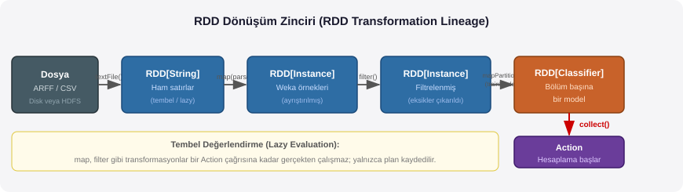
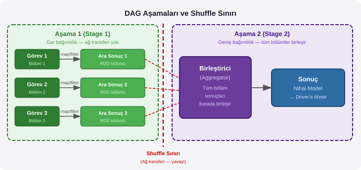
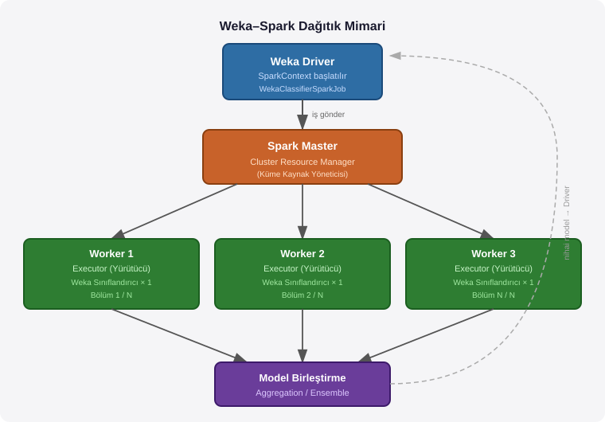

# Weka ile Apache Spark Kullanımı

> **Sürüm notu.** Bu belgedeki sınıf ve seçenek adları, Weka 3.8.x ile uyumlu `distributedWekaSpark` 1.0.9 paketinin (bağımlılığı `distributedWekaBase` 1.0.17) kaynak kodundan doğrulanmıştır. Kavramsal giriş için önce [weka_dagitik_spark_giris.md](weka_dagitik_spark_giris.md) dosyasını okuyunuz.

## Tek Makinenin Sınırları

Elinizdeki veri kümesi 200 GB, makinenizin belleği (RAM, Random Access Memory) ise 32 GB olsun. Tek bir Weka oturumunda bu veri yüklenemez; bellek taşar ve süreç durur. Milyonlarca satır içeren tıbbi kayıtlar, müşteri işlem geçmişleri ya da uydu görüntüsü üst verileri (metadata) bu türden örneklerdir.

Bu noktada iki yol vardır. Birincisi **dikey ölçekleme** (vertical scaling): daha güçlü ve daha fazla belleği olan tek bir makine almak. Bu yol bir noktadan sonra ekonomik ve teknik bir tavana dayanır. İkincisi **yatay ölçekleme** (horizontal scaling): hesabı birden fazla makineye dağıtmak. Büyük veri (big data) altyapılarının çoğu bu fikre dayanır.

Dağıtımı yönetmek için bir çerçeveye ihtiyaç vardır: Hangi makine hangi parçayı işleyecek? Bir makine çökerse ne olacak? İş bölüşümünü ve sonuçların birleştirilmesini kim yönetecek? Apache Spark bu sorulara yanıt vermek üzere tasarlanmıştır.

---

## Apache Spark

Apache Spark, 2009 yılında Kaliforniya Üniversitesi Berkeley'de Matei Zaharia'nın öncülüğünde geliştirilmeye başlanan açık kaynaklı bir dağıtık hesaplama çerçevesidir (distributed computing framework). Bugün Apache Software Foundation bünyesinde sürdürülmektedir.

Spark'ın çıkış noktası, önceki nesil sistem olan Hadoop MapReduce'un bir zayıflığını gidermektir. MapReduce, her işlem adımının ara sonuçlarını HDFS'e (Hadoop Distributed File System, Hadoop dağıtık dosya sistemi), yani diske yazar. Makine öğrenmesi gibi aynı veriyi defalarca okuyan yinelemeli (iterative) algoritmalar bu disk döngüsü nedeniyle yavaş kalır. Spark ara sonuçları mümkün olduğunca bellekte tutarak bu darboğazı aşar.

---

## Temel Kavramlar

### RDD: Resilient Distributed Dataset

Spark'ın temel veri soyutlaması **RDD**'dir (Resilient Distributed Dataset, dayanıklı dağıtık veri kümesi). Adındaki üç sözcük yapının üç temel özelliğini anlatır:

- **Resilient (dayanıklı):** Bir makine arızalanırsa Spark kaybolan veri bölümünü yeniden hesaplayabilir. Bunun için RDD'nin nasıl oluşturulduğu, yani **soy ağacı** (lineage) kaydedilir. *Resilient* sözcüğü Latince *resilire* (geri sıçramak) kökünden gelir.
- **Distributed (dağıtık):** Veri, kümedeki birden fazla makinenin belleğine **bölümler** (partition) hâlinde yayılır.
- **Dataset (veri kümesi):** Sıradan bir koleksiyon gibi kullanılır; ancak paralel, dağıtık ve hataya dayanıklıdır.

Bir üretim hattı düşünelim: Büyük bir sipariş tek bir tezgâhta bitirilmeye çalışılmaz; parçalara bölünür ve her parça farklı bir tezgâha verilir. Tezgâhlar eşzamanlı çalışır; biri durursa onun işi yeniden atanır. RDD de veriyi bölümlere ayırır ve her bölümü bir işçi düğüme (worker node) gönderir.

```text
RDD bölümleme (3 işçi örneği):

  Kaynak veri (7,5 milyon satır)
  ┌───────────────────────────────┐
  │  Bölüm 1  (2,5 M satır)       │ ──► İşçi 1
  │  Bölüm 2  (2,5 M satır)       │ ──► İşçi 2
  │  Bölüm 3  (2,5 M satır)       │ ──► İşçi 3
  └───────────────────────────────┘
```



### Tembel Değerlendirme (Lazy Evaluation)

Spark işlemleri iki gruba ayrılır:

**Dönüşümler (transformations):** Bir RDD'den yeni bir RDD üretir. `map()`, `filter()`, `flatMap()`, `groupBy()` birer dönüşümdür. Dönüşümler **tembel** çalışır: Çağrıldıklarında hesaplama başlamaz, yalnızca "şu dönüşüm uygulanacak" bilgisi kaydedilir.

**Eylemler (actions):** Birikmiş dönüşüm planını tetikler ve somut bir sonuç döndürür. `collect()`, `count()`, `reduce()`, `saveAsTextFile()` birer eylemdir. Bir eylem çağrıldığında Spark planın tamamını ele alır ve çalıştırır.

Bu tasarım sayesinde Spark gereksiz hesaplamalardan kaçınır ve ardışık dönüşümleri tek bir geçişte birleştirerek başarımı artırır.

### DAG: Directed Acyclic Graph

Spark, dönüşüm zincirini bir DAG'a (Directed Acyclic Graph, yönlü döngüsüz çizge) dönüştürür. Çizgedeki her düğüm bir işlemi, her kenar veri akışını gösterir. *Acyclic* sözcüğü, Yunanca *kyklos* (çember) kökünden gelen *cyclic* sözcüğüne olumsuzluk bildiren *a-* önekinin eklenmesiyle oluşur. Döngüsüzlük, bir işlemin çıktısının kendisine geri dönemeyeceğini garanti eder; bu da kaybolan bölümlerin soy ağacı üzerinden yeniden hesaplanmasını mümkün kılar.

Spark, DAG'ı **aşamalara** (stage) böler. Bir aşama içindeki görevler ağ üzerinden veri taşımadan paralel çalışabilir. `groupBy()` veya `reduceByKey()` gibi işlemler tüm bölümler arasında veri **karıştırma** (shuffle) gerektirir ve bir aşama sınırı oluşturur. Bu sınırlar ağ trafiği gerektirdiğinden başarımın en hassas noktalarıdır.



---

## Weka–Spark Bütünleşmesi

**Weka** (Waikato Environment for Knowledge Analysis, Waikato bilgi analizi ortamı), Yeni Zelanda'daki Waikato Üniversitesi'nde geliştirilen Java tabanlı bir makine öğrenmesi kitaplığı ve araç takımıdır. Tasarımı gereği tek bir JVM (Java Virtual Machine, Java sanal makinesi) üzerinde çalışır. Algoritma çeşitliliği çok geniş olsa da büyük veri kümelerinde bu tek makine sınırıyla karşılaşılır.

Bu sınırı aşmak için Mark Hall tarafından **`distributedWekaSpark`** paketi geliştirilmiştir. Paket, Weka'nın öğrenme algoritmalarını bir Spark kümesi üzerinde çalıştırmanın altyapısını sağlar. İşleyiş şöyle özetlenebilir:

1. Veri kümesi Spark RDD'sine yüklenerek N bölüme ayrılır.
2. Her bölümde bağımsız bir Weka sınıflandırıcısı eğitilir.
3. Bölüm modelleri bir birleştirme (aggregation) adımında birleştirilir: Birleştirilebilir modeller (örneğin Naive Bayes) tek bir modele, diğerleri bir oylamalı topluluk (`Vote`) modeline dönüşür.
4. Birleşik model sürücü programa (driver) döner ve diske kaydedilir.

Bu yaklaşım, Rastgele Orman gibi zaten birden fazla bağımsız modeli birleştiren topluluk (ensemble) yöntemleriyle doğal bir uyum içindedir. Weka'nın mevcut sınıflandırıcıları değiştirilmeden dağıtık ortamda kullanılabilir.



---

## Kurulum

### 1. Java ve Weka

Weka 3.8.x kurulu olmalıdır. Windows kurulumu kendi Java çalışma ortamıyla gelir. Komut satırında kullanılan Java sürümü `java -version` ile görülebilir. Paket Spark 1.1.1 kitaplıklarını içerir ve Java 8 döneminde hazırlanmıştır; yeni Java sürümlerinde sorun yaşanırsa Weka'yı bir Java 8 çalışma ortamıyla başlatmayı deneyiniz.

### 2. Paketin Kurulması

Yerel modda çalışmak için ayrıca Spark indirmek **gerekmez**; paket yerel mod için gerekli Spark kitaplıklarını içerir.

- **Grafik arayüzle:** Weka GUI Chooser → **Tools → Package Manager** → `distributedWekaSpark` → **Install**. `distributedWekaBase` bağımlılığı kendiliğinden kurulur.
- **Komut satırıyla:**

  ```bash
  java -cp weka.jar weka.core.WekaPackageManager -install-package distributedWekaSpark
  ```

Paket yöneticisi, kurulu Weka sürümüyle uyumlu en yeni paket sürümünü seçer (Weka 3.8 için 1.0.9). Kurulumdan sonra paket `~/wekafiles/packages/distributedWekaSpark/` dizinindedir; örnek veriler `sample_data/` alt dizinindedir.

### 3. İşlerin Komut Satırından Çalıştırılması

Spark işleri `weka.Run` sınıfı aracılığıyla çalıştırılır. `weka.Run` kurulu paketleri kendiliğinden yüklediği için sınıf yolunu (classpath) elle düzenlemek gerekmez:

```bash
java -Xmx4g -cp weka.jar weka.Run weka.distributed.spark.<İşSınıfı> [seçenekler]
```

Bir işin tüm seçenekleri `-h` ile listelenir. Aşağıdaki örnekler bash sözdizimiyle yazılmıştır; Windows komut isteminde satır devamı için `\` yerine `^` kullanılır ya da komut tek satıra yazılır. `local[*]` ifadesi kabuğun joker karakter olarak yorumlamaması için tırnak içinde yazılmalıdır.

---

## Temel Kullanım

Weka–Spark işlerinin tipik akışı üç adımdan oluşur: başlık oluşturma, eğitim ve değerlendirme. Tüm işlerde ortak olan Spark seçenekleri şunlardır:

| Seçenek | Açıklama |
| :--- | :--- |
| `-master <adres>` | Spark ana süreci: `local[*]` (yerel, tüm çekirdekler), `local[4]`, `spark://sunucu` (bağımsız küme) ya da `yarn-client` |
| `-port <port>` | Kümedeki ana sürecin portu (bağımsız Spark kümesinde varsayılan 7077) |
| `-input-file <yol>` | Girdi CSV dosyası (yerel yol ya da `hdfs://...`) |
| `-output-dir <yol>` | Çıktı dizini; her iş kendi alt dizinini kullanır (`arff/`, `model/`, `eval/` ...) |
| `-min-slices <sayı>` | Verinin en az kaç bölüme (partition) ayrılacağı; paralellik derecesi |
| `-max-slices <sayı>` | Bölüm sayısının üst sınırı |

### Adım 1: ARFF Başlığının Oluşturulması

Weka, dağıtık işleme başlamadan önce veri kümesinin şemasını bilmek ister: öznitelik (attribute) adları, türleri, kategorik değerlerin listesi. `ArffHeaderSparkJob` bu şemayı ve özet istatistikleri CSV dosyasını paralel olarak tarayarak oluşturur. Milyonlarca satırlık bir dosyada tek makinede uzun sürebilecek bu tarama, paralel yapıda çok daha kısa sürer.

```bash
java -Xmx4g -cp weka.jar weka.Run weka.distributed.spark.ArffHeaderSparkJob \
  -master "local[*]" -min-slices 4 \
  -input-file ~/wekafiles/packages/distributedWekaSpark/sample_data/hypothyroid.csv \
  -names-file ~/wekafiles/packages/distributedWekaSpark/sample_data/hypothyroid.names \
  -header-file-name hypo.arff \
  -output-dir ~/sparkOutput
```

| Seçenek | Açıklama |
| :--- | :--- |
| `-names-file <yol>` | Her satırda bir öznitelik adı bulunan dosya (başlıksız CSV için) |
| `-A <ad1,ad2,...>` | Öznitelik adlarının virgülle ayrılmış listesi (`-names-file` yerine) |
| `-header-file-name <ad>` | Üretilecek başlık dosyasının adı; dosya `<output-dir>/arff/` altına yazılır |
| `-existing-header <yol>` | Daha önce üretilmiş başlık; verilirse veri yeniden taranmaz |
| `-F <ayırıcı>`, `-M <simge>` | Alan ayırıcı ve eksik değer simgesi |

### Adım 2: Sınıflandırıcı Eğitimi

`WekaClassifierSparkJob`, gerekirse başlık işini kendi içinde çalıştırır; daha önce üretilmiş başlık `-existing-header` ile verilir:

```bash
java -Xmx4g -cp weka.jar weka.Run weka.distributed.spark.WekaClassifierSparkJob \
  -master "local[*]" -min-slices 4 \
  -input-file ~/wekafiles/packages/distributedWekaSpark/sample_data/hypothyroid.csv \
  -existing-header ~/sparkOutput/arff/hypo.arff \
  -output-dir ~/sparkOutput \
  -class last -model-file-name rf.model \
  -randomize \
  -W weka.classifiers.trees.RandomForest -- -I 100
```

| Seçenek | Açıklama |
| :--- | :--- |
| `-class <ad ya da sıra>` | Sınıf özniteliği (varsayılan: son öznitelik) |
| `-model-file-name <ad>` | Model `<output-dir>/model/<ad>` olarak kaydedilir |
| `-W <sınıf>` ve `--` | Kullanılacak Weka sınıflandırıcısı; `--` işaretinden sonraki seçenekler doğrudan sınıflandırıcıya iletilir |
| `-randomize` | Veriyi bölümlere ayırmadan önce karıştırır; sınıf nominal ise katmanlandırır (stratify) |
| `-num-iterations <sayı>` | Veri üzerinden geçiş sayısı (varsayılan 1). 1'den büyük değerler yalnızca SGD gibi artımlı sınıflandırıcılarda anlamlıdır |

**Bölüm sayısı ile `-num-iterations` karıştırılmamalıdır.** Veri, `-min-slices` (ya da karıştırma işindeki bölüm sayısı) kadar parçaya ayrılır ve her parçada ayrı bir model eğitilir. Rastgele Orman `Aggregateable` olmadığından dört bölümden dört orman elde edilir ve bunlar bir `Vote` topluluğunda birleştirilir. İyi bir başlangıç değeri olarak bölüm sayısını kümedeki toplam çekirdek sayısının 2–4 katı seçebilirsiniz; ancak her bölümün, anlamlı bir model eğitmeye yetecek kadar örnek içermesi gerekir.

### Adım 3: Değerlendirme

```bash
java -Xmx4g -cp weka.jar weka.Run weka.distributed.spark.WekaClassifierEvaluationSparkJob \
  -master "local[*]" -min-slices 4 \
  -input-file ~/wekafiles/packages/distributedWekaSpark/sample_data/hypothyroid.csv \
  -existing-header ~/sparkOutput/arff/hypo.arff \
  -output-dir ~/sparkOutput -output-subdir rf_cv \
  -class last -randomize -total-folds 10 \
  -W weka.classifiers.trees.RandomForest -- -I 100
```

Bu komut 10 katlı çapraz doğrulama (10-fold cross-validation) yapar ve raporu `<output-dir>/eval/rf_cv/` altına yazar. Masaüstü Weka'da (Explorer) katlar tek bir JVM içinde değerlendirilir; burada her katın modelleri Spark üzerinde paralel oluşturulur ve değerlendirilir. Rapor doğruluk (accuracy), Kappa istatistiği, F-ölçütü (F-measure), ROC eğrisi altındaki alan gibi ölçütleri içerir. `-auc <oran>` seçeneği, ROC alanı hesabı için saklanacak tahminlerin oranını belirler.

---

## Diğer İşler

| İş sınıfı | İşlev | Çıktı alt dizini |
| :--- | :--- | :--- |
| `ArffHeaderSparkJob` | CSV'den ARFF başlığı ve özet istatistikler üretir | `arff/` |
| `RandomizedDataSparkJob` | Veriyi karıştırır, katmanlandırır ve bölümlere ayırır (`-num-splits`, `-seed`) | `randomized/` |
| `WekaClassifierSparkJob` | Dağıtık sınıflandırıcı eğitir | `model/` |
| `WekaClassifierEvaluationSparkJob` | Çapraz doğrulama ya da ayrı test kümesiyle (`-test-set-path`) değerlendirme | `eval/` |
| `WekaScoringSparkJob` | Eğitilmiş bir modelle verinin tamamını puanlar (tahmin üretir) | — |
| `CorrelationMatrixSparkJob` | Korelasyon ya da kovaryans matrisi, isteğe bağlı PCA (`-pca`) | `correlation/` |
| `KMeansClustererSparkJob` | k-ortalamalar kümeleme, k-means‖ başlatma (`-num-clusters`, `-num-iterations`, `-num-runs`) | `kmeans/` |
| `CanopyClustererSparkJob` | Kanopi kümeleme (yalnızca komut satırı ve Java API) | `canopy/` |

Pakette Weka filtrelerini doğrudan uygulayan ayrı bir Spark işi **bulunmaz**. Bir ön işleme filtresi kullanılacaksa filtre masaüstü Weka'da (örneğin başlık üzerinde) yapılandırılıp kaydedilir ve `WekaClassifierSparkJob` işine `-preconstructed-filter <yol>` seçeneğiyle verilir; ya da sınıflandırıcı, filtreyi içeren `weka.classifiers.meta.FilteredClassifier` olarak seçilir.

---

## Küme Modları

### Yerel Mod (Local Mode)

Geliştirme ve hata ayıklama için idealdir; ağ iletişimi gerektirmez ve tüm Spark süreçleri tek bir JVM içinde çalışır.

```text
-master "local"      # tek iş parçacığı
-master "local[4]"   # 4 iş parçacığı
-master "local[*]"   # mevcut tüm çekirdekler
```

### Bağımsız Küme (Standalone Cluster)

Spark'ın kendi küme yöneticisiyle birden fazla makine eşgüdümlenir: bir makinede ana süreç (master), diğerlerinde işçi süreçleri (worker) başlatılır. İş gönderilirken `-master spark://<ana-sunucu>` ve `-port 7077` verilir; girdi dosyası tüm işçilerin erişebileceği bir yerde (örneğin `hdfs://...`) bulunmalıdır.

**Sürüm uyumu önemlidir.** Spark istemcisi ile kümenin aynı Spark sürümünü kullanması gerekir. `distributedWekaSpark` 1.0.9 paketi Spark 1.1.1 kitaplıklarını içerdiğinden güncel bir Spark 3.x kümesine doğrudan bağlanamaz. Gerçek bir küme için:

- Kümede paketle uyumlu bir Spark sürümü çalıştırılmalı,
- Paket açıklamasında belirtildiği gibi `wekafiles/packages/distributedWekaSpark/lib` dizinindeki Spark kitaplıkları, kümedeki Hadoop sürümü için derlenmiş `spark-assembly-...jar` dosyasıyla değiştirilmelidir.

### YARN (Yet Another Resource Negotiator)

Mevcut bir Hadoop kümesinde YARN'ı kaynak yöneticisi olarak kullanmak için `-master yarn-client` verilir. Bu modda sürücü program işi gönderen makinede (Weka'nın çalıştığı yerde) kalır; bu nedenle iş bitene kadar Weka süreci açık tutulmalıdır.

---

## Java API ile Doğrudan Kullanım

Spark işleri Java kodundan da çağrılabilir. Bu yaklaşım, dağıtık öğrenme adımını daha büyük bir Java uygulamasına gömmek için kullanışlıdır.

```java
import weka.core.Utils;
import weka.distributed.spark.WekaClassifierSparkJob;

public class DagitikEgitim {
    public static void main(String[] args) throws Exception {
        WekaClassifierSparkJob job = new WekaClassifierSparkJob();
        job.setOptions(Utils.splitOptions(
            "-master local[*] -min-slices 4 "
          + "-input-file /veri/egitim.csv "
          + "-names-file /veri/oznitelik_adlari.txt "
          + "-output-dir /veri/cikti "
          + "-model-file-name nb.model "
          + "-W weka.classifiers.bayes.NaiveBayes"));
        job.runJob();
    }
}
```

Derlemek ve çalıştırmak için `weka.jar` ile birlikte paket dizinlerindeki jar dosyaları sınıf yoluna eklenmelidir (`~/wekafiles/packages/distributedWekaBase/` ve `~/wekafiles/packages/distributedWekaSpark/` altındaki `.jar` dosyaları ve `lib/*`).

---

## Sık Karşılaşılan Sorunlar

**`ClassNotFoundException` ya da işin bulunamaması.** Paket kurulu değildir ya da işler `weka.Run` kullanılmadan, paket jar'ları sınıf yoluna eklenmeden çalıştırılmıştır.

**Serileştirme hatası (serialization error).** Spark, nesneleri ağ üzerinden taşımak için serileştirir (serialization). Weka sınıflandırıcıları `java.io.Serializable` arayüzünü uygular; kendi yazdığınız sınıflandırıcıların da bu arayüzü uygulaması gerekir.

**Bellek yetersizliği (`OutOfMemoryError`).** Yerel modda tüm işlem Weka'nın JVM'inde yapıldığı için `-Xmx` değeri artırılmalıdır. Kümede ise bölüm sayısı (`-min-slices`) artırılarak bölüm başına düşen veri azaltılabilir; `-cluster-mem` seçeneği işçi belleğini belirler.

**Başlık ile veri uyumsuzluğu.** Başlık, eğitim verisinin tamamından türetilir. Puanlanacak ya da test edilecek veride başlıkta bulunmayan yeni kategorik değerler varsa Weka hata verir. Başlığı, eğitim ve test verisinin birleşimi üzerinde oluşturmak bu sorunu önler.

---

## Başarım İpuçları

**Bölüm sayısı.** Çok az bölüm paralelliği düşürür; çok fazla bölüm hem görev yönetimi ek yükünü artırır hem de her bölümde eğitilen modelin daha az veriyle eğitilmesine yol açar.

**Spark arayüzü.** İş çalışırken `http://localhost:4040` adresinden aşamaların (stage) sürelerini ve görev hatalarını izleyebilirsiniz. Hangi aşamanın darboğaz oluşturduğunu görmek eniyilemenin en hızlı yoludur.

**Veri yerelliği (data locality).** Hesabı verinin bulunduğu makineye taşımak ağ trafiğini azaltır. HDFS kullanan yapılandırmalarda Spark görevleri mümkün olduğunca verinin bulunduğu düğümlerde çalıştırır.

**Önbellekleme (caching).** Aynı veri üzerinden birden fazla geçiş yapan işlerde (çapraz doğrulama gibi) RDD'yi bellekte tutmak disk okumalarını önler. Kendi Spark uygulamalarınızda bu `rdd.cache()` ya da `rdd.persist()` ile yapılır; Dağıtık Weka, art arda çalışan işler arasında veri kümelerini kendi içinde önbelleğe alır.

**Karıştırma (shuffling).** Oylamalı topluluk oluşturan sınıflandırıcılardan önce veriyi `-randomize` seçeneğiyle ya da `RandomizedDataSparkJob` ile karıştırmak, bölümlerdeki sınıf dağılımını dengeleyerek model kalitesini artırır.

---

## Kaynaklar

- Apache Spark belgeleri — [spark.apache.org/docs/latest](https://spark.apache.org/docs/latest/)
- Weka paket listesi — [waikato.github.io/weka-wiki/packages/list](https://waikato.github.io/weka-wiki/packages/list/)
- Hall, M. (2015). Weka and Spark. [markahall.blogspot.com/2015/03/weka-and-spark.html](http://markahall.blogspot.com/2015/03/weka-and-spark.html)
- Zaharia, M. ve ark. (2012). Resilient distributed datasets: A fault-tolerant abstraction for in-memory cluster computing. *NSDI'12*.
